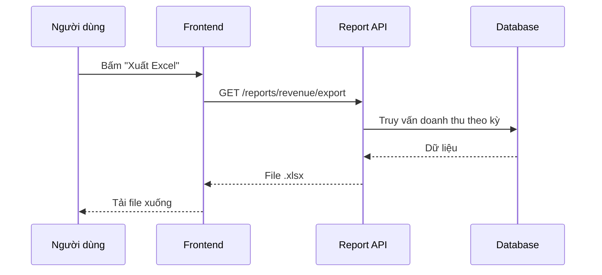

# Quy tắc đặt câu hỏi và làm việc với AI

## 1. Chuẩn bị dự án và yêu cầu

- Tạo `CLAUDE.md`, skill tại `.claude/skills/<tên-skill>/SKILL.md` và hook phù hợp với dự án.
- Nhờ AI soạn prompt lập kế hoạch cho yêu cầu, sau đó đọc lại để xác nhận kế hoạch đúng với mục tiêu trước khi triển khai.

### 1.1 Đề xuất cấu hình `.claude` bằng plugin của Anthropic

Chạy lệnh sau để AI phân tích codebase và đề xuất hook, subagent, skill, plugin, MCP phù hợp:

```text
/claude-code-setup:claude-automation-recommender
```

## 2. Tạo và kết nối Kanban

> **Mỗi yêu cầu là một thẻ trên bảng Kanban trước khi bắt đầu Explore.**

Bảng Kanban giúp theo dõi tiến độ, tránh làm nhiều việc cùng lúc và cho AI một nguồn ngữ cảnh thống nhất về task: mục tiêu, tiêu chí hoàn thành, nhánh và PR liên quan.

### 2.1 Tạo bảng

- Chọn công cụ: GitHub Projects, Jira, Linear, Trello...
- Tạo các cột cơ bản: `Backlog` → `To do` → `In progress` → `Review` → `Done`.
- Giới hạn số thẻ trong `In progress` (ví dụ tối đa 2) để tập trung hoàn thành từng việc.

### 2.2 Kết nối bảng với AI

- Kết nối qua MCP để AI đọc và cập nhật thẻ, ví dụ với GitHub:

  ```text
  claude mcp add --transport http github https://api.githubcopilot.com/mcp/
  ```

- Hoặc dùng CLI có sẵn, ví dụ `gh project` cho GitHub Projects.
- Ghi vào `CLAUDE.md` bảng nào đang dùng và quy ước đặt tên thẻ, nhánh (ví dụ nhánh `feature/<mã-thẻ>-<mô-tả-ngắn>`).

### 2.3 Nội dung một thẻ

Mỗi thẻ nên trả lời được:

- Mục tiêu: thêm, bỏ hoặc thay đổi cái gì.
- Phạm vi: dự án hoặc phần nào của dự án.
- Tiêu chí hoàn thành có thể kiểm tra.
- Liên kết: nhánh, PR, tài liệu hoặc issue liên quan.

**Ví dụ yêu cầu:**

```text
Đọc thẻ "Chuyển ảnh sang WebP" trên bảng Kanban của dự án.
Chuyển thẻ sang In progress, tạo nhánh theo quy ước trong CLAUDE.md,
sau đó bắt đầu bước thu thập yêu cầu. Chưa sửa mã.
```

Khi làm xong từng giai đoạn của quy trình ở mục 3, cập nhật trạng thái thẻ tương ứng: bắt đầu thu thập yêu cầu → `In progress`, mở PR → `Review`, merge → `Done`. Gắn link diagram và design vào thẻ ngay khi có.

## 3. Quy trình làm việc cốt lõi

> **Requirements → Explore → Diagram → Design → Plan → Code → Commit**

Quy trình gốc của khóa học là **Explore → Plan → Code → Commit**. Bắt đầu viết mã ngay thường dẫn đến nhiều vòng sửa sai; khảo sát và lập kế hoạch trước giúp giảm chi phí về sau. Ở đây bổ sung thêm ba bước: thu thập yêu cầu trước khi khảo sát, sau đó vẽ diagram và design để thống nhất hướng đi bằng hình ảnh trước khi lập kế hoạch.

- Bài gốc: [Claude Code 101 — Explore, plan, code, commit](https://anthropic.skilljar.com/claude-code-101/469792)
- Video: [The explore → plan → code → commit workflow](https://www.youtube.com/watch?v=xJQuF02NAK8)

### 3.1 Requirements — Thu thập yêu cầu

Trước khi để AI đọc code, cần làm rõ **vấn đề cần giải quyết** và **thế nào là xong**. Yêu cầu mơ hồ ở bước này sẽ khiến mọi bước sau đi sai hướng.

Phải trả lời các câu hỏi sau:

- Ai dùng tính năng này và họ đang gặp vấn đề gì?
- Kết quả mong muốn là gì? Hành vi nào người dùng nhìn thấy được?
- Phạm vi: phần nào nằm trong yêu cầu, phần nào **không** làm lần này?
- Ràng buộc: deadline, công nghệ, hiệu năng, bảo mật, tương thích ngược.
- Tiêu chí chấp nhận (acceptance criteria) có thể kiểm tra được.
- Còn điểm nào chưa rõ cần hỏi lại người yêu cầu?

Có thể để AI phỏng vấn ngược lại bạn thay vì tự viết hết:

**Mẫu prompt:**

```text
Tôi muốn thêm tính năng xuất báo cáo doanh thu ra Excel.
Đừng khảo sát code vội. Hãy hỏi tôi từng câu một để làm rõ: ai dùng,
dữ liệu nào cần xuất, phạm vi không làm, ràng buộc và tiêu chí chấp nhận.
Khi đủ thông tin, tóm tắt thành danh sách yêu cầu để tôi duyệt
và cập nhật vào thẻ Kanban.
```

### 3.2 Explore — Khảo sát

Claude đọc cấu trúc dự án, các tệp liên quan, bài kiểm thử và tài liệu. Không cần đọc mọi thứ; mục tiêu là xác định **thay đổi nằm ở đâu và phụ thuộc vào những gì**. Có thể dùng Plan mode hoặc subagent Explore khi chỉ cần phác họa codebase.

#### Khi phát triển tính năng

Phải trả lời các câu hỏi sau:

- Mong muốn là gì: thêm tính năng gì, bỏ hoặc thay đổi cái gì?
- Làm ở dự án nào, hoặc phần nào của dự án?
- Model LLM nào phù hợp nhất để làm tính năng hoặc chức năng đó?
- Có cần ghi chú hoặc viết tài liệu (docx) không?
- Có làm theo lộ trình hoặc tài liệu đã được chuẩn bị sẵn không?
- Có cần kết nối với MCP nào không?

**Ví dụ yêu cầu:**

```text
Khảo sát pipeline tải ảnh. Xác định điểm thích hợp để chuyển sang WebP,
dependency đang dùng và test liên quan. Chỉ đọc và báo cáo, chưa sửa mã.
```

**Mẫu prompt:**

```text
Hãy khảo sát luồng thanh toán và lập kế hoạch tách logic tính thuế
thành một module riêng. Chỉ đọc, chưa sửa mã.

Kế hoạch phải nêu:
- tệp sẽ thay đổi;
- interface trước và sau;
- test cần thêm hoặc cập nhật;
- rủi ro tương thích;
- tiêu chí hoàn thành có thể kiểm tra.
```

#### Khi sửa lỗi

Phải trả lời các câu hỏi sau:

- Nguyên nhân của lỗi là gì? Phân loại lỗi: lỗi business, lỗi code, lỗi từ framework hay do thiếu tính năng.
- Đề xuất cách sửa phù hợp với loại lỗi đó.

Thay vì hỏi chung chung:

```text
Sửa phần đăng nhập.
```

Hãy mô tả mục tiêu và tiêu chí hoàn thành:

```text
Tìm nguyên nhân người dùng bị đăng xuất sau khi tải lại trang.
Trước tiên hãy lần theo luồng tạo và lưu session, chưa sửa mã.
Sau đó đề xuất kế hoạch. Thành công khi test session hiện có vượt qua
và có thêm test tái hiện lỗi tải lại trang.
```

### 3.3 Diagram — Tạo và vẽ sơ đồ

Sau khi khảo sát, vẽ lại luồng hiện tại và luồng sau khi thay đổi. Sơ đồ giúp phát hiện sớm chỗ hiểu sai giữa bạn và AI mà đọc văn bản dài khó thấy.

Chọn loại sơ đồ theo câu hỏi cần trả lời:

| Loại sơ đồ | Dùng khi cần thể hiện |
| --- | --- |
| Flowchart | Luồng xử lý, các nhánh điều kiện |
| Sequence diagram | Thứ tự gọi giữa client, API, service, database |
| ERD | Bảng dữ liệu và quan hệ giữa chúng |
| Architecture diagram | Các thành phần hệ thống và cách chúng kết nối |
| State diagram | Các trạng thái của một đối tượng (ví dụ đơn hàng) |

Công cụ gợi ý:

- **Mermaid** viết ngay trong file Markdown, dễ cho AI tạo và dễ review trong PR.
- **FigJam, draw.io, Excalidraw** khi cần sơ đồ trình bày cho người khác xem.

**Mẫu prompt:**

```text
Dựa trên kết quả khảo sát, vẽ sequence diagram bằng Mermaid cho luồng
xuất báo cáo: hiện tại và sau khi thay đổi. Đánh dấu rõ phần mới thêm.
Lưu vào docs/diagrams/export-report.md. Chưa sửa mã.
```

**Ví dụ kết quả:**



Đọc lại sơ đồ và sửa ngay nếu sai. Sửa sơ đồ rẻ hơn rất nhiều so với sửa code.

### 3.4 Design — Tạo và vẽ thiết kế

Khi thay đổi có giao diện, cần có design trước khi lập kế hoạch code. Với tác vụ không có giao diện (API, script, refactor), thay bằng bản thiết kế kỹ thuật ngắn: interface, cấu trúc dữ liệu, format request/response.

Một design tốt cần có:

- Các màn hình hoặc component bị ảnh hưởng.
- Đủ trạng thái: mặc định, đang tải, rỗng, lỗi, thành công.
- Hành vi trên các kích thước màn hình (desktop, mobile).
- Tận dụng design system, màu, font và component đã có trong dự án.

Công cụ gợi ý:

- **Figma** (có thể kết nối qua MCP để AI đọc design và chuyển thành code).
- **Prototype HTML** do AI tạo nhanh để xem trực tiếp trên trình duyệt.

**Mẫu prompt:**

```text
Dựa trên yêu cầu ở thẻ Kanban và sơ đồ docs/diagrams/export-report.md,
đề xuất design cho nút "Xuất Excel" trên trang báo cáo doanh thu.
Dùng component và màu có sẵn trong dự án. Thể hiện đủ trạng thái
mặc định, đang xuất, lỗi và thành công. Tạo prototype HTML để tôi xem trước.
Chưa sửa mã của ứng dụng.
```

Chỉ chuyển sang Plan sau khi bạn đã duyệt design.

### 3.5 Plan — Lập kế hoạch

Một kế hoạch tốt cần nêu rõ:

- Mong muốn: thêm tính năng gì, bỏ hoặc thay đổi cái gì.
- Bám theo yêu cầu, diagram và design đã duyệt ở các bước trước.
- Lộ trình thực hiện, ví dụ: tạo interface trước → setup state → sử dụng ở đâu.
- Các tệp dự kiến sửa.
- Trình tự thực hiện.
- Rủi ro và trường hợp biên.
- Tiêu chí thành công.
- Lệnh kiểm thử cụ thể.

Đây là thời điểm ít tốn kém nhất để điều chỉnh hướng đi. Nếu kế hoạch đụng đến quá nhiều tệp hoặc thêm dependency không cần thiết, hãy thu hẹp phạm vi trước khi triển khai.

### 3.6 Code — Thực thi có kiểm chứng

Sau khi duyệt kế hoạch, Claude triển khai theo từng bước. Để giai đoạn này ổn định:

- Định nghĩa “hoàn thành” bằng kết quả có thể quan sát: test nào phải qua, đầu ra nào phải xuất hiện.
- Cấp công cụ phù hợp. Ví dụ, tác vụ giao diện cần có khả năng mở và kiểm tra trình duyệt.
- Dùng test suite đáng tin cậy; test sai có thể tạo cảm giác thành công giả.

Nếu một lỗi lặp lại do quy ước dự án, hãy ghi quy ước vào `CLAUDE.md` thay vì sửa thủ công trong mọi phiên.

### 3.7 Commit — Rà soát và đóng gói thay đổi

Trước khi commit:

1. Tự chạy và kiểm tra thay đổi.
2. Xem `git diff`, đặc biệt là các tệp nằm ngoài dự kiến.
3. Nhờ subagent reviewer đánh giá chỉ-đọc để có góc nhìn mới.
4. Chạy test, lint và type-check phù hợp.
5. Nhờ Claude soạn commit message theo phong cách của repository.

Quy trình không kết thúc chỉ vì AI thông báo đã xong. Thay đổi chỉ nên được xem là hoàn tất sau khi đã qua rà soát của con người và các bước kiểm chứng.

## 4. Một prompt rõ ràng cần có gì?

1. **Mục tiêu:** Bạn muốn hoàn thành việc gì?
2. **Ngữ cảnh:** Khu vực hoặc luồng nào liên quan? Dự án dùng công nghệ gì?
3. **Phạm vi:** Được sửa phần nào, phần nào cần giữ nguyên?
4. **Ràng buộc:** Có cần theo pattern, framework, style hoặc yêu cầu tương thích nào không? Có được thêm dependency không?
5. **Tiêu chí thành công:** Cần chạy test/build nào? Hành vi nào phải hoạt động?
6. **Mức tự chủ:** Chỉ phân tích, lập kế hoạch hay được phép thực hiện?

### Ví dụ: thêm tính năng dark mode

Yêu cầu không chỉ là “thêm dark mode”, mà cần nói vị trí công tắc, phạm vi toàn ứng dụng và yêu cầu màu tương phản dựa trên theme sáng hiện có. Trong Plan mode, Claude tìm cấu trúc theme, hỏi điều chưa rõ và đưa ra kế hoạch. Bạn duyệt kế hoạch trước khi cho phép thực thi.

**Mẫu prompt:**

```text
Ứng dụng cần dark mode trên toàn bộ giao diện.
Hãy đặt công tắc chuyển theme ở header và tìm bảng màu tối có độ tương phản
phù hợp với theme sáng hiện tại. Trước tiên dùng Plan mode để khảo sát cách
ứng dụng đang quản lý theme, liệt kê các tệp sẽ sửa và cách kiểm thử.
Chưa viết mã cho đến khi tôi duyệt kế hoạch.
```

## 5. Cách phản hồi một kế hoạch chưa tốt

Đừng chỉ nói “làm lại”. Hãy chỉ rõ phần cần thay đổi và phần cần giữ nguyên.

**Ví dụ:**

```text
Giữ nguyên bước 1 và 2. Ở bước 3, không thêm dependency mới;
hãy tận dụng CSS variables hiện có. Bổ sung kiểm thử cho việc lưu lựa chọn
theme sau khi tải lại trang.
```

## 6. Kiểm tra trước khi push

Sau khi hoàn thành thay đổi:

- [ ] Chạy thử và xác nhận hành vi mới hoạt động.
- [ ] Kiểm tra cả phần code thay đổi lẫn các phần liên quan không thay đổi.
- [ ] Đối chiếu phạm vi thay đổi với yêu cầu và tiêu chí trên thẻ Kanban; xác nhận không sửa ngoài phạm vi.
- [ ] Sau khi kiểm tra xong, push lên một nhánh riêng cho task. Nhánh này có thể xóa khi không còn cần thiết.

## 7. Rà soát lại sau khi push lên GitHub

1. Nhờ AI trên web kiểm tra code vừa push và nắm ngữ cảnh codebase.
2. Nếu AI phát hiện vấn đề, yêu cầu viết prompt cụ thể để sửa vấn đề đó.
3. Đưa prompt xuống IDE để AI sửa code.
4. Kiểm tra và push phần sửa lên GitHub.
5. Lặp lại việc rà soát cho đến khi AI không còn báo vấn đề, rồi chuyển thẻ Kanban sang `Done`.
