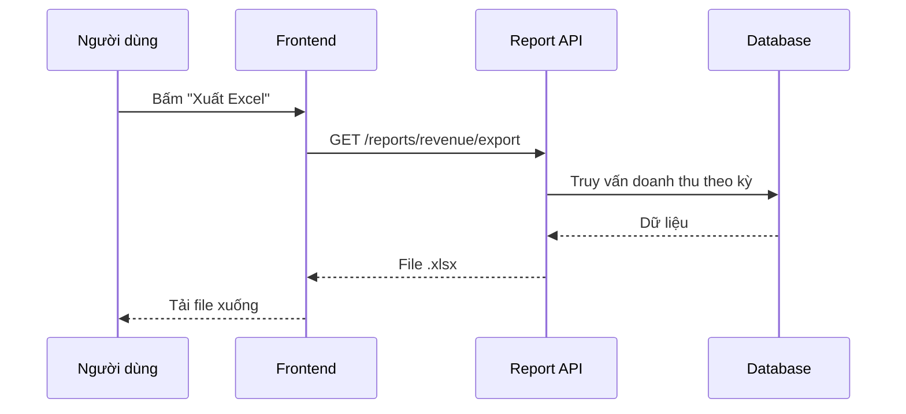

# Quy tắc đặt câu hỏi và làm việc với AI

## 1. Chuẩn bị dự án (làm một lần)

Những việc dưới đây chỉ cấu hình một lần cho mỗi dự án. Sau đó mọi task đều dùng lại, không lặp lại trong từng task.

### 1.1 `CLAUDE.md`, skill và hook

- Tạo `CLAUDE.md` ghi lại:
  - lệnh build, test, lint, type-check;
  - quy ước code và đặt tên;
  - quy ước tài liệu: mỗi tính năng một thư mục `docs/features/<tên-tính-năng>/` (xem mục 2.2);
  - bảng Kanban đang dùng và quy ước đặt tên thẻ, nhánh (mục 1.5);
  - các sự kiện cần báo qua Telegram (mục 1.6).
- Tạo skill tại `.claude/skills/<tên-skill>/SKILL.md` (mục 1.4) và hook (mục 1.3) phù hợp với dự án.

### 1.2 Đề xuất cấu hình `.claude` bằng plugin của Anthropic

Chạy lệnh sau để AI phân tích codebase và đề xuất hook, subagent, skill, plugin, MCP phù hợp:

```text
/claude-code-setup:claude-automation-recommender
```

### 1.3 Hook — để máy ép bước kiểm chứng

Thay vì phải nhớ nhắc AI "chạy lint", "chạy test" sau mỗi lần sửa, cấu hình hook để Claude Code tự chạy. Ví dụ trong `.claude/settings.json`:

```json
{
  "hooks": {
    "PostToolUse": [
      {
        "matcher": "Edit|Write",
        "hooks": [{ "type": "command", "command": "npm run lint --silent || exit 2" }]
      }
    ],
    "Stop": [
      {
        "hooks": [{ "type": "command", "command": "npm test --silent || exit 2" }]
      }
    ]
  }
}
```

- `PostToolUse` chạy sau mỗi lần AI sửa file. `Stop` chạy khi AI định kết thúc lượt.
- Exit code `2` trả nội dung lỗi về cho Claude, buộc AI xử lý tiếp thay vì báo "đã xong".
- Nếu test suite chạy lâu, ở hook `Stop` chỉ chạy test liên quan hoặc type-check, còn toàn bộ test để ở bước 2.13.

### 1.4 Đóng gói mẫu prompt thành skill

Các mẫu prompt trong mục 2 được dùng lại ở mọi task. Thay vì copy-paste, hãy đóng gói chúng thành skill và gọi bằng `/tên-skill`. Ví dụ `.claude/skills/critique/SKILL.md`:

```markdown
---
name: critique
description: Phản biện yêu cầu hoặc kế hoạch, tìm chỗ sai, chỗ thiếu, chỗ chưa quyết định và rủi ro
---

Đóng vai người phản biện khó tính. Đọc các file được chỉ định ...
(dán nội dung mẫu prompt ở mục 2.5 vào đây)
```

Có thể dùng skill có sẵn từ plugin thay vì tự viết:

| Bước | Skill có sẵn gợi ý |
| --- | --- |
| 2.3 Requirements | `superpowers:brainstorming` |
| 2.5, 2.9 Critique | `mattpocock-skills:grilling` |
| 2.8 Plan | `superpowers:writing-plans` |
| 2.11 Build | `superpowers:test-driven-development`, `mattpocock-skills:tdd` |
| 2.13 Review & PR | `/code-review`, `superpowers:requesting-code-review` |

### 1.5 Bảng Kanban

> **Mỗi task cỡ M hoặc L là một thẻ trên bảng Kanban, được tạo ngay từ bước Requirements.**

Bảng Kanban gom mọi tài liệu của một task vào một chỗ, giúp theo dõi tiến độ, tránh làm nhiều việc cùng lúc và cho AI một nguồn ngữ cảnh thống nhất ở các phiên sau.

#### Tạo bảng

- Chọn công cụ: GitHub Projects, Jira, Linear, Trello...
- Tạo các cột cơ bản: `Backlog` → `To do` → `In progress` → `Review` → `Done`.
- Giới hạn số thẻ trong `In progress` (ví dụ tối đa 2) để tập trung hoàn thành từng việc.

#### Kết nối bảng với AI

- Kết nối qua MCP để AI đọc và cập nhật thẻ, ví dụ với GitHub:

  ```text
  claude mcp add --transport http github https://api.githubcopilot.com/mcp/
  ```

- Hoặc dùng CLI có sẵn, ví dụ `gh project` cho GitHub Projects.
- Ghi vào `CLAUDE.md` bảng nào đang dùng và quy ước đặt tên thẻ, nhánh (ví dụ nhánh `feature/<mã-thẻ>-<mô-tả-ngắn>`).

#### Vòng đời một thẻ

| Thời điểm | Cột | Việc cần làm trên thẻ |
| --- | --- | --- |
| Bắt đầu Requirements (2.3) | `Backlog` | Tạo thẻ, ghi mục tiêu và phạm vi |
| Sau mỗi bước của giai đoạn ①②③ | `Backlog` | Gắn link tài liệu vừa tạo |
| Qua cổng ③ (duyệt Breakdown) | `To do` | Thêm danh sách task thành checklist |
| Bắt đầu task đầu tiên (2.11) | `In progress` | Tạo nhánh theo quy ước |
| Mở PR (2.13) | `Review` | Gắn link PR |
| Merge và xong review sau push (2.14) | `Done` | Ghi các mục nợ kỹ thuật còn lại (nếu có) thành thẻ mới |

#### Nội dung một thẻ

- Mục tiêu: thêm, bỏ hoặc thay đổi cái gì.
- Phạm vi: dự án hoặc phần nào của dự án.
- Tiêu chí hoàn thành có thể kiểm tra.
- Liên kết: thư mục `docs/features/<tên>/`, design, nhánh, PR hoặc issue liên quan.

Nếu tính năng lớn, tách thành nhiều thẻ nhỏ, mỗi thẻ có thể hoàn thành và review độc lập.

### 1.6 Telegram — Giao việc và nhận thông báo từ xa

> **Không cần ngồi trước máy: giao việc, duyệt kế hoạch và xem tiến độ qua Telegram.**

Các giai đoạn Plan → Build → Ship có thể chạy lâu. Kết nối Telegram giúp bạn nhắn việc cho AI từ điện thoại và nhận thông báo khi AI cần duyệt hoặc đã làm xong, thay vì phải theo dõi terminal liên tục.

#### Thiết lập kết nối

1. Mở Telegram, chat với **@BotFather**, gửi `/newbot` để tạo bot và lấy **bot token**.
2. Cài plugin Telegram cho Claude Code, sau đó chạy lệnh cấu hình và dán token vào:

   ```text
   /telegram:configure
   ```

3. Nhắn thử một tin cho bot, rồi duyệt ghép nối (pairing) và giới hạn chỉ tài khoản của bạn được ra lệnh:

   ```text
   /telegram:access
   ```

4. Ghi vào `CLAUDE.md` những loại sự kiện cần báo qua Telegram để AI làm theo ở mọi phiên.

#### Giao việc qua Telegram

Nhắn cho bot giống như gõ prompt trong terminal, vẫn theo nguyên tắc ở mục 3: rõ mục tiêu, phạm vi và mức tự chủ.

**Ví dụ tin nhắn:**

```text
Đọc thẻ "Xuất báo cáo doanh thu ra Excel" trên Kanban và
docs/features/export-report/. Lập kế hoạch theo mục 2.8.
Gửi kế hoạch qua đây để tôi duyệt. Chưa sửa mã.
```

#### Thông báo nên nhận

- Một cổng kiểm soát (⛔) đang chờ bạn duyệt.
- AI cần quyết định hoặc cấp quyền để tiếp tục.
- Test, lint hoặc build bị lỗi mà AI không tự sửa được.
- Đã mở PR, thẻ chuyển sang `Review`.
- Task hoàn tất, kèm tóm tắt ngắn những gì đã thay đổi.

#### Lưu ý bảo mật

- Bot token như mật khẩu: không commit vào repo, không gửi cho người khác.
- Chỉ cho phép tài khoản của bạn (allowlist) ra lệnh. Ai nhắn được cho bot là có thể điều khiển AI trên máy bạn.
- Việc quan trọng như push, merge, xóa dữ liệu vẫn nên duyệt rõ ràng, không để AI tự làm chỉ vì có một tin nhắn yêu cầu.

## 2. Quy trình làm việc cốt lõi

```text
① DEFINE   Requirements (+ thẻ Backlog) → Explore → Critique            ⛔ không còn mục "chặn"
② DESIGN   Spec (Luồng + Sơ đồ) → Design (UI hoặc kỹ thuật)              ⛔ bạn duyệt design
③ PLAN     Plan → Critique kế hoạch → Breakdown                          ⛔ bạn duyệt danh sách task
④ BUILD    lặp mỗi task: test từ Luồng → code → hook kiểm chứng → commit
⑤ SHIP     Docs → Review & PR → Review sau push (tối đa 2 vòng)
```

Quy trình gốc của khóa học là **Explore → Plan → Code → Commit**. Bắt đầu viết mã ngay thường dẫn đến nhiều vòng sửa sai; khảo sát và lập kế hoạch trước giúp giảm chi phí về sau. Ở đây quy trình gốc được mở rộng thành năm giai đoạn. Giữa các giai đoạn có **cổng kiểm soát (⛔)**: chưa qua cổng thì chưa được sang giai đoạn sau. Phát hiện lỗi càng sớm thì càng rẻ: sửa vài dòng tài liệu thay vì sửa cả sơ đồ, design và code.

- Bài gốc: [Claude Code 101 — Explore, plan, code, commit](https://anthropic.skilljar.com/claude-code-101/469792)
- Video: [The explore → plan → code → commit workflow](https://www.youtube.com/watch?v=xJQuF02NAK8)

### 2.1 Chọn quy trình theo cỡ task

Không phải task nào cũng cần đủ năm giai đoạn. Quy trình quá nặng cho việc nhỏ sẽ khiến bạn bỏ luôn cả quy trình. Xác định cỡ task trước khi bắt đầu:

| Cỡ | Dấu hiệu | Các bước |
| --- | --- | --- |
| **S** | 1–2 tệp, mô tả được thay đổi trong một câu | Explore → Build → Review & PR |
| **M** | Một tính năng nhỏ, không đổi kiến trúc hay schema | Requirements → Explore → Critique → Spec (chỉ phần Luồng) → Plan → Breakdown → Build → Docs → Review & PR |
| **L** | Có giao diện mới, đổi schema, chạm nhiều module | Đủ cả năm giai đoạn |

- Cỡ S không cần thẻ Kanban riêng và không cần thư mục `docs/features/`.
- Cỡ M vẫn viết phần Luồng vì đó là nguồn để viết test ở giai đoạn Build.
- Không chắc thì chọn cỡ lớn hơn. Nếu giữa chừng phát hiện task lớn hơn dự kiến, nâng cỡ và quay lại làm các bước còn thiếu.

### 2.2 Nguyên tắc chung cho mọi giai đoạn

#### Mỗi giai đoạn chạy trong một phiên mới

Ngữ cảnh hội thoại dài làm AI quên chi tiết đầu phiên và bám vào những gì chính nó đã nói. Vì vậy:

- Trước mỗi giai đoạn mới, chạy `/clear` (hoặc mở phiên mới).
- Đầu vào của giai đoạn là **file** do giai đoạn trước tạo ra, không phải trí nhớ hội thoại.
- Khi AI đi sai hướng giữa chừng, dùng `/rewind` để quay về điểm trước đó thay vì cố sửa trong cùng ngữ cảnh đã sai.

#### File là hợp đồng giữa các giai đoạn

Mỗi tính năng có một thư mục duy nhất:

```text
docs/features/export-report/
├── spec.md        # Yêu cầu + Sơ đồ + Luồng hoạt động. Tài liệu "sống": luôn khớp với code.
├── decisions.md   # Kết quả phản biện và quyết định đã chốt. Là lịch sử: chỉ thêm, không sửa.
├── plan.md        # Kế hoạch + danh sách task. Dùng trong lúc Build; giữ hoặc xóa sau khi merge.
└── design/        # Prototype hoặc thiết kế kỹ thuật (nếu có).
```

Tách theo **vòng đời** của tài liệu: `spec.md` phải cập nhật theo code, `decisions.md` không bao giờ sửa lại, `plan.md` chỉ sống trong lúc làm. Gộp các phần cùng vòng đời vào một file giúp bước Docs (2.12) chỉ cần đồng bộ một chỗ.

#### Bảng giai đoạn

| Giai đoạn | Bước | Đầu ra | Cổng (ai duyệt) | Bỏ qua khi |
| --- | --- | --- | --- | --- |
| ① Define | 2.3–2.5 | `spec.md` (Yêu cầu), `decisions.md`, thẻ `Backlog` | Bạn: không còn mục **chặn** | Cỡ S (chỉ làm Explore) |
| ② Design | 2.6–2.7 | `spec.md` (Sơ đồ, Luồng), `design/` | Bạn duyệt design | Cỡ S; cỡ M chỉ viết Luồng |
| ③ Plan | 2.8–2.10 | `plan.md`, checklist trên thẻ, thẻ → `To do` | Bạn duyệt danh sách task | Cỡ S; cỡ M bỏ Critique kế hoạch |
| ④ Build | 2.11 | Một commit cho mỗi task, test xanh | Hook + test tự động | Không bao giờ bỏ |
| ⑤ Ship | 2.12–2.14 | `spec.md` đã cập nhật, PR, thẻ `Done` | Bạn + reviewer | Cỡ S bỏ Docs nếu không đổi luồng |

---

## Giai đoạn ① DEFINE — Hiểu đúng vấn đề

### 2.3 Requirements — Thu thập yêu cầu

Trước khi để AI đọc code, cần làm rõ **vấn đề cần giải quyết** và **thế nào là xong**. Yêu cầu mơ hồ ở bước này sẽ khiến mọi bước sau đi sai hướng.

Phải trả lời các câu hỏi sau:

- Ai dùng tính năng này và họ đang gặp vấn đề gì?
- Kết quả mong muốn là gì: thêm, bỏ hay thay đổi cái gì? Hành vi nào người dùng nhìn thấy được?
- Làm ở dự án nào, hoặc phần nào của dự án?
- Phạm vi: phần nào nằm trong yêu cầu, phần nào **không** làm lần này?
- Ràng buộc: deadline, công nghệ, hiệu năng, bảo mật, tương thích ngược.
- Có làm theo lộ trình hoặc tài liệu đã được chuẩn bị sẵn không?
- Có cần đầu ra tài liệu riêng cho người khác (docx, slide) không?
- Tiêu chí chấp nhận (acceptance criteria) có thể kiểm tra được.
- Còn điểm nào chưa rõ cần hỏi lại người yêu cầu?

Có thể để AI phỏng vấn ngược lại bạn thay vì tự viết hết:

**Mẫu prompt:**

```text
Tôi muốn thêm tính năng xuất báo cáo doanh thu ra Excel.
Đừng khảo sát code vội. Hãy hỏi tôi từng câu một để làm rõ: ai dùng,
dữ liệu nào cần xuất, phạm vi không làm, ràng buộc và tiêu chí chấp nhận.
Khi đủ thông tin, tóm tắt thành danh sách yêu cầu để tôi duyệt,
lưu vào mục "Yêu cầu" của docs/features/export-report/spec.md,
và tạo thẻ "Xuất báo cáo doanh thu ra Excel" ở cột Backlog trên Kanban.
```

### 2.4 Explore — Khảo sát

Claude đọc cấu trúc dự án, các tệp liên quan, bài kiểm thử và tài liệu. Không cần đọc mọi thứ, và **chưa lập kế hoạch ở bước này**. Có thể dùng Plan mode hoặc subagent Explore khi chỉ cần phác họa codebase.

#### Khi phát triển tính năng

Khảo sát chỉ cần trả lời bốn câu:

1. **Ở đâu:** thay đổi nằm ở những module, tệp nào?
2. **Phụ thuộc gì:** module đó gọi đến và bị gọi bởi những gì? Dùng dependency hoặc MCP nào?
3. **Test nào đang bao phủ:** test hiện có cho vùng này, và vùng nào chưa có test?
4. **Pattern có sẵn:** dự án đã giải quyết bài toán tương tự ở đâu, theo cách nào, để làm theo cho thống nhất?

**Mẫu prompt:**

```text
Đọc mục "Yêu cầu" trong docs/features/export-report/spec.md.
Khảo sát codebase và trả lời: thay đổi nằm ở đâu, phụ thuộc vào gì,
test nào đang bao phủ vùng đó, và dự án đã có pattern tương tự nào
(ví dụ chỗ nào đã xuất file hoặc chạy job nền). Chỉ đọc và báo cáo,
chưa lập kế hoạch, chưa sửa mã.
```

#### Khi sửa lỗi

Phải trả lời các câu hỏi sau:

- Nguyên nhân của lỗi là gì? Phân loại lỗi: lỗi business, lỗi code, lỗi từ framework hay do thiếu tính năng.
- Đề xuất cách sửa phù hợp với loại lỗi đó.

Thay vì hỏi chung chung:

```text
Sửa phần đăng nhập.
```

Hãy mô tả mục tiêu và tiêu chí hoàn thành:

```text
Tìm nguyên nhân người dùng bị đăng xuất sau khi tải lại trang.
Trước tiên hãy lần theo luồng tạo và lưu session, chưa sửa mã.
Sau đó đề xuất kế hoạch. Thành công khi test session hiện có vượt qua
và có thêm test tái hiện lỗi tải lại trang.
```

### 2.5 Critique — Tư duy phản biện ⛔

> **Trước khi vẽ sơ đồ và thiết kế, phải tìm ra chỗ sai, chỗ thiếu và chỗ chưa quyết định.**

AI thường đồng ý với người dùng rồi làm tiếp. Ở bước này, bạn yêu cầu AI đóng vai người phản biện: chủ động tìm điểm yếu trong yêu cầu, trong hướng tiếp cận và trong dự án hiện tại.

Critique là một **cổng kiểm soát dùng lại được**, chạy hai lần trong quy trình:

- Lần 1 (bước này): phản biện yêu cầu và kết quả khảo sát.
- Lần 2 (bước 2.9): phản biện kế hoạch.

Cần soi theo bốn nhóm:

- **Sai:** giả định không khớp với code thực tế, yêu cầu mâu thuẫn nhau, hướng tiếp cận không giải quyết được vấn đề gốc, chọn sai công nghệ.
- **Thiếu:** trường hợp biên, xử lý lỗi, phân quyền, bảo mật, hiệu năng, dữ liệu cũ (migration), test, tài liệu, nhóm người dùng bị ảnh hưởng nhưng chưa được nhắc tới.
- **Chưa quyết định:** chỗ có nhiều cách làm nhưng chưa ai chốt (ví dụ xuất đồng bộ hay chạy nền, giới hạn bao nhiêu dòng), những chỗ ghi "để sau tính".
- **Rủi ro:** điều có thể làm hỏng tính năng đang chạy, phụ thuộc bên ngoài, chi phí, thay đổi khó quay lui.

Câu hỏi gợi ý:

- Nếu dự án này thất bại, nguyên nhân có khả năng nhất là gì? (pre-mortem)
- Giả định nào mà nếu sai thì toàn bộ hướng đi phải làm lại?
- Có cách đơn giản hơn để đạt cùng mục tiêu không?
- Yêu cầu nào hiện chưa kiểm tra được?

**Mẫu prompt:**

```text
Đóng vai người phản biện khó tính. Đọc mục "Yêu cầu" trong
docs/features/export-report/spec.md và kết quả khảo sát. Đừng đồng ý cho qua, hãy tìm:
- chỗ sai: giả định không khớp với code, yêu cầu mâu thuẫn;
- chỗ thiếu: trường hợp biên, lỗi, phân quyền, hiệu năng, dữ liệu lớn, test;
- chỗ chưa có quyết định rõ ràng;
- rủi ro ảnh hưởng đến tính năng đang chạy.
Mỗi vấn đề ghi mức độ (chặn / quan trọng / nhỏ), lý do và đề xuất.
Sau đó hỏi tôi từng câu một về các điểm cần quyết định.
Ghi kết quả vào docs/features/export-report/decisions.md. Chưa sửa mã.
```

**Ví dụ kết quả:**

| Mức độ | Vấn đề | Đề xuất |
| --- | --- | --- |
| Chặn | Chưa rõ ai được phép xuất báo cáo doanh thu | Chốt quyền: chỉ Admin và Kế toán |
| Quan trọng | Kỳ có 500.000 dòng sẽ bị timeout nếu xuất đồng bộ | Chạy nền, gửi link tải khi xong |
| Nhỏ | Chưa quy định định dạng số tiền trong file | Dùng định dạng VND, không có số lẻ |

Bạn xử lý từng mục theo một trong ba cách: sửa lại yêu cầu trong `spec.md`, chốt quyết định, hoặc chấp nhận rủi ro và ghi chú lý do vào `decisions.md`.

**⛔ Cổng ①:** chỉ chuyển sang giai đoạn Design khi không còn mục **chặn** nào. Gắn link `decisions.md` vào thẻ Kanban.

Mẹo: nên phản biện trong một phiên mới hoặc nhờ một subagent làm. AI vừa viết yêu cầu sẽ có xu hướng bảo vệ chính những gì nó đã viết.

---

## Giai đoạn ② DESIGN — Thống nhất hướng đi

### 2.6 Spec — Luồng hoạt động và sơ đồ

> **Sơ đồ cho thấy bức tranh tổng thể. Luồng chi tiết mô tả từng bước và từng nhánh. Cả hai nằm chung trong `spec.md`.**

Bước này bổ sung hai mục vào `spec.md`: **Sơ đồ** (dễ đọc, giúp phát hiện chỗ hiểu sai giữa bạn và AI) và **Luồng hoạt động** (đủ chi tiết để viết test và đối chiếu khi review code). Cỡ M chỉ cần mục Luồng.

#### Sơ đồ

Vẽ luồng hiện tại và luồng sau khi thay đổi. Chọn loại sơ đồ theo câu hỏi cần trả lời:

| Loại sơ đồ | Dùng khi cần thể hiện |
| --- | --- |
| Flowchart | Luồng xử lý, các nhánh điều kiện |
| Sequence diagram | Thứ tự gọi giữa client, API, service, database |
| ERD | Bảng dữ liệu và quan hệ giữa chúng |
| Architecture diagram | Các thành phần hệ thống và cách chúng kết nối |
| State diagram | Các trạng thái của một đối tượng (ví dụ đơn hàng) |

Công cụ gợi ý:

- **Mermaid** viết ngay trong file Markdown, dễ cho AI tạo và dễ review trong PR. Đây là lựa chọn mặc định cho `spec.md`.
- **FigJam, draw.io, Excalidraw** khi cần sơ đồ trình bày cho người khác xem.

**Ví dụ sơ đồ:**



#### Luồng hoạt động

Với mỗi tính năng, cần mô tả:

- **Điểm kích hoạt:** ai hoặc cái gì bắt đầu luồng (người dùng bấm nút, cron job, webhook...).
- **Điều kiện trước:** quyền và trạng thái dữ liệu cần có.
- **Đầu vào:** tham số, kiểu dữ liệu, giới hạn hợp lệ.
- **Luồng chính:** các bước được đánh số, mỗi bước ghi rõ thành phần nào làm gì.
- **Luồng rẽ nhánh:** đi theo hướng nào khi điều kiện khác đi (dữ liệu lớn, không có dữ liệu...).
- **Luồng lỗi:** lỗi gì, xảy ra ở bước nào, người dùng nhận được phản hồi gì, có ghi log hoặc thử lại không.
- **Kết quả:** dữ liệu nào thay đổi và người dùng nhận được gì.

**Ví dụ luồng:**

```text
Tính năng: Xuất báo cáo doanh thu ra Excel

Kích hoạt: người dùng bấm "Xuất Excel" trên trang báo cáo doanh thu.
Điều kiện trước: đã đăng nhập, có role Admin hoặc Kế toán.
Đầu vào: kỳ báo cáo (từ ngày, đến ngày), dài tối đa 12 tháng.

Luồng chính:
1. Frontend gọi GET /reports/revenue/export?from=...&to=...
2. API kiểm tra quyền và tính hợp lệ của kỳ báo cáo.
3. API đếm số dòng. Nếu ≤ 50.000 dòng thì truy vấn và tạo file .xlsx.
4. API trả file. Frontend tải file xuống và hiện thông báo thành công.

Rẽ nhánh:
3a. Trên 50.000 dòng: tạo job chạy nền, trả 202 kèm mã job.
    Khi job xong, gửi link tải qua thông báo trong ứng dụng.
3b. Kỳ không có dữ liệu: trả 204, frontend hiện "Không có dữ liệu trong kỳ này".

Lỗi:
E1. Không đủ quyền (bước 2): trả 403. Với role khác, frontend ẩn nút.
E2. Kỳ không hợp lệ hoặc dài quá 12 tháng (bước 2): trả 400 kèm thông báo cụ thể.
E3. Lỗi database (bước 3): trả 500 và ghi log. Frontend hiện "Xuất thất bại, hãy thử lại".

Kết quả: người dùng nhận file revenue_<từ>_<đến>.xlsx. Dữ liệu trong hệ thống không thay đổi.
```

**Mỗi nhánh rẽ (3a, 3b) và mỗi lỗi (E1–E3) sẽ trở thành ít nhất một test case** ở giai đoạn Build. Vì vậy hãy đánh mã cho từng nhánh như ví dụ trên.

**Mẫu prompt:**

```text
Đọc docs/features/export-report/spec.md (mục Yêu cầu) và decisions.md.
Bổ sung vào spec.md hai mục:
1. "Sơ đồ": sequence diagram bằng Mermaid cho luồng hiện tại và sau khi thay đổi,
   đánh dấu rõ phần mới thêm.
2. "Luồng hoạt động": cho từng tính năng trong phạm vi, ghi rõ điểm kích hoạt,
   điều kiện trước, đầu vào, luồng chính (đánh số), luồng rẽ nhánh (3a, 3b...)
   và luồng lỗi (E1, E2...), kết quả.
Chỗ nào chưa có quyết định thì liệt kê riêng để hỏi tôi, không tự giả định.
Chưa sửa mã.
```

Đọc lại sơ đồ và luồng, sửa ngay nếu sai: sửa tài liệu rẻ hơn rất nhiều so với sửa code. Nếu phát hiện chỗ chưa có quyết định (ví dụ chưa biết kỳ báo cáo được dài tối đa bao lâu), quay lại bước 2.5 để chốt rồi mới viết tiếp.

### 2.7 Design — Thiết kế giao diện hoặc kỹ thuật ⛔

Khi thay đổi có giao diện, cần có design trước khi lập kế hoạch code. Với tác vụ không có giao diện (API, script, refactor), thay bằng bản thiết kế kỹ thuật ngắn: interface, cấu trúc dữ liệu, format request/response. Lưu vào `docs/features/<tên>/design/`.

Một design giao diện tốt cần có:

- Các màn hình hoặc component bị ảnh hưởng.
- Đủ trạng thái: mặc định, đang tải, rỗng, lỗi, thành công (đối chiếu với các nhánh và lỗi trong mục Luồng).
- Hành vi trên các kích thước màn hình (desktop, mobile).
- Tận dụng design system, màu, font và component đã có trong dự án.

Công cụ gợi ý:

- **Figma** (có thể kết nối qua MCP để AI đọc design và chuyển thành code).
- **Prototype HTML** do AI tạo nhanh để xem trực tiếp trên trình duyệt.

**Mẫu prompt:**

```text
Dựa trên docs/features/export-report/spec.md, đề xuất design cho nút "Xuất Excel"
trên trang báo cáo doanh thu. Dùng component và màu có sẵn trong dự án.
Thể hiện đủ trạng thái tương ứng với mục Luồng: mặc định, đang xuất,
chạy nền (3a), không có dữ liệu (3b), lỗi (E2, E3) và thành công.
Tạo prototype HTML trong docs/features/export-report/design/ để tôi xem trước.
Chưa sửa mã của ứng dụng.
```

**⛔ Cổng ②:** chỉ chuyển sang giai đoạn Plan sau khi bạn đã duyệt design. Gắn link design vào thẻ Kanban.

---

## Giai đoạn ③ PLAN — Quyết định cách làm

### 2.8 Plan — Lập kế hoạch

Một kế hoạch tốt cần nêu rõ:

- Mong muốn: thêm tính năng gì, bỏ hoặc thay đổi cái gì.
- Bám theo `spec.md`, `decisions.md` và design đã duyệt.
- Lộ trình thực hiện, ví dụ: tạo interface trước → setup state → sử dụng ở đâu.
- Các tệp dự kiến sửa, interface trước và sau.
- Trình tự thực hiện.
- Dependency hoặc MCP mới (nếu có) và lý do cần.
- Rủi ro tương thích và trường hợp biên.
- Tiêu chí thành công và lệnh kiểm thử cụ thể.

Đây là thời điểm ít tốn kém nhất để điều chỉnh hướng đi. Hãy đọc lại kế hoạch và xác nhận nó đúng với mục tiêu trước khi đi tiếp.

**Mẫu prompt:**

```text
Đọc docs/features/export-report/ (spec.md, decisions.md, design/).
Lập kế hoạch triển khai, chưa sửa mã. Kế hoạch phải nêu:
- tệp sẽ thay đổi;
- interface trước và sau;
- dependency mới (nếu có) và lý do;
- test cần thêm hoặc cập nhật, ánh xạ tới các nhánh 3a, 3b, E1–E3 trong spec.md;
- rủi ro tương thích;
- tiêu chí hoàn thành có thể kiểm tra.
Lưu vào docs/features/export-report/plan.md.
```

### 2.9 Critique kế hoạch

Kế hoạch là chỗ AI hay tự ý mở rộng: sửa lan sang nhiều tệp, thêm dependency không cần, hoặc bỏ sót test. Chạy lại bước phản biện (2.5), lần này nhắm vào `plan.md`. Cỡ M có thể bỏ qua bước này.

**Mẫu prompt:**

```text
Đóng vai người phản biện khó tính. Đọc docs/features/export-report/plan.md
đối chiếu với spec.md và decisions.md. Tìm:
- tệp hoặc thay đổi nằm ngoài phạm vi yêu cầu;
- dependency mới có thể thay bằng thứ dự án đã có;
- nhánh hoặc lỗi trong spec.md chưa có test tương ứng;
- thay đổi khó quay lui (migration, đổi API công khai);
- cách đơn giản hơn để đạt cùng mục tiêu.
Mỗi vấn đề ghi mức độ (chặn / quan trọng / nhỏ) và đề xuất.
Ghi thêm vào cuối decisions.md. Chưa sửa mã.
```

Nếu kế hoạch đụng đến quá nhiều tệp hoặc thêm dependency không cần thiết, thu hẹp phạm vi trong `plan.md` trước khi đi tiếp.

### 2.10 Breakdown — Phân tích và phân mảnh công việc ⛔

> **Chia kế hoạch lớn thành các task nhỏ. Mỗi task phải làm, kiểm tra và commit được độc lập.**

Plan trả lời câu hỏi "làm gì và theo hướng nào". Bước này trả lời "làm theo thứ tự nào và mỗi lần làm bao nhiêu". Nếu giao cả một kế hoạch lớn trong một lượt, AI dễ bị quá tải ngữ cảnh và sửa lan sang nhiều tệp. Diff sinh ra vừa khó review, vừa khó tìm chỗ hỏng khi test lỗi.

#### Phân tích

- **Các phần cấu thành:** dữ liệu, logic nghiệp vụ, API, giao diện, test, tài liệu.
- **Phụ thuộc:** task nào phải xong trước. Ví dụ: kiểu dữ liệu và interface trước, rồi đến logic, sau cùng là giao diện.
- **Rủi ro cao hoặc chưa chắc chắn:** đưa lên làm sớm nhất có thể. Nếu hướng đi sai thì phát hiện khi chưa tốn nhiều công.
- **Có thể làm song song:** những task này giao được cho subagent hoặc làm trên một git worktree riêng.

#### Một task tốt cần

- **Nhỏ:** xong trong một phiên, chạm ít tệp, diff đọc hết trong vài phút.
- **Độc lập:** làm xong task nào thì ứng dụng vẫn build được và test vẫn qua, không để lại code dang dở.
- **Kiểm chứng được:** ghi rõ test nào sẽ viết trước, lấy từ nhánh nào trong mục Luồng của `spec.md`.
- **Có đầu ra rõ ràng:** một commit.
- **Có model phù hợp:** Opus cho task cần suy luận hoặc rủi ro cao, Sonnet cho task code thông thường, Haiku cho task cơ học (đổi tên, format, cập nhật import).

Nên chia theo **lát cắt dọc (vertical slice)** thay vì theo tầng. Mỗi task đi xuyên từ dữ liệu đến giao diện, nhưng chỉ cho một trường hợp nhỏ, nên chạy thử được ngay. Ví dụ: làm "xuất một kỳ, ít dòng" trước, rồi mới làm "chạy nền cho dữ liệu lớn".

**Mẫu prompt:**

```text
Dựa trên docs/features/export-report/plan.md đã duyệt,
chia thành các task nhỏ theo lát cắt dọc. Với mỗi task, ghi:
- mô tả ngắn và các tệp dự kiến sửa;
- task phụ thuộc;
- test viết trước, ghi rõ ứng với nhánh nào (luồng chính, 3a, 3b, E1...) trong spec.md;
- lệnh kiểm tra;
- model đề xuất (Opus / Sonnet / Haiku) và lý do.
Đưa task có rủi ro cao lên sớm, đánh dấu task có thể làm song song.
Mỗi task phải để ứng dụng ở trạng thái build và test được.
Thêm danh sách task vào cuối plan.md và thành checklist trên thẻ Kanban. Chưa sửa mã.
```

**Ví dụ kết quả:**

| # | Task | Phụ thuộc | Test viết trước (từ Luồng) | Model |
| --- | --- | --- | --- | --- |
| 1 | Hàm truy vấn doanh thu theo kỳ | — | Luồng chính bước 3: trả đúng số dòng theo kỳ | Sonnet |
| 2 | API `GET /reports/revenue/export` trả file `.xlsx` cho dữ liệu nhỏ | 1 | Luồng chính bước 4; E1 (403); E2 (400); 3b (204) | Sonnet |
| 3 | Chạy nền khi vượt 50.000 dòng, gửi link tải khi xong | 2 | 3a: trả 202 kèm mã job; test với 500.000 dòng giả | Opus (rủi ro cao, làm sớm) |
| 4 | Nút "Xuất Excel" với đủ trạng thái theo design | 2 | Mở trình duyệt: tải được file, hiện đúng trạng thái 3a, 3b, E3 | Sonnet |

Task 3 và 4 có thể làm song song.

**⛔ Cổng ③:** bạn duyệt danh sách task. Chuyển thẻ sang `To do`.

---

## Giai đoạn ④ BUILD — Thực thi có kiểm chứng

### 2.11 Vòng lặp cho từng task

Làm lần lượt từng task trong `plan.md`. Khi bắt đầu task đầu tiên, chuyển thẻ sang `In progress` và tạo nhánh theo quy ước. Mỗi task đi qua đúng vòng lặp sau:

1. **Phiên mới:** `/clear`, rồi cho AI đọc task cần làm trong `plan.md` và mục Luồng liên quan trong `spec.md`.
2. **Viết test trước:** viết test cho nhánh tương ứng trong Luồng, chạy và **xác nhận test thất bại**. Test không thất bại trước khi có code thì chưa chắc đã kiểm tra đúng thứ cần kiểm tra.
3. **Code đến khi test qua:** hook ở mục 1.3 tự chạy lint sau mỗi lần sửa và chạy test khi AI định dừng.
4. **Kiểm chứng:** xem diff, chạy toàn bộ test và type-check. Với task giao diện, mở trình duyệt kiểm tra.
5. **Commit:** một commit cho task này, rồi đánh dấu task xong trên checklist của thẻ Kanban.

**Mẫu prompt:**

```text
Làm task 2 trong docs/features/export-report/plan.md.
Trước tiên viết test cho luồng chính bước 4, E1, E2 và 3b theo mục Luồng
trong spec.md, chạy để xác nhận chúng thất bại. Sau đó code đến khi các test qua.
Không sửa tệp ngoài danh sách của task 2. Xong thì cho tôi xem diff, chưa commit.
```

Để giai đoạn này ổn định:

- Định nghĩa "hoàn thành" bằng kết quả có thể quan sát: test nào phải qua, đầu ra nào phải xuất hiện.
- Cấp công cụ phù hợp. Ví dụ, tác vụ giao diện cần có khả năng mở và kiểm tra trình duyệt.
- Dùng test suite đáng tin cậy; test sai có thể tạo cảm giác thành công giả.
- Nếu một task phình to quá dự kiến, dừng lại và chia nhỏ tiếp trong `plan.md` thay vì cố làm cho xong.
- Nếu một lỗi lặp lại do quy ước dự án, ghi quy ước vào `CLAUDE.md` thay vì sửa thủ công trong mọi phiên.

---

## Giai đoạn ⑤ SHIP — Đóng gói và rà soát

### 2.12 Docs — Đồng bộ tài liệu với code

> **Code đã đổi thì tài liệu cũng phải đổi theo, trong cùng một PR.**

Khi triển khai, code thực tế thường lệch một chút so với kế hoạch ban đầu. Nếu không cập nhật lại, tài liệu sẽ sai dần, và ở phiên sau AI đọc tài liệu sai sẽ khảo sát và lập kế hoạch sai theo.

Cần rà soát và cập nhật:

- **`spec.md`:** mục Sơ đồ và Luồng theo đúng code đã viết: luồng chính, điều kiện rẽ nhánh, cách xử lý lỗi, trường hợp biên. Bỏ phần "hiện tại" cũ nếu không còn đúng.
- **Cấu trúc source code:** thư mục, module, tệp mới thêm hoặc đã xóa, và vai trò của từng phần (trong `README.md` hoặc `docs/ARCHITECTURE.md`).
- **Interface:** API, tham số, format dữ liệu vào và ra nếu có thay đổi.
- **`CLAUDE.md`:** nếu có quy ước mới (lệnh build, test, cách đặt tên...), ghi lại để AI dùng ở các phiên sau.
- **Không sửa `decisions.md`:** đó là lịch sử. Nếu code đi khác quyết định đã chốt, ghi thêm một mục mới giải thích lý do.

**Mẫu prompt:**

```text
Code cho thẻ "Xuất báo cáo doanh thu ra Excel" đã xong.
So sánh code thực tế với docs/features/export-report/spec.md và plan.md.
Cập nhật lại:
- mục Sơ đồ và Luồng trong spec.md theo đúng code;
- cấu trúc thư mục và vai trò các module mới trong docs/ARCHITECTURE.md.
Liệt kê những chỗ code khác với kế hoạch ban đầu. Không sửa code.
```

Danh sách "những chỗ khác với kế hoạch" rất đáng đọc: nó cho biết AI đã tự quyết định những gì trong lúc code, để bạn xác nhận hoặc yêu cầu sửa trước khi mở PR.

### 2.13 Review & PR

Trước khi push:

- [ ] Tự chạy thử và xác nhận hành vi mới hoạt động.
- [ ] Xem `git diff` của cả nhánh, đặc biệt là các tệp nằm ngoài dự kiến trong `plan.md`.
- [ ] Kiểm tra cả phần code thay đổi lẫn các phần liên quan không thay đổi.
- [ ] Đối chiếu với yêu cầu và tiêu chí trên thẻ Kanban; xác nhận không sửa ngoài phạm vi.
- [ ] Nhờ subagent reviewer (hoặc `/code-review`) đánh giá chỉ-đọc để có góc nhìn mới.
- [ ] Chạy toàn bộ test, lint và type-check (hook chỉ chạy một phần, ở đây chạy đủ).

Sau đó:

1. Push lên nhánh riêng của thẻ. Nhánh này có thể xóa sau khi merge.
2. Nhờ Claude soạn mô tả PR theo phong cách của repository, gắn link thẻ và `docs/features/<tên>/`.
3. Chuyển thẻ sang `Review`.

Quy trình không kết thúc chỉ vì AI thông báo đã xong. Thay đổi chỉ nên được xem là hoàn tất sau khi đã qua rà soát của con người và các bước kiểm chứng.

### 2.14 Review sau khi push (tối đa 2 vòng)

1. Nhờ AI trên web (hoặc Claude trên GitHub PR) kiểm tra code vừa push với đầy đủ ngữ cảnh codebase.
2. Chỉ xử lý các vấn đề mức **chặn** và **quan trọng**. Với mỗi vấn đề, yêu cầu AI viết prompt cụ thể để sửa.
3. Đưa prompt xuống IDE để AI sửa code, chạy lại kiểm chứng, push.
4. **Dừng sau tối đa 2 vòng.** AI reviewer gần như luôn tìm ra thêm điều gì đó để góp ý; lặp đến khi "không còn vấn đề" sẽ không bao giờ kết thúc.
5. Các vấn đề mức **nhỏ** và những gì còn lại sau 2 vòng: ghi thành thẻ nợ kỹ thuật mới ở `Backlog`.
6. Merge và chuyển thẻ sang `Done`.

## 3. Một prompt rõ ràng cần có gì?

1. **Mục tiêu:** Bạn muốn hoàn thành việc gì?
2. **Ngữ cảnh:** Khu vực hoặc luồng nào liên quan? Dự án dùng công nghệ gì? File tài liệu nào cần đọc?
3. **Phạm vi:** Được sửa phần nào, phần nào cần giữ nguyên?
4. **Ràng buộc:** Có cần theo pattern, framework, style hoặc yêu cầu tương thích nào không? Có được thêm dependency không?
5. **Tiêu chí thành công:** Cần chạy test/build nào? Hành vi nào phải hoạt động?
6. **Mức tự chủ:** Chỉ phân tích, lập kế hoạch hay được phép thực hiện?

### Ví dụ: thêm tính năng dark mode

Yêu cầu không chỉ là "thêm dark mode", mà cần nói vị trí công tắc, phạm vi toàn ứng dụng và yêu cầu màu tương phản dựa trên theme sáng hiện có. Trong Plan mode, Claude tìm cấu trúc theme, hỏi điều chưa rõ và đưa ra kế hoạch. Bạn duyệt kế hoạch trước khi cho phép thực thi.

**Mẫu prompt:**

```text
Ứng dụng cần dark mode trên toàn bộ giao diện.
Hãy đặt công tắc chuyển theme ở header và tìm bảng màu tối có độ tương phản
phù hợp với theme sáng hiện tại. Trước tiên dùng Plan mode để khảo sát cách
ứng dụng đang quản lý theme, liệt kê các tệp sẽ sửa và cách kiểm thử.
Chưa viết mã cho đến khi tôi duyệt kế hoạch.
```

## 4. Cách phản hồi một kế hoạch chưa tốt

Đừng chỉ nói "làm lại". Hãy chỉ rõ phần cần thay đổi và phần cần giữ nguyên.

**Ví dụ:**

```text
Giữ nguyên bước 1 và 2. Ở bước 3, không thêm dependency mới;
hãy tận dụng CSS variables hiện có. Bổ sung kiểm thử cho việc lưu lựa chọn
theme sau khi tải lại trang.
```
