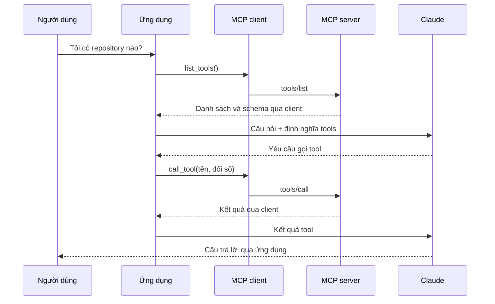

# Introduction to Model Context Protocol — Giảng lại bằng tiếng Việt

**Khóa học:** Anthropic Academy · **Giảng viên:** Stephen Grider  
**Ngày biên soạn và đối chiếu:** 15/10/2026  
**Trang khóa học:** [Introduction to Model Context Protocol](https://anthropic.skilljar.com/introduction-to-model-context-protocol)

Tài liệu này giải thích lại khóa học theo đúng thứ tự 14 mục, với ví dụ xuyên suốt là một chatbot quản lý tài liệu. Mỗi bài kỹ thuật có phần giải thích, thao tác, kết quả mong đợi và điểm dễ nhầm. Bạn có thể vừa đọc vừa làm trong trình soạn thảo mã nguồn và terminal.

**Cách biên soạn:** đã truy cập từng mục trong khóa học, đọc phần nội dung văn bản của các bài, đọc phụ đề của bài chào mừng và bài thiết lập dự án, tải và đối chiếu bộ mã nguồn `cli_project_COMPLETE.zip`. Đây là bản diễn giải và hướng dẫn thực hành, không phải bản chép lời hay bản mô tả từng khung hình video. Các ví dụ tiếng Việt, bài tự luyện và chương trình thực hành độc lập ở cuối là phần bổ sung của người biên soạn.

Hai mục không phải bài giảng kỹ thuật là khảo sát và bài đánh giá. Khảo sát có 3 câu; bài đánh giá có 7 câu. Đã đọc câu đầu của bài đánh giá; các câu sau yêu cầu trả lời câu trước nên không được truy cập bằng cách làm bài thay người học. Phần 13 ghi rõ giới hạn này và cung cấp câu hỏi tự luyện riêng.

## Mục lục

1. [Welcome to the course — Chuẩn bị học](#bai-01)
2. [Introducing MCP — MCP giải quyết việc gì?](#bai-02)
3. [MCP clients — Hiểu đường đi của một yêu cầu](#bai-03)
4. [Project setup — Thiết lập dự án](#bai-04)
5. [Defining tools with MCP — Tạo công cụ](#bai-05)
6. [The server inspector — Kiểm tra server](#bai-06)
7. [Course satisfaction survey — Khảo sát](#bai-07)
8. [Implementing a client — Viết client](#bai-08)
9. [Defining resources — Cung cấp dữ liệu](#bai-09)
10. [Accessing resources — Đọc và đính kèm dữ liệu](#bai-10)
11. [Defining prompts — Tạo mẫu hướng dẫn](#bai-11)
12. [Prompts in the client — Dùng mẫu từ client](#bai-12)
13. [Final assessment on MCP — Ôn để làm đánh giá](#bai-13)
14. [MCP review — Chọn đúng thành phần](#bai-14)

Sau 14 mục: [bài thực hành độc lập](#thuc-hanh), [xử lý lỗi](#xu-ly-loi), [bảng tra nhanh](#tra-nhanh), [nguồn và kiểm chứng](#nguon).

## Bức tranh chung trước khi học

Giả sử bạn muốn hỏi chatbot: “Trong `report.pdf` có gì? Hãy sửa chiều cao từ 20m thành 25m.” Mô hình không tự có quyền mở tài liệu của bạn. Ứng dụng phải cung cấp cách lấy dữ liệu và thực hiện thao tác.

MCP, viết đầy đủ là **Model Context Protocol**, quy định cách ứng dụng AI và các server cung cấp dữ liệu/công cụ trao đổi với nhau. Bạn vẫn cần quyền truy cập dịch vụ đích, logic nghiệp vụ và một ứng dụng điều phối; MCP chuẩn hóa phần kết nối.

Hình dung một văn phòng:

| Thành phần | Ví von | Trách nhiệm trong dự án |
|---|---|---|
| Người dùng | Người giao việc | Đặt câu hỏi, chọn tài liệu, chọn quy trình |
| Host / ứng dụng AI | Văn phòng điều phối | Quản lý hội thoại, gọi Claude, xử lý yêu cầu sử dụng công cụ |
| MCP client | Nhân viên liên lạc | Kết nối và gửi yêu cầu đúng giao thức tới MCP server |
| MCP server | Quầy dịch vụ chuyên môn | Công bố công cụ, dữ liệu và mẫu hướng dẫn |
| Claude / mô hình | Người suy luận | Hiểu yêu cầu, đề xuất gọi tool, tổng hợp câu trả lời |
| Dịch vụ hoặc kho dữ liệu | Nơi giữ hồ sơ thật | GitHub, cơ sở dữ liệu, hệ thống tài liệu… |

Trong khóa học, ứng dụng điều phối cũng có lúc được gọi là “your server”. Đừng nhầm nó với **MCP server**: một bên phục vụ ứng dụng chat, một bên cung cấp khả năng qua MCP. Ở dự án mẫu, ứng dụng điều phối là CLI chạy trên máy của bạn, không cần triển khai web server.

### Lưu ý phiên bản để làm theo được

Khóa học dùng API Python SDK nhánh 1.x: `FastMCP`, `ClientSession`, `stdio_client`. File `uv.lock` trong bộ mã nguồn đã tải khóa `mcp` tại **1.26.0**. Phần thực hành độc lập của tài liệu cũng dùng bản này.

Tài liệu chính thức hiện tại đã có SDK v2 và ví dụ dùng tên API khác, chẳng hạn `MCPServer` và `Client`. Vì vậy, khi theo khóa học, hãy dùng môi trường/lockfile đi kèm hoặc phiên bản chỉ định trong hướng dẫn này. Không trộn tùy ý ví dụ 1.x với ví dụ v2. [Nguồn đối chiếu phiên bản hiện tại: Python SDK chính thức](https://github.com/modelcontextprotocol/python-sdk).

---

<a id="bai-01"></a>
## 1. Welcome to the course — Chuẩn bị học

[Mở bài gốc](https://anthropic.skilljar.com/introduction-to-model-context-protocol/303756)

### Bài này muốn bạn hiểu gì?

Bạn sẽ lần lượt học vấn đề MCP giải quyết, vai trò client/server và ba thành phần cơ bản mà server cung cấp:

- **Tools:** những việc mô hình có thể đề xuất thực hiện.
- **Resources:** dữ liệu mà ứng dụng có thể đọc.
- **Prompts:** mẫu thông điệp/hướng dẫn có tham số để người dùng kích hoạt.

Điều kiện đầu vào là biết Python cơ bản và có Python trên máy. Bạn nên hiểu hàm, từ điển, import, kiểu dữ liệu và ngoại lệ. Với `async def`, hãy hiểu đơn giản rằng hàm có thể tạm nhường trong khi chờ I/O; `await` chờ kết quả của một thao tác bất đồng bộ.

### Thao tác chuẩn bị

1. Mở terminal. Trên Windows có thể dùng PowerShell trong VS Code.
2. Kiểm tra Python bằng `python --version`.
3. Kiểm tra uv bằng `uv --version`.
4. Nếu chưa có uv, xem [hướng dẫn chính thức của uv](https://docs.astral.sh/uv/). README dự án cũng đưa cách cài bằng `pip install uv`.
5. Tạo một thư mục riêng để giải nén bài tập. Mở chính thư mục chứa `main.py` trong trình soạn thảo.
6. Chưa cần viết server ngay; đến bài 4 mới thiết lập và chạy dự án.

**Kết quả cần thấy:** terminal nhận lệnh Python và uv; bạn biết nơi mở file và nơi nhập lệnh.

### Ví dụ dễ hiểu

Nếu Claude là người viết báo cáo, tool giống chức năng “mở hồ sơ” hoặc “sửa hồ sơ”; resource giống bộ hồ sơ ứng dụng đã đặt sẵn lên bàn; prompt giống phiếu giao việc có sẵn “hãy chuyển hồ sơ này thành Markdown”.

**Tự kiểm tra:** Bạn có phân biệt được “nội dung hồ sơ” với “chức năng sửa hồ sơ” không? Đó là bước đầu để phân biệt resource và tool.

---

<a id="bai-02"></a>
## 2. Introducing MCP — MCP giải quyết việc gì?

[Mở bài gốc](https://anthropic.skilljar.com/introduction-to-model-context-protocol/296689)

### Vấn đề trước khi có MCP

Giả sử chatbot của bạn phải trả lời: “Những pull request nào đang mở trong các repository GitHub của tôi?” Bạn cần cho mô hình biết có những công cụ nào, mỗi công cụ nhận tham số gì và phải chạy hàm nào khi mô hình yêu cầu.

Nếu tự tích hợp tất cả, bạn phải viết mô tả/schema công cụ, hàm gọi GitHub API, xử lý phản hồi và duy trì chúng khi dịch vụ thay đổi. Làm tương tự cho nhiều dịch vụ sẽ tạo ra nhiều mã tích hợp.

Một MCP server cho GitHub có thể đóng gói phần chức năng GitHub và công bố nó qua một giao diện chung. Ứng dụng của bạn kết nối server đó, khám phá công cụ rồi gọi công cụ khi cần.

### Điều chuyển đi đâu?

Phần đặc thù dịch vụ — ví dụ gọi endpoint nào của GitHub — nằm trong MCP server. Phần điều phối hội thoại và quyết định cho phép thao tác vẫn thuộc ứng dụng. Nếu bạn tự viết MCP server thì bạn vẫn phải viết logic tích hợp phía server; lợi ích là nhiều ứng dụng có thể dùng lại giao diện đó.

### MCP khác tool use thế nào?

**Tool use** là cơ chế mô hình yêu cầu dùng một công cụ có tên và đối số. **MCP** là cách ứng dụng khám phá và thực thi những khả năng được server công bố. Chúng bổ sung cho nhau.

Ví dụ minh họa:

```text
Mô hình đề xuất: gọi list_open_pull_requests(repo="demo")
Ứng dụng: xác định server nào có công cụ đó
MCP client: gửi yêu cầu gọi công cụ
MCP server: gọi GitHub API và trả dữ liệu
Ứng dụng: đưa kết quả lại cho mô hình
Mô hình: giải thích danh sách pull request cho người dùng
```

### Thao tác học bài này

1. Vẽ ba ô: ứng dụng chat → MCP client → MCP server GitHub.
2. Thêm ô GitHub API sau MCP server.
3. Ghi cạnh MCP server: “schema + hàm thực thi đặc thù GitHub”.
4. Ghi cạnh ứng dụng: “hội thoại + gọi mô hình + xử lý tool use”.
5. Thay GitHub bằng hệ thống tài liệu nội bộ. Kiểm tra xem trách nhiệm mỗi ô có còn hợp lý không.

**Kết quả cần đạt:** bạn chỉ ra được nơi phải sửa mã khi API dịch vụ thay đổi: thường là phần triển khai MCP server tương ứng.

### Điểm dễ nhầm

- MCP không phải mô hình AI mới.
- MCP không tự cấp quyền truy cập mọi dịch vụ.
- Ai cũng có thể viết MCP server; không phải server nào cũng do nhà cung cấp dịch vụ phát hành.
- Có giao thức chung không có nghĩa mọi ứng dụng đều hỗ trợ mọi tính năng giống nhau.

**Tự kiểm tra:** Nếu ứng dụng đã dùng MCP, bạn có còn cần đoạn mã gửi câu hỏi tới Claude và chuyển kết quả tool về Claude không? Có.

---

<a id="bai-03"></a>
## 3. MCP clients — Hiểu đường đi của một yêu cầu

[Mở bài gốc](https://anthropic.skilljar.com/introduction-to-model-context-protocol/296690)

### Vai trò client

MCP client là đầu mối liên lạc mà ứng dụng dùng để nói chuyện với MCP server. SDK giúp xử lý kết nối, định dạng thông điệp và các thao tác của giao thức.

Trong dự án mẫu, client khởi chạy server thành một tiến trình con, rồi hai bên trao đổi qua **stdio**: đầu vào/đầu ra chuẩn. Vì thế bạn không phải tự mở một HTTP server để làm bài.

Bài học giới thiệu ý tưởng độc lập với lớp vận chuyển và nhắc đến HTTP, WebSocket cùng các cách truyền khác. Khi triển khai thực tế, cần chọn transport được phiên bản SDK và bên kết nối hỗ trợ. Đối chiếu tài liệu hiện tại cho thấy stdio và Streamable HTTP là các lựa chọn được SDK chính thức hỗ trợ; không suy ra rằng mọi client đều hỗ trợ WebSocket chỉ vì bài có nhắc tới. [Python SDK chính thức](https://github.com/modelcontextprotocol/python-sdk).

### Hai trao đổi đầu tiên cần nhớ

| Mục đích | Tên trong bài | Cách gọi ở SDK 1.x |
|---|---|---|
| Hỏi server có công cụ gì | `ListToolsRequest` / `ListToolsResult` | `session.list_tools()` |
| Chạy một công cụ | `CallToolRequest` / `CallToolResult` | `session.call_tool(...)` |

Trong giao thức, các phương thức tương ứng thường được nhắc dưới dạng `tools/list` và `tools/call`. Các tên lớp request/result giúp mô tả thông điệp; bạn không cần tự dựng các lớp đó cho bài tập này.

### Đường đi đầy đủ: “Tôi có repository nào?”

1. Người dùng gửi câu hỏi vào ứng dụng.
2. Ứng dụng hỏi MCP client danh sách tool.
3. Client yêu cầu server liệt kê tool.
4. Server trả tên, mô tả và schema đầu vào.
5. Ứng dụng chuyển câu hỏi và định nghĩa tool cho Claude.
6. Claude trả một yêu cầu dùng tool, ví dụ lấy danh sách repository.
7. Ứng dụng đọc tên và đối số mà Claude đề xuất.
8. Ứng dụng gọi MCP client để chạy tool.
9. MCP server thực hiện logic tương ứng, chẳng hạn gọi GitHub API.
10. Kết quả đi ngược về ứng dụng.
11. Ứng dụng gửi kết quả tool cho Claude.
12. Claude viết câu trả lời; ứng dụng hiển thị cho người dùng.



### Thao tác để tự kiểm chứng

1. Lấy một yêu cầu cụ thể: “Đọc `report.pdf`”.
2. Viết tên tool dự kiến: `read_doc_contents`.
3. Viết đối số: `{"doc_id": "report.pdf"}`.
4. Tự chỉ ra bước nào thuộc mô hình và bước nào thuộc chương trình.
5. Sau bài 8, mở `core/chat.py` và `core/tools.py` để tìm các bước tương ứng trong mã.

**Kết quả cần đạt:** bạn hiểu rằng mô hình đề xuất lời gọi, còn mã ứng dụng và MCP server thực hiện lời gọi. Mô hình không trực tiếp chạy hàm Python trong bộ nhớ của bạn.

---

<a id="bai-04"></a>
## 4. Project setup — Thiết lập dự án

[Mở bài gốc và tải bài tập](https://anthropic.skilljar.com/introduction-to-model-context-protocol/296694)

### Sản phẩm sẽ xây

Một chatbot trong terminal làm việc với sáu tài liệu giả, chỉ lưu trong bộ nhớ Python. Ban đầu server có hai tool: đọc nội dung và thay nội dung. Các bài sau thêm tài nguyên cho chức năng `@` và prompt cho lệnh `/format`.

Khóa học xây cả client lẫn server để bạn hiểu hai phía. Trong công việc thực tế, bạn có thể chỉ viết server cho người khác dùng, hoặc chỉ viết ứng dụng client kết nối các server đã có.

### Bước 1 — Tải đúng bộ mã nguồn

Trong mục **Downloads** có:

- `cli_project.zip`: bộ khởi đầu để điền chức năng theo bài.
- `cli_project_COMPLETE.zip`: bộ tham khảo có phần triển khai hoàn chỉnh hơn.

Tải bộ khởi đầu để học; giữ bản hoàn chỉnh ở thư mục khác để đối chiếu. Giải nén rồi mở thư mục có `README.md`, `pyproject.toml` và `main.py`. Nếu terminal đang đứng ở thư mục cha, hãy `cd` vào đúng thư mục dự án.

### Bước 2 — Nhận diện các file

```text
thư-mục-dự-án/
├── .env              # Cấu hình cho ứng dụng gọi Claude
├── main.py           # Điểm khởi động
├── mcp_server.py     # Dictionary tài liệu, tools, resources, prompts
├── mcp_client.py     # Kết nối MCP và các hàm bọc session
├── pyproject.toml    # Khai báo dự án và thư viện
├── uv.lock           # Phiên bản thư viện đã khóa
└── core/
    ├── chat.py       # Vòng lặp hội thoại và tool use
    ├── tools.py      # Chuyển schema, định tuyến, trả kết quả tool
    ├── cli_chat.py   # Xử lý @tài_liệu và /lệnh
    ├── cli.py        # Giao diện terminal và autocomplete
    └── claude.py     # Gọi Anthropic API
```

### Bước 3 — Cấu hình `.env`

Mở `.env` ngay trong thư mục dự án và đặt các biến sau bằng thông tin của chính bạn:

```dotenv
ANTHROPIC_API_KEY="dien_api_key_cua_ban"
CLAUDE_MODEL="dien_model_id_ma_tai_khoan_cua_ban_truy_cap_duoc"
USE_UV="1"
```

`CLAUDE_MODEL` phải là model ID hợp lệ, không phải nguyên chuỗi minh họa ở trên. Xem model được tài khoản của bạn hỗ trợ khi thực hành. `main.py` trong bản tải về kiểm tra cả hai biến đầu, dù phần README hướng dẫn thiết lập chủ yếu nhắc API key. `USE_UV=1` làm ứng dụng khởi chạy server con bằng `uv run mcp_server.py`.

Bạn chỉ nhập key trong file cấu hình của mình. Không đưa key vào câu hỏi cho chatbot hay nội dung tài liệu thử nghiệm. Chạy hội thoại trong `main.py` sẽ gọi Anthropic API theo tài khoản của bạn; kiểm tra server bằng Inspector không cần gọi mô hình.

### Bước 4 — Cài môi trường theo uv

Nếu bộ mã nguồn có `uv.lock`, dùng cách bổ sung sau để bám phiên bản đã khóa:

```powershell
uv sync --locked
uv run main.py
```

README của bài đưa quy trình tạo môi trường rồi cài dự án:

```powershell
uv venv
.\.venv\Scripts\Activate.ps1
uv pip install -e .
uv run main.py
```

Hai quy trình là hai lựa chọn, không cần chạy cả hai. Cách có lockfile giúp tránh vô tình lấy SDK major mới do khai báo phụ thuộc dùng dấu `>=`. Khi dùng `uv run`, bạn thường không cần kích hoạt môi trường thủ công.

**Python:** README ghi 3.9+, nhưng `pyproject.toml` của bản tải về yêu cầu **3.10 trở lên**. Hãy theo yêu cầu trong file dự án; phần kiểm chứng của tài liệu dùng Python 3.11.

### Nếu không dùng uv

Ví dụ sau giữ MCP tại phiên bản đã đối chiếu, thay vì cài phiên bản mới nhất:

```powershell
python -m venv .venv
.\.venv\Scripts\Activate.ps1
python -m pip install anthropic python-dotenv prompt-toolkit "mcp[cli]==1.26.0"
python main.py
```

Đặt `USE_UV="0"` trong `.env`. Đây là cách cài bổ sung; README gốc đưa ví dụ ghim MCP 1.8.0. Muốn tái tạo sát bộ phụ thuộc đã tải, ưu tiên uv cùng lockfile.

### Bước 5 — Kiểm tra ứng dụng cơ bản

1. Chạy `uv run main.py` trong thư mục dự án.
2. Tại dấu nhắc `>`, nhập `What's one plus one?` rồi Enter.
3. Kỳ vọng chatbot trả lời tương đương “2”. Câu chữ có thể khác.
4. Nếu xuất hiện cảnh báo refresh resources/prompts ở bộ khởi đầu, có thể do các chức năng đó còn là TODO và sẽ được bổ sung ở bài sau. Phân biệt cảnh báo này với lỗi API key/model.
5. Nhấn `Ctrl+C` để thoát.

**Điểm rất quan trọng:** `report.pdf` trong dự án chỉ là **khóa của dictionary chứa chuỗi văn bản**. Chương trình chưa đọc PDF thật; tương tự với `.docx`. Sửa tài liệu chỉ sửa dữ liệu trong tiến trình, khởi động lại sẽ mất thay đổi.

---

<a id="bai-05"></a>
## 5. Defining tools with MCP — Tạo công cụ

[Mở bài gốc](https://anthropic.skilljar.com/introduction-to-model-context-protocol/296697)

### Ý tưởng cốt lõi

Bạn viết một hàm Python và gắn decorator `@mcp.tool(...)`. SDK dùng chữ ký hàm, type hints và mô tả tham số để tạo schema công cụ. Schema cho mô hình biết tên tool, mục đích và các trường đầu vào.

Ví dụ giống quầy tiếp nhận hồ sơ: bảng hướng dẫn ghi “Đọc hồ sơ”, cần cung cấp “mã hồ sơ”; nhân viên phía sau quầy biết cách tra kho và trả nội dung.

### Bước 1 — Mở server và thêm import

Trong `mcp_server.py`, kiểm tra đã có:

```python
from mcp.server.fastmcp import FastMCP
from pydantic import Field

mcp = FastMCP("DocumentMCP", log_level="ERROR")
```

Chỉ tạo một biến `mcp`. Nếu file đã có import/khởi tạo thì bổ sung phần còn thiếu, không dán lặp lại toàn bộ đầu file.

### Bước 2 — Hiểu dữ liệu mẫu

`docs` ánh xạ ID tài liệu sang nội dung. Ví dụ riêng để dễ hình dung:

```python
docs = {
    "report.pdf": "Tháp giải nhiệt cao 20m, cần kiểm tra định kỳ.",
    "plan.md": "Khảo sát, thiết kế, triển khai, nghiệm thu.",
}
```

Khi làm trên dự án gốc, giữ dictionary sáu tài liệu sẵn có để các ví dụ trong bài khớp nhau.

### Bước 3 — Tạo tool đọc

Thêm dưới dictionary, trước đoạn `if __name__ == "__main__":`:

```python
@mcp.tool(
    name="read_doc_contents",
    description="Đọc nội dung tài liệu theo ID.",
)
def read_document(
    doc_id: str = Field(description="ID tài liệu, ví dụ report.pdf"),
) -> str:
    if doc_id not in docs:
        raise ValueError(f"Không có tài liệu: {doc_id}")
    return docs[doc_id]
```

- `read_document` là tên hàm Python nội bộ.
- `read_doc_contents` là tên tool được công bố, có thể khác tên hàm.
- `doc_id: str` cho biết trường đầu vào là chuỗi.
- `Field(description=...)` giải thích tham số cho bên sử dụng tool.
- Kiểm tra tồn tại giúp trả lỗi rõ ràng khi ID sai.

### Bước 4 — Tạo tool sửa

```python
@mcp.tool(
    name="edit_document",
    description="Thay văn bản khớp chính xác trong một tài liệu.",
)
def edit_document(
    doc_id: str = Field(description="ID tài liệu cần sửa"),
    old_str: str = Field(description="Chuỗi cần tìm, khớp cả khoảng trắng"),
    new_str: str = Field(description="Chuỗi thay thế"),
) -> None:
    if doc_id not in docs:
        raise ValueError(f"Không có tài liệu: {doc_id}")
    docs[doc_id] = docs[doc_id].replace(old_str, new_str)
```

Ví dụ đầu vào:

```json
{"doc_id": "report.pdf", "old_str": "20m", "new_str": "25m"}
```

### Bước 5 — Cho server chạy qua stdio

Cuối file cần có cấu trúc sau; giữ lại nếu đã có:

```python
if __name__ == "__main__":
    mcp.run(transport="stdio")
```

Đến bài 6, bạn sẽ dùng Inspector để gọi hai tool. Chỉ chạy trực tiếp file server có thể khiến terminal trông như đang chờ: server đang đợi thông điệp MCP, chưa phải lỗi.

### Hiểu đúng hành vi sửa

`str.replace()` mặc định thay **mọi** chỗ khớp, không chỉ lần đầu. Nếu `old_str` không có trong văn bản, chuỗi sẽ giữ nguyên và code trên không báo lỗi. Hàm mẫu trả `None`, vì thế không nên chờ một câu “đã sửa thành công”; hãy đọc lại tài liệu để kiểm chứng.

Đây là logic demo. Nếu xây sản phẩm, có thể bổ sung kiểm tra số lần khớp, yêu cầu chính xác một vị trí, lưu phiên bản và trả thông tin thay đổi. Những phần đó nằm ngoài triển khai gốc của bài.

**Kết quả cần đạt:** server công bố được hai tool; bạn hiểu schema được suy ra từ hàm và không nhầm tên hàm Python với tên tool.

---

<a id="bai-06"></a>
## 6. The server inspector — Kiểm tra server

[Mở bài gốc](https://anthropic.skilljar.com/introduction-to-model-context-protocol/296693)

### Inspector dùng để làm gì?

Inspector là một client dành cho phát triển. Nó giúp bạn xem server công bố gì, điền tham số và gửi lời gọi trực tiếp. Nhờ đó, bạn có thể kiểm tra lỗi server mà chưa cần giao diện chat hoặc Claude.

### Bước 1 — Mở Inspector

Trong terminal ở thư mục dự án:

```powershell
uv run mcp dev mcp_server.py
```

Bài gốc viết `mcp dev mcp_server.py` sau khi kích hoạt môi trường; thêm `uv run` giúp chọn môi trường của dự án. Nếu được yêu cầu Node/npm để khởi chạy Inspector, cài Node theo yêu cầu của phiên bản Inspector đang dùng.

Terminal sẽ in URL. Bài minh họa địa chỉ thường gặp `http://127.0.0.1:6274`, nhưng **hãy mở URL thực tế được in ra**, kể cả phần token nếu có. Inspector hiện tại vẫn có lệnh khởi chạy bằng `npx @modelcontextprotocol/inspector`; giao diện và điều kiện phiên bản đã thay đổi theo thời gian. [Tài liệu Inspector chính thức](https://modelcontextprotocol.io/docs/tools/inspector).

### Bước 2 — Kết nối

1. Giữ terminal đang chạy.
2. Mở URL Inspector trong trình duyệt.
3. Kiểm tra cấu hình server theo lệnh phát sinh từ `mcp dev`.
4. Nhấn **Connect** nếu chưa kết nối.
5. Kỳ vọng trạng thái chuyển sang **Connected** hoặc trạng thái tương đương.

### Bước 3 — Thử tool đọc

1. Mở tab **Tools**.
2. Nhấn **List Tools** nếu giao diện yêu cầu.
3. Chọn `read_doc_contents`.
4. Nhập `doc_id` là `report.pdf`.
5. Nhấn **Run Tool** hoặc nút gọi tương đương.
6. Xem kết quả. Với dữ liệu gốc, nội dung nhắc đến tháp ngưng tụ cao `20m`.

### Bước 4 — Thử sửa rồi đọc lại

1. Chọn `edit_document`.
2. Điền `doc_id=report.pdf`, `old_str=20m`, `new_str=25m`.
3. Chạy tool.
4. Chuyển về `read_doc_contents` và đọc lại cùng ID.
5. Kỳ vọng nội dung có `25m`.

Đây là một kiểm tra hành vi có ý nghĩa: nó xác nhận hai lời gọi làm việc trên cùng trạng thái server đang chạy, không chỉ xác nhận “nút gọi không báo lỗi”.

### Bước 5 — Thử trường hợp lỗi

Gọi tool đọc với `doc_id=khong-ton-tai.md`. Bạn cần thấy lỗi về tài liệu không tồn tại. Sau đó thử sửa một chuỗi không xuất hiện và đọc lại: bạn sẽ thấy vì sao cần kiểm tra kết quả sửa thay vì chỉ tin trạng thái gọi hàm.

### Những điều cần nhớ

- Mỗi lần server khởi động lại, dictionary được tạo lại từ đầu.
- Server do Inspector khởi chạy và server do `main.py` khởi chạy thường là hai tiến trình khác nhau; dữ liệu trong RAM của chúng không tự chia sẻ.
- Đã thấy tài liệu đổi trong Inspector không có nghĩa lần mở CLI mới sẽ thấy thay đổi đó.
- Đừng in log tùy tiện vào stdout của server stdio; nên dùng logging/stderr để tránh làm lẫn luồng giao thức.

**Tự kiểm tra:** Nếu sửa trong Inspector rồi thoát Inspector, mở CLI và thấy `20m` trở lại, bạn có thể giải thích bằng vòng đời tiến trình không?

---

<a id="bai-07"></a>
## 7. Course satisfaction survey — Khảo sát

[Mở mục gốc](https://anthropic.skilljar.com/introduction-to-model-context-protocol/297281)

Đây là khảo sát phản hồi khóa học, không phải bài kỹ thuật về MCP. Trang hiển thị **3 câu hỏi** và nút **Start**. Không có nội dung lập trình mới để giảng lại ở mục này.

Nếu muốn gửi phản hồi, bạn tự mở mục này, nhấn Start, đọc từng câu và trả lời theo trải nghiệm của mình. Người biên soạn không chọn hoặc nộp phản hồi thay bạn.

Bạn có thể tạm ghi lại ba điều để tự đánh giá việc học: khái niệm nào đã rõ, thao tác nào còn mắc và ví dụ nào bạn muốn áp dụng vào công việc. Đây là gợi ý riêng, không phải nội dung ba câu hỏi chính thức.

---

<a id="bai-08"></a>
## 8. Implementing a client — Viết client

[Mở bài gốc](https://anthropic.skilljar.com/introduction-to-model-context-protocol/296696)

### Hai thành phần của client trong bài

1. **`MCPClient`:** lớp bọc do dự án tự viết, cung cấp những hàm dễ gọi cho ứng dụng.
2. **`ClientSession`:** đối tượng của SDK, làm việc với kết nối và các thao tác MCP.

Lớp bọc giống bảng điều khiển đơn giản; session giống bộ phận thật sự giữ đường truyền. Bạn không phải viết lại giao thức khi tạo lớp bọc.

### Bước 1 — Đọc phần kết nối đã có

Mở `mcp_client.py`. Trong bản đối chiếu, `connect()` thực hiện:

1. Tạo `StdioServerParameters` từ command, args và env.
2. Mở `stdio_client(...)` để khởi chạy/kết nối tiến trình server.
3. Nhận hai luồng đọc và ghi.
4. Tạo `ClientSession` bằng hai luồng đó.
5. Gọi `await session.initialize()` để khởi tạo phiên.

`AsyncExitStack` giữ các context manager để đóng tài nguyên theo đúng thứ tự khi kết thúc. `async with MCPClient(...)` giúp tự kết nối lúc vào và cleanup lúc ra.

### Bước 2 — Bổ sung hàm liệt kê tool

Đặt bên trong lớp `MCPClient`, thay phần TODO tương ứng:

```python
async def list_tools(self) -> list[types.Tool]:
    result = await self.session().list_tools()
    return result.tools
```

`self.session()` là phương thức của lớp bọc, trả về session đã khởi tạo. `.list_tools()` phía sau là phương thức SDK. Kết quả SDK là một đối tượng có trường `.tools`, không phải danh sách trần.

### Bước 3 — Bổ sung hàm gọi tool

```python
async def call_tool(
    self, tool_name: str, tool_input: dict
) -> types.CallToolResult:
    return await self.session().call_tool(tool_name, tool_input)
```

Ví dụ: `tool_name="read_doc_contents"`, `tool_input={"doc_id": "report.pdf"}`. Không truyền chuỗi JSON đã mã hóa vào chỗ dictionary nếu phương thức đang nhận dictionary.

### Bước 4 — Kiểm tra client trực tiếp

Bài giảng hướng dẫn chạy:

```powershell
uv run mcp_client.py
```

**Điểm cần sửa theo bộ mã nguồn đã tải:** hàm kiểm tra cuối `mcp_client.py` trong bản COMPLETE chỉ có `pass` bên trong `async with`; do đó chạy thành công cũng có thể không in gì. Thay `pass` bằng đoạn sau để quan sát:

```python
for tool in await _client.list_tools():
    print(tool.name, tool.inputSchema)

result = await _client.call_tool(
    "read_doc_contents", {"doc_id": "report.pdf"}
)
print(result)
```

Kỳ vọng thấy hai tên `read_doc_contents`, `edit_document` và nội dung tài liệu. Kiểm tra này chỉ dùng MCP server cục bộ, không cần Claude.

### Bước 5 — Kiểm tra toàn luồng chat

1. Chạy `uv run main.py`.
2. Nhập `What is the contents of the report.pdf document?`.
3. Ứng dụng lấy danh sách tool và gửi định nghĩa cho Claude.
4. Claude có thể đề xuất gọi `read_doc_contents`.
5. Ứng dụng dùng client để thực hiện và gửi kết quả về Claude.
6. Bạn nhận câu trả lời dựa trên nội dung thật của dictionary.

### Nối với phần điều phối đã được viết sẵn

Trong `core/tools.py`, dự án chuyển định nghĩa MCP sang định dạng mà API mô hình dùng:

| Từ MCP tool | Sang định nghĩa tool cho Claude |
|---|---|
| `name` | `name` |
| `description` | `description` |
| `inputSchema` | `input_schema` |

Trong `core/chat.py`, chương trình lặp khi mô hình trả `stop_reason == "tool_use"`. Kết quả tool phải gắn với ID của lời gọi tương ứng rồi được gửi lại trong hội thoại. Nếu chỉ thực thi tool mà không gửi kết quả cho mô hình, mô hình chưa có dữ liệu để hoàn tất câu trả lời.

**Kết quả cần đạt:** bạn liệt kê/gọi được tool qua client, hiểu khởi tạo/cleanup và chỉ ra nơi chuyển schema sang định dạng API mô hình.

---

<a id="bai-09"></a>
## 9. Defining resources — Cung cấp dữ liệu

[Mở bài gốc](https://anthropic.skilljar.com/introduction-to-model-context-protocol/296699)

### Vì sao đã có tool đọc mà còn cần resource?

Cùng một tài liệu có thể được lấy theo hai cách, tùy ai chủ động:

- Người dùng hỏi chung “Trong báo cáo có gì?”; mô hình có thể chọn tool đọc.
- Người dùng gõ `@report.pdf`; ứng dụng đã biết tài liệu được chọn và chủ động lấy nội dung để đính kèm vào câu hỏi.

Cách thứ hai phù hợp với resource. Ứng dụng cần dữ liệu cho giao diện hoặc ngữ cảnh, không cần chờ mô hình quyết định gọi tool.

Ví von: tool là “nhờ người xử lý đi lấy hồ sơ khi thấy cần”; resource là “ứng dụng lấy đúng hồ sơ bạn vừa chọn và đặt sẵn trên bàn”. Một tool vẫn có thể chỉ đọc dữ liệu. Phân biệt hai loại theo cách dùng và bên điều khiển, không chỉ theo tiêu chí có sửa dữ liệu hay không.

### Hai dữ liệu cần cho chức năng `@`

1. Danh sách ID tài liệu để hiện gợi ý.
2. Nội dung tài liệu được chọn để đưa vào hội thoại.

Server nhận yêu cầu đọc theo URI và trả nội dung cùng metadata như MIME type. Trong bài, luồng này được gọi là `ReadResourceRequest` / `ReadResourceResult`.

### Bước 1 — Tạo resource có URI cố định

Trong `mcp_server.py`, thêm trước phần chạy server:

```python
@mcp.resource("docs://documents", mime_type="application/json")
def list_docs() -> list[str]:
    return list(docs.keys())
```

`docs://documents` là định danh do server và ứng dụng thống nhất, không phải một địa chỉ web bắt buộc mở được bằng Chrome. URI này luôn trỏ tới danh sách ID tài liệu. SDK chuyển danh sách Python thành nội dung phù hợp để gửi qua giao thức.

### Bước 2 — Tạo resource có tham số

```python
@mcp.resource(
    "docs://documents/{doc_id}", mime_type="text/plain"
)
def fetch_doc(doc_id: str) -> str:
    if doc_id not in docs:
        raise ValueError(f"Không có tài liệu: {doc_id}")
    return docs[doc_id]
```

Đây là **resource template**. Khi client đọc `docs://documents/plan.md`, SDK lấy `plan.md` từ vị trí `{doc_id}` rồi truyền vào hàm.

| URI | Ý nghĩa | Kiểu nội dung ở bài tập |
|---|---|---|
| `docs://documents` | Tất cả ID tài liệu | JSON, ví dụ `["report.pdf", "plan.md"]` |
| `docs://documents/report.pdf` | Nội dung một tài liệu | Văn bản |

### Bước 3 — Chọn MIME type đúng với dữ liệu thực tế

MIME type giúp client biết cách xử lý nội dung. `application/json` dùng cho dữ liệu JSON; `text/plain` cho văn bản thuần. Có thể cung cấp dữ liệu nhị phân, nhưng client phải xử lý nhánh binary phù hợp.

Đừng đặt MIME `application/pdf` chỉ vì ID kết thúc bằng `.pdf`: trong bài này giá trị trả về vẫn là chuỗi mô phỏng nội dung, không phải byte của một PDF thật.

### Bước 4 — Thử trong Inspector

1. Lưu file, khởi động lại phiên kiểm tra nếu server chưa nhận thay đổi.
2. Chạy `uv run mcp dev mcp_server.py`.
3. Mở URL terminal cung cấp và kết nối server.
4. Mở **Resources**; liệt kê và đọc `docs://documents`.
5. Kỳ vọng thấy danh sách sáu ID trong dự án gốc.
6. Mở **Resource Templates** hoặc khu vực template tương ứng.
7. Chọn `docs://documents/{doc_id}`, nhập `doc_id=report.pdf`.
8. Đọc resource và kiểm tra nội dung, URI, MIME type trong phản hồi.

### Một phân biệt quan trọng

**Liệt kê metadata các resource** là thao tác của giao thức. Còn **đọc resource `docs://documents` để lấy danh sách ID nghiệp vụ** là thiết kế riêng của dự án. Hai việc không đồng nghĩa. Ở đây danh sách tài liệu được trả về như nội dung của một resource JSON.

**Kết quả cần đạt:** server cung cấp được URI cố định lẫn URI template; bạn hiểu chức năng `@` cần cả danh sách ID và nội dung.

---

<a id="bai-10"></a>
## 10. Accessing resources — Đọc và đính kèm dữ liệu

[Mở bài gốc](https://anthropic.skilljar.com/introduction-to-model-context-protocol/296695)

### Việc còn thiếu ở client

Server đã cung cấp dữ liệu. Client cần đọc URI, nhận phản hồi rồi chuyển nội dung thành kiểu dữ liệu mà ứng dụng dùng được. Với resource JSON, ứng dụng cần danh sách Python; với tài liệu văn bản, ứng dụng cần chuỗi.

### Bước 1 — Thêm import trong `mcp_client.py`

```python
import json
from typing import Any
from pydantic import AnyUrl
from mcp import types
```

Chỉ thêm những import chưa có. `AnyUrl` biểu diễn URI theo kiểu mà SDK 1.x sử dụng.

### Bước 2 — Viết hàm đọc resource

Đoạn sau tương ứng cách triển khai của dự án, thêm kiểm tra đầu vào phản hồi để dễ hiểu lỗi hơn:

```python
async def read_resource(self, uri: str) -> Any:
    result = await self.session().read_resource(AnyUrl(uri))
    if not result.contents:
        raise ValueError("Resource không trả nội dung")

    resource = result.contents[0]
    if not isinstance(resource, types.TextResourceContents):
        raise TypeError("Ví dụ này chỉ xử lý resource dạng văn bản")

    if resource.mimeType == "application/json":
        return json.loads(resource.text)
    return resource.text
```

Đây là **bản bổ sung kiểm tra lỗi**, không phải chép nguyên đoạn trong bài. Mã của khóa học chọn phần tử đầu và xử lý JSON/văn bản. Một phản hồi MCP có thể có nhiều phần; không nên khái quát rằng mọi resource luôn chỉ có đúng một phần tử.

### Đọc từng dòng cho dễ hiểu

1. Gửi yêu cầu đọc URI qua session.
2. Lấy một phần nội dung từ `result.contents` theo giả định của bài.
3. Xác định có phải dạng văn bản không.
4. Nếu MIME là JSON, dùng `json.loads()` để biến chuỗi JSON thành đối tượng Python.
5. Nếu là văn bản khác, trả nguyên chuỗi.

Ví dụ chuỗi `'["report.pdf", "plan.md"]'` sau `json.loads()` trở thành danh sách `['report.pdf', 'plan.md']`. Bạn có thể dùng danh sách đó để tạo gợi ý trong giao diện.

### Bước 3 — Kiểm tra trực tiếp trong client

Trong context `async with ... as _client` của phần kiểm tra cuối file, dùng:

```python
print(await _client.read_resource("docs://documents"))
print(await _client.read_resource("docs://documents/report.pdf"))
```

Chạy `uv run mcp_client.py`. Kết quả đầu là danh sách ID; kết quả sau là nội dung tài liệu. Không cần gọi Claude cho bước kiểm tra này.

### Bước 4 — Hiểu phần giao diện có sẵn

Trong `core/cli_chat.py`:

- `list_docs_ids()` đọc `docs://documents`.
- `get_doc_content(doc_id)` đọc `docs://documents/{doc_id}`.
- `_extract_resources(query)` tìm những từ bắt đầu bằng `@`, rồi lấy nội dung tương ứng.
- `_process_query(...)` đưa câu hỏi và tài liệu vào ngữ cảnh gửi cho Claude.

Ký tự `@` là quy ước của **ứng dụng mẫu**, không phải một ký tự đặc biệt mà giao thức MCP tự xử lý.

### Bước 5 — Thử chức năng `@`

1. Chạy `uv run main.py`.
2. Nhập `Tell me about @`.
3. Khi danh sách gợi ý xuất hiện, dùng phím lên/xuống để chọn; hoàn tất bằng Tab hoặc phím phù hợp với giao diện. Bài giảng cũng minh họa chọn rồi tiếp tục bằng dấu cách.
4. Cách ổn định nếu autocomplete không như mong đợi: gõ nguyên câu `Tell me about @report.pdf`.
5. Nhấn Enter để gửi.
6. Ứng dụng đọc tài liệu trước khi gửi câu hỏi; Claude có thể trả lời ngay từ nội dung đã đính kèm, không cần một lượt tool đọc riêng.

Ví dụ ngữ cảnh do ứng dụng tạo, giản lược để dễ nhìn:

```xml
<query>Tell me about @report.pdf</query>
<context>
  <document id="report.pdf">Nội dung tài liệu được đọc từ resource</document>
</context>
```

### Điểm dễ vướng trong mã mẫu

Bộ tách mention dựa vào `query.split()` và nhận diện từng từ bắt đầu bằng `@`. Vì vậy, `@report.pdf?` có thể không khớp `report.pdf`. Khi thử bài, dùng `@report.pdf` với khoảng trắng tách từ và tránh dấu câu dính ngay sau ID.

Đính kèm resource không làm chi phí ngữ cảnh biến mất: nội dung vẫn đi vào đầu vào của mô hình. Với tài liệu lớn, cần thiết kế chọn đoạn hoặc giới hạn nội dung; bài tập dùng chuỗi ngắn để tập trung vào MCP.

**Kết quả cần đạt:** bạn thấy được đường đi `@ID → read_resource → ngữ cảnh → mô hình`, và phân biệt nó với lời gọi tool do mô hình đề xuất.

---

<a id="bai-11"></a>
## 11. Defining prompts — Tạo mẫu hướng dẫn

[Mở bài gốc](https://anthropic.skilljar.com/introduction-to-model-context-protocol/296698)

### Prompt trong MCP là gì?

Đó là một mẫu tạo ra các thông điệp có thể gửi cho mô hình. Mẫu có tên, mô tả và tham số. Server xây sẵn hướng dẫn để người dùng không phải viết lại một yêu cầu phức tạp mỗi lần.

Ví dụ: thay vì chỉ gõ “định dạng lại tài liệu”, một prompt tốt có thể nói rõ giữ nguyên ý nghĩa, thêm heading/list/table khi phù hợp, dùng công cụ sửa và trả lại phiên bản cuối. Lợi ích là một cách giao việc nhất quán và có thể tái sử dụng. Chất lượng vẫn phụ thuộc vào mẫu, mô hình, dữ liệu và việc kiểm thử; không phải cứ dùng MCP prompt là kết quả luôn đúng.

### Quy trình mẫu của bài

Người dùng nhập `/format plan.md`. Ứng dụng nhận tên `format` và `doc_id=plan.md`, lấy thông điệp đã điền tham số từ server rồi chuyển cho Claude. Claude dùng tools để đọc và sửa tài liệu.

**Điểm mấu chốt:** gọi `get_prompt` mới chỉ lấy thông điệp. Nó không tự gọi mô hình và không tự sửa tài liệu.

### Bước 1 — Thêm import

Trong `mcp_server.py`:

```python
from mcp.server.fastmcp.prompts import base
from pydantic import Field
```

### Bước 2 — Định nghĩa prompt `format`

Ví dụ diễn đạt lại hướng dẫn của bài bằng tiếng Việt:

```python
@mcp.prompt(
    name="format",
    description="Định dạng lại tài liệu thành Markdown.",
)
def format_document(
    doc_id: str = Field(description="ID tài liệu cần định dạng"),
) -> list[base.Message]:
    instruction = f"""
Hãy đọc tài liệu có ID dưới đây bằng read_doc_contents:
<document_id>{doc_id}</document_id>

Chuyển nội dung sang Markdown dễ đọc, giữ nguyên ý nghĩa.
Dùng heading, danh sách hoặc bảng khi phù hợp.
Dùng edit_document để cập nhật tài liệu, rồi trả phiên bản cuối.
"""
    return [base.UserMessage(instruction)]
```

Tên công bố là **`format`**, dù tên hàm Python là `format_document`. Client phải yêu cầu tên công bố.

Mẫu gốc trong bộ COMPLETE yêu cầu thêm cấu trúc và có thể thêm câu chữ nhưng không đổi ý nghĩa; sau khi sửa thì trả bản cuối, không giải thích thay đổi. Ví dụ trên bổ sung việc nói rõ dùng tool đọc để người mới dễ hình dung luồng thực thi.

### Bước 3 — Kiểm tra mẫu trong Inspector

1. Lưu file, khởi chạy/kết nối lại Inspector.
2. Mở phần **Prompts**.
3. Liệt kê prompt và chọn `format`.
4. Điền `doc_id=plan.md`.
5. Nhấn **Get Prompt** hoặc nút lấy prompt tương đương.
6. Kiểm tra kết quả có message role `user` và nội dung đã chứa `plan.md`.
7. Xác nhận không còn biến chưa điền như `{doc_id}` trong message cuối.

Ở bước này bạn đang xem yêu cầu **sẽ gửi cho mô hình**. Nếu Inspector chỉ hiển thị message mà tài liệu chưa đổi, đó là hành vi đúng của việc lấy prompt.

### Bước 4 — Nghĩ về chất lượng mẫu

Thử mẫu với tài liệu ngắn, tài liệu đã có Markdown và tài liệu chứa số liệu cần giữ nguyên. Kiểm tra đầu ra có mất thông tin không. Nếu một prompt có tên “summarize”, nên nêu rõ độ dài tóm tắt, nội dung cần giữ và có sửa tài liệu gốc hay chỉ trả lời.

Trong bộ COMPLETE đã đối chiếu có TODO cho prompt tóm tắt và README minh họa `/summarize`, nhưng server thực tế chỉ định nghĩa prompt **`format`**. Vì vậy đừng coi `/summarize` là lệnh chắc chắn có sẵn.

**Kết quả cần đạt:** bạn tạo được prompt có tham số và hiểu sự khác biệt giữa “lấy hướng dẫn” với “thực thi quy trình có mô hình và tools”.

---

<a id="bai-12"></a>
## 12. Prompts in the client — Dùng mẫu từ client

[Mở bài gốc](https://anthropic.skilljar.com/introduction-to-model-context-protocol/296692)

### Hai chức năng cần bổ sung

Client cần hỏi “server có những prompt nào?” và “hãy tạo message cho prompt này với các đối số này”. Một hàm phục vụ danh sách lệnh, hàm còn lại phục vụ lần người dùng chọn lệnh cụ thể.

### Bước 1 — Liệt kê prompt

Trong lớp `MCPClient` của `mcp_client.py`:

```python
async def list_prompts(self) -> list[types.Prompt]:
    result = await self.session().list_prompts()
    return result.prompts
```

Danh sách chứa metadata như tên, mô tả và đối số. Ứng dụng dùng nó để xây menu hoặc gợi ý lệnh.

### Bước 2 — Lấy thông điệp đã điền tham số

```python
async def get_prompt(self, prompt_name: str, args: dict[str, str]):
    result = await self.session().get_prompt(prompt_name, args)
    return result.messages
```

Ví dụ:

```python
messages = await _client.get_prompt("format", {"doc_id": "plan.md"})
for message in messages:
    print(message.role, message.content)
```

Đối số là mapping tên tham số sang chuỗi. Khóa `doc_id` phải khớp tham số server định nghĩa; `format` phải khớp tên prompt công bố.

### Bước 3 — Hiểu ứng dụng nối prompt vào hội thoại thế nào

Trong `core/cli_chat.py`, `_process_command` thực hiện luồng sau:

1. Kiểm tra câu nhập có bắt đầu bằng `/` không.
2. Tách tên lệnh và ID tài liệu.
3. Gọi `get_prompt(command, {"doc_id": ...})`.
4. Chuyển các MCP prompt message sang định dạng message mà Anthropic API nhận.
5. Thêm chúng vào lịch sử hội thoại.
6. Để vòng lặp chat gọi Claude và xử lý tool use như các bài trước.

MCP message và message của API mô hình là hai cấu trúc riêng; dự án có hàm chuyển đổi để nối chúng. Không nên mặc định truyền nguyên mọi loại MCP content sang một API mô hình bất kỳ mà không chuyển đổi.

### Bước 4 — Thử `/format`

1. Chạy `uv run main.py`.
2. Gõ `/`; giao diện có thể hiện danh sách prompt.
3. Chọn hoặc gõ `format`.
4. Thêm dấu cách, chọn hoặc gõ `plan.md`.
5. Kiểm tra cả dòng là `/format plan.md`, rồi Enter.
6. Ứng dụng lấy prompt và gửi cho Claude.
7. Claude có thể gọi tool đọc, tạo nội dung Markdown rồi gọi tool sửa.
8. Bạn nhận phiên bản được định dạng.
9. Trong **cùng phiên chat**, hỏi `What is the contents of the plan.md document?` để đọc lại và kiểm chứng thay đổi.

Câu chữ Markdown cụ thể không cố định. Với dữ liệu gốc chỉ có một câu ngắn, không cần mong chờ một báo cáo dài hoặc nhiều bảng.

### Nếu menu không hoàn thành đúng

Bản CLI có một số giới hạn ở autocomplete đối số. Bạn có thể gõ thẳng `/format plan.md`. Cũng nên tránh chỉ nhập `/format` rồi Enter: bộ xử lý lệnh mẫu truy cập từ thứ hai và chưa kiểm tra đầy đủ trường hợp thiếu đối số.

### Ba hiểu nhầm cần tránh

- `/format` là quy ước UI của ứng dụng này, không phải cú pháp lệnh bắt buộc của MCP.
- Prompt được lấy về chưa tạo ra kết quả cuối; vẫn cần lượt gọi mô hình và thực thi tool.
- Một mẫu prompt có thể chứa nhiều message user/assistant; ví dụ chỉ trả một user message để đơn giản hóa.

**Kết quả cần đạt:** bạn lần được đường đi `/format plan.md → get_prompt → messages → Claude → tools → nội dung mới`.

---

<a id="bai-13"></a>
## 13. Final assessment on MCP — Ôn để làm đánh giá

[Mở mục gốc](https://anthropic.skilljar.com/introduction-to-model-context-protocol/297196)

### Nội dung đã kiểm tra được trên trang

Bài có tên **Final Assessment Quiz on MCP**, gồm **7 câu hỏi**. Sau khi mở Start, câu đầu hỏi về hai thành phần chính khi xây MCP client. Nội dung kiểm tra tương ứng bài 8: lớp bọc **MCP Client** và **Client Session**.

Trang yêu cầu chọn câu trả lời mới đi tiếp. Người biên soạn không chọn/nộp đáp án thay bạn, vì vậy không khẳng định đã đọc sáu câu còn lại. Những câu bên dưới là **bài tự luyện do người biên soạn tạo**, không phải đề chính thức hoặc đáp án chính thức của Anthropic.

### Cách tự làm bài trên trang

1. Ôn ba cặp: tool/model, resource/ứng dụng, prompt/người dùng.
2. Mở mục đánh giá; nếu trang đang ở câu đầu thì tiếp tục từ đó.
3. Đọc tình huống và tự chọn phương án.
4. Nhấn **Next Question** để chuyển câu sau.
5. Đọc các hướng dẫn và kết quả do hệ thống hiển thị ở cuối. Tên nút nộp và quy định đạt phụ thuộc trang thực tế; tài liệu này không suy đoán điểm chuẩn.

### Bảy câu tự luyện kèm giải thích

**1. Chatbot kết nối được GitHub qua MCP. MCP thay thế hoàn toàn GitHub API không?**  
Không. MCP server có thể vẫn gọi GitHub API ở phía sau. MCP chuẩn hóa cách ứng dụng AI khám phá và gọi khả năng của server.

**2. Claude trả yêu cầu `read_doc_contents` với `doc_id=report.pdf`. Thành phần nào thực hiện hàm đọc?**  
Ứng dụng nhận yêu cầu tool use, gọi qua MCP client; MCP server thực hiện hàm. Claude nhận kết quả để tiếp tục suy luận.

**3. Vì sao client phải gọi `initialize()` và cleanup?**  
Khởi tạo để thiết lập phiên giao tiếp; cleanup để đóng session/luồng/tiến trình được quản lý, tránh giữ tài nguyên sau khi ứng dụng kết thúc.

**4. Bạn cần danh sách tài liệu để hiện autocomplete. Chọn primitive nào?**  
Resource phù hợp vì ứng dụng chủ động lấy dữ liệu cho UI. Dự án dùng URI `docs://documents` trả danh sách ID.

**5. Một tool chỉ đọc dữ liệu thì có sai thiết kế không?**  
Không. Tools không bắt buộc phải ghi dữ liệu. Trong bài, `read_doc_contents` là một tool đọc. Cách lựa chọn và bên điều khiển mới là tiêu chí quan trọng.

**6. `get_prompt("format", {"doc_id": "plan.md"})` có lập tức sửa tài liệu không?**  
Không. Nó trả message được dựng từ mẫu. Ứng dụng còn phải gửi message tới mô hình và thực thi các tool mà mô hình yêu cầu.

**7. Sửa `report.pdf` từ 20m thành 25m rồi khởi động lại server, vì sao lại thành 20m?**  
Dữ liệu là dictionary trong RAM. Khi tiến trình mới khởi động, dictionary lấy lại giá trị ban đầu; bài tập chưa lưu xuống đĩa hoặc cơ sở dữ liệu.

### Bài kiểm tra thực hành trước khi làm đánh giá

Bạn nên tự làm được cả năm việc: liệt kê tool, gọi tool đọc, sửa rồi đọc lại, đọc resource JSON và lấy prompt có tham số. Nếu cả năm đều chạy được và bạn giải thích được ai chủ động mỗi bước, kiến thức cốt lõi của khóa đã khá vững.

---

<a id="bai-14"></a>
## 14. MCP review — Chọn đúng thành phần

[Mở bài gốc](https://anthropic.skilljar.com/introduction-to-model-context-protocol/296691)

### Ba primitive, ba nơi chủ động

| Primitive | Bên chủ động theo cách thiết kế của khóa học | Trong dự án | Khi nào phù hợp? |
|---|---|---|---|
| Tool | Mô hình đề xuất sử dụng | Đọc/sửa tài liệu | Cần mô hình chọn một khả năng để hoàn thành việc |
| Resource | Mã ứng dụng | Danh sách ID và nội dung cho `@` | Cần dữ liệu cho UI hoặc ngữ cảnh |
| Prompt | Người dùng kích hoạt qua UI | `/format plan.md` | Cần một mẫu giao việc/quy trình có thể dùng lại |

“Model-controlled” trong bài mô tả nơi đề xuất lựa chọn tool. Ứng dụng vẫn thực thi lời gọi, quản lý quyền và có thể yêu cầu người dùng duyệt thao tác theo thiết kế sản phẩm. Đây không phải cam kết rằng mô hình được chạy mọi hành động vô điều kiện.

### Một tình huống dùng cả ba

Bạn muốn định dạng lại kế hoạch triển khai:

1. **Resource** cung cấp danh sách tài liệu để giao diện gợi ý `plan.md`.
2. Người dùng chọn **prompt** `format` và tài liệu.
3. Ứng dụng lấy thông điệp hướng dẫn từ server.
4. Claude chọn **tool** đọc tài liệu.
5. Claude soạn lại nội dung rồi đề xuất **tool** sửa.
6. Ứng dụng chuyển kết quả tool trở lại Claude.
7. Claude trả bản cuối cho người dùng.

Ba primitive hợp tác trong một quy trình, không phải ba lựa chọn luôn loại trừ lẫn nhau.

### Cách chọn khi bạn tự xây ứng dụng

Hãy hỏi lần lượt:

- “Tôi muốn mô hình có thêm một khả năng mà nó có thể chọn dùng?” → Xem xét **tool**.
- “Mã ứng dụng đã biết cần dữ liệu gì cho UI/ngữ cảnh?” → Xem xét **resource**.
- “Người dùng nên có một thao tác để gọi mẫu hướng dẫn đã chuẩn bị?” → Xem xét **prompt**.

Ví dụ mở rộng do người biên soạn đề xuất:

| Nhu cầu | Thiết kế có thể dùng |
|---|---|
| Mô hình kiểm tra tồn kho theo mã hàng | Tool `check_stock` |
| Giao diện hiển thị danh sách kho để chọn | Resource danh sách kho |
| Nút “Lập báo cáo tồn kho tuần” | Prompt có tham số tuần/kho |
| Ứng dụng đính kèm tài liệu đã chọn vào câu hỏi | Resource nội dung tài liệu |
| Mô hình đề xuất tạo một bản ghi mới | Tool tạo bản ghi, đi qua quyền và quy trình của ứng dụng |

### Thao tác tổng kết

1. Mở `mcp_server.py`, tìm ba decorator `@mcp.tool`, `@mcp.resource`, `@mcp.prompt`.
2. Với mỗi hàm, nói rõ đầu vào, đầu ra và ai chủ động dùng nó.
3. Mở `mcp_client.py`, đối chiếu phương thức gọi tương ứng.
4. Chạy ba kịch bản: hỏi đọc tài liệu bằng tool, hỏi với `@report.pdf`, chạy `/format plan.md`.
5. Giải thích vì sao các kịch bản khác nhau nhưng có thể dùng cùng nguồn dữ liệu `docs`.

**Sau khóa học, bạn cần nắm:** MCP chuẩn hóa kết nối; client giữ đường giao tiếp; server cung cấp khả năng; host điều phối mô hình và công cụ; tools/resources/prompts phục vụ ba kiểu tương tác khác nhau.

---

<a id="thuc-hanh"></a>
## Bài thực hành độc lập: tự thấy cả ba primitive hoạt động

**Phần bổ sung của người biên soạn.** Đây là một ví dụ nhỏ chạy riêng, không thay thế bộ CLI của khóa học. Bạn sẽ kiểm tra giao tiếp MCP trực tiếp; chưa có mô hình nên chưa có bước AI tự quyết định gọi tool hoặc tự viết lại tài liệu.

Hai file dưới đây được thiết kế cho **Python 3.11 và `mcp==1.26.0`**, cùng phiên bản MCP được khóa trong bộ bài tập đã đối chiếu. Không cần `.env` hoặc API key cho ví dụ này.

### A. Tạo thư mục và môi trường

Mở PowerShell trong nơi bạn muốn lưu bài thực hành, tạo thư mục mới:

```powershell
mkdir mcp-demo
cd mcp-demo
uv venv --python 3.11
uv pip install --python .venv/Scripts/python.exe "mcp[cli]==1.26.0"
```

Sau đó tạo `demo_server.py` và `smoke_client.py` trong chính thư mục `mcp-demo`. Hai file cùng cấp với nhau. Nếu máy chưa có Python 3.11, chuẩn bị Python trước khi chạy lệnh tạo môi trường này.

### B. File `demo_server.py`

Đây là server đủ tools, resources và prompt. So với tool sửa tối giản trong bài, ví dụ bổ sung việc báo lỗi khi không tìm thấy chuỗi cần thay và trả một câu xác nhận. Dữ liệu vẫn chỉ ở trong RAM.

```python
# file: demo_server.py
from mcp.server.fastmcp import FastMCP
from mcp.server.fastmcp.prompts import base
from pydantic import Field

mcp = FastMCP("VietnameseDocumentDemo", log_level="ERROR")

docs = {
    "report.pdf": "Tháp giải nhiệt cao 20m. Cần kiểm tra mỗi quý.",
    "plan.md": "Khảo sát hiện trạng. Thiết kế. Triển khai. Nghiệm thu.",
}


def require_doc(doc_id: str) -> str:
    if doc_id not in docs:
        raise ValueError(f"Không có tài liệu: {doc_id}")
    return docs[doc_id]


@mcp.tool(
    name="read_doc_contents",
    description="Đọc nội dung một tài liệu theo ID.",
)
def read_document(
    doc_id: str = Field(description="ID tài liệu, ví dụ report.pdf"),
) -> str:
    return require_doc(doc_id)


@mcp.tool(
    name="edit_document",
    description="Thay tất cả vị trí khớp chính xác trong tài liệu.",
)
def edit_document(
    doc_id: str = Field(description="ID tài liệu cần sửa"),
    old_str: str = Field(description="Văn bản cũ cần tìm chính xác"),
    new_str: str = Field(description="Văn bản mới"),
) -> str:
    current = require_doc(doc_id)
    if not old_str:
        raise ValueError("Chuỗi cần tìm không được rỗng")
    if old_str not in current:
        raise ValueError("Không tìm thấy chuỗi cần thay")
    docs[doc_id] = current.replace(old_str, new_str)
    return f"Đã cập nhật {doc_id}"


@mcp.resource("docs://documents", mime_type="application/json")
def list_docs() -> list[str]:
    return list(docs.keys())


@mcp.resource("docs://documents/{doc_id}", mime_type="text/plain")
def fetch_doc(doc_id: str) -> str:
    return require_doc(doc_id)


@mcp.prompt(name="format", description="Chuyển tài liệu sang Markdown.")
def format_document(doc_id: str) -> list[base.Message]:
    return [
        base.UserMessage(
            f"Đọc tài liệu {doc_id} bằng read_doc_contents. "
            "Định dạng thành Markdown rõ ràng, giữ nguyên ý nghĩa. "
            "Dùng edit_document để cập nhật, rồi trả nội dung cuối."
        )
    ]


if __name__ == "__main__":
    mcp.run(transport="stdio")
```

**Đọc mã theo nhóm:** `require_doc` là helper nội bộ, không được công bố thành tool vì không có decorator. Hai hàm có `@mcp.tool` là khả năng gọi được qua MCP. Hai hàm có `@mcp.resource` cung cấp dữ liệu. Hàm có `@mcp.prompt` trả hướng dẫn cho mô hình, không thực hiện sửa dữ liệu.

### C. File `smoke_client.py`

Đây là chương trình kiểm tra hành vi. Nó tự khởi chạy server bằng đúng Python đang chạy client, khởi tạo session, gọi và kiểm tra kết quả, sau đó đóng kết nối bằng `async with`.

```python
# file: smoke_client.py
import asyncio
import json
import sys
from pathlib import Path

from mcp import ClientSession, StdioServerParameters, types
from mcp.client.stdio import stdio_client
from pydantic import AnyUrl


def tool_text(result: types.CallToolResult) -> str:
    if result.isError:
        raise RuntimeError(str(result.content))
    return "\n".join(
        item.text for item in result.content
        if isinstance(item, types.TextContent)
    )


def resource_text(result: types.ReadResourceResult) -> str:
    assert len(result.contents) == 1
    item = result.contents[0]
    assert isinstance(item, types.TextResourceContents)
    return item.text


async def main() -> None:
    server_file = Path(__file__).with_name("demo_server.py").resolve()
    params = StdioServerParameters(
        command=sys.executable,
        args=[str(server_file)],
    )

    async with stdio_client(params) as (read, write):
        async with ClientSession(read, write) as session:
            await session.initialize()

            tools = await session.list_tools()
            assert {t.name for t in tools.tools} == {
                "read_doc_contents", "edit_document"
            }
            print("PASS: list_tools")

            first_read = await session.call_tool(
                "read_doc_contents", {"doc_id": "report.pdf"}
            )
            assert "20m" in tool_text(first_read)
            print("PASS: read tool")

            edited = await session.call_tool(
                "edit_document",
                {"doc_id": "report.pdf", "old_str": "20m", "new_str": "25m"},
            )
            tool_text(edited)
            second_read = await session.call_tool(
                "read_doc_contents", {"doc_id": "report.pdf"}
            )
            assert "25m" in tool_text(second_read)
            assert "20m" not in tool_text(second_read)
            print("PASS: edit then read")

            missing = await session.call_tool(
                "read_doc_contents", {"doc_id": "missing.md"}
            )
            assert missing.isError
            print("PASS: missing document returns tool error")

            direct = await session.list_resources()
            assert "docs://documents" in {str(r.uri) for r in direct.resources}
            templates = await session.list_resource_templates()
            assert any(
                str(t.uriTemplate) == "docs://documents/{doc_id}"
                for t in templates.resourceTemplates
            )
            print("PASS: resource discovery")

            ids = await session.read_resource(AnyUrl("docs://documents"))
            assert json.loads(resource_text(ids)) == ["report.pdf", "plan.md"]
            content = await session.read_resource(
                AnyUrl("docs://documents/report.pdf")
            )
            assert "25m" in resource_text(content)
            print("PASS: JSON and templated text resources")

            prompts = await session.list_prompts()
            assert [p.name for p in prompts.prompts] == ["format"]
            before_prompt = await session.read_resource(
                AnyUrl("docs://documents/plan.md")
            )
            prompt = await session.get_prompt("format", {"doc_id": "plan.md"})
            assert len(prompt.messages) == 1
            assert prompt.messages[0].role == "user"
            message_content = prompt.messages[0].content
            assert isinstance(message_content, types.TextContent)
            assert "plan.md" in message_content.text
            print("PASS: list and get parameterized prompt")

            unchanged = await session.read_resource(
                AnyUrl("docs://documents/plan.md")
            )
            assert resource_text(unchanged) == resource_text(before_prompt)
            print("PASS: retrieving a prompt does not edit documents")

    print("All MCP checks passed. No model API was called.")


if __name__ == "__main__":
    asyncio.run(main())
```

### D. Chạy và đọc kết quả

Trong PowerShell, tại thư mục chứa hai file:

```powershell
.\.venv\Scripts\python.exe smoke_client.py
```

Bạn không cần mở thêm terminal để chạy server, vì client sẽ tự khởi chạy nó. Kết quả cần có các dòng `PASS` và kết thúc bằng:

```text
All MCP checks passed. No model API was called.
```

Điều này xác nhận đường giao tiếp MCP, các handler và dữ liệu trả về hoạt động trong ví dụ. Nó chưa xác nhận Claude chọn tool tốt hay định dạng văn bản đẹp, vì chưa có lời gọi mô hình.

### E. Dùng chính ví dụ này trong Inspector

```powershell
.\.venv\Scripts\mcp.exe dev demo_server.py
```

Mở URL được in ra, kết nối và thử lại các thao tác từ bài 6, 9, 11. Khi Inspector khởi chạy một server mới, nội dung ban đầu lại có `20m`. Trong cùng phiên Inspector, sửa sang `25m` rồi đọc bằng cả tool và resource để thấy chúng dùng chung dictionary.

### F. Nối sang ứng dụng có mô hình

Để có trải nghiệm chat, quay lại bộ dự án khóa học: `main.py` đã có phần gọi Claude và vòng lặp xử lý tool use. Bạn cần hiểu bốn đoạn nối:

1. `list_tools()` → chuyển schema thành định nghĩa tool cho API mô hình.
2. Phản hồi `tool_use` → `call_tool(name, input)`.
3. Kết quả tool → message kết quả, gắn với ID lời gọi → gọi lại mô hình.
4. `read_resource` hoặc `get_prompt` → chuyển nội dung/message vào hội thoại.

Chỉ một MCP server và một client kiểm tra không tự tạo ra chatbot. Phần host gọi mô hình mới hoàn thành luồng đó.

---

<a id="xu-ly-loi"></a>
## Xử lý các lỗi thường gặp khi làm theo

| Hiện tượng | Nguyên nhân nên kiểm tra | Thao tác cụ thể |
|---|---|---|
| Không có lệnh `uv` | Chưa cài hoặc terminal chưa nhận PATH | Kiểm tra hướng dẫn uv; mở terminal mới sau khi cài |
| `ModuleNotFoundError: mcp` | Chạy nhầm Python/môi trường | Với dự án dùng `uv run ...`; với demo dùng đúng `.venv/Scripts/python.exe` |
| Lỗi import `FastMCP`/API khác ví dụ | Đang dùng SDK khác major | Xem phiên bản cài đặt; dùng lockfile khóa học hoặc `mcp==1.26.0` cho demo |
| `CLAUDE_MODEL cannot be empty` | Thiếu biến model trong `.env` | Điền model ID hợp lệ trong file ở thư mục dự án |
| `ANTHROPIC_API_KEY cannot be empty` | Thiếu key hoặc file không được nạp như mong đợi | Kiểm tra tên `.env` và vị trí chạy `main.py` |
| Lỗi model không tồn tại/không được phép | Model ID sai hoặc tài khoản không có quyền | Đối chiếu model được tài khoản hỗ trợ rồi cập nhật cấu hình |
| Chạy server thấy terminal đứng yên | Server stdio đang chờ client | Chạy client hoặc Inspector để gửi yêu cầu |
| Inspector không kết nối | Server lỗi, command/path sai, hoặc URL khởi chạy không đầy đủ | Xem terminal, kiểm tra file server và mở đúng URL vừa được in |
| Tools/Resources/Prompts chưa có | Đăng ký sai chỗ, chưa lưu file hoặc tiến trình dùng mã cũ | Đặt decorator trước `mcp.run`, lưu file, kết nối lại server và liệt kê lại |
| Chạy `mcp_client.py` không in gì | Phần kiểm tra cuối file chỉ có `pass` | Thêm lệnh in/gọi kiểm tra như bài 8 |
| Sửa xong mà nội dung không đổi | `old_str` không khớp, hoặc đang đọc tiến trình khác | Đọc trước để lấy chuỗi chính xác; sửa và đọc lại trong cùng phiên |
| Dữ liệu mất sau khi chạy lại | Dữ liệu chỉ trong RAM | Đây là hành vi của demo; cần thêm lưu trữ nếu muốn bền vững |
| `@report.pdf?` không lấy tài liệu | Bộ tách mention đơn giản giữ cả dấu `?` | Dùng đúng `@report.pdf` tách riêng bằng khoảng trắng |
| `/format` gây lỗi thiếu đối số | Bộ parser chờ ID ở từ thứ hai | Gõ đầy đủ `/format plan.md` |
| `/summarize` không có | README/TODO nhắc đến nhưng server chưa đăng ký | Dùng `/format` hoặc tự triển khai prompt tóm tắt riêng |
| Lấy prompt xong mà tài liệu chưa đổi | Mới dựng message, chưa chạy mô hình/tools | Kiểm tra trong CLI hoặc xem vòng lặp host như bài 12 |
| Autocomplete không như video | Giao diện/logic hoàn thành khác hoặc có giới hạn | Gõ nguyên ID hoặc nguyên lệnh để tiếp tục bài |

### Một lỗi trong phần điều phối mà người học có thể gặp

Trong bản COMPLETE đã tải, nhánh `except` của `core/tools.py` có tham chiếu `tool_output` dù biến này có thể chưa được gán nếu `call_tool` ném ngoại lệ. Nó cũng có thể đánh dấu sai trạng thái lỗi. Nếu đang mở rộng bài và gặp tình huống này, chỉnh nhánh ngoại lệ để trả kết quả với trạng thái `"error"` trực tiếp, thay vì kiểm tra biến đầu ra chưa chắc tồn tại. Đây là nhận xét khi đọc mã nguồn, chưa phải lỗi đã được tái hiện bằng một lần gọi Anthropic API trong quá trình biên soạn.

Không cần sửa mọi phần của dự án để hiểu MCP. Khi chẩn đoán, hãy tách thành ba tầng: server có trả đúng không, client có giao tiếp đúng không, cuối cùng host có chuyển schema/message và xử lý tool use đúng không.

---

<a id="tra-nhanh"></a>
## Bảng tra nhanh để vừa học vừa làm

### Từ thuật ngữ sang ngôn ngữ dễ hiểu

| Thuật ngữ | Cách hiểu |
|---|---|
| Protocol | Quy ước chung về cách hai bên trao đổi |
| Transport | Đường chuyển thông điệp, chẳng hạn stdio |
| Host | Ứng dụng AI quản lý trải nghiệm người dùng và điều phối |
| Client | Phía kết nối tới một MCP server |
| Session | Phiên giao tiếp đã khởi tạo và đang được quản lý |
| Schema | Mô tả có cấu trúc về dữ liệu đầu vào/đầu ra |
| Decorator | Cú pháp `@...` gắn đăng ký/hành vi vào hàm Python |
| URI | Định danh resource; không nhất thiết là URL web |
| Resource template | Mẫu URI có tham số như `{doc_id}` |
| MIME type | Nhãn loại nội dung, ví dụ JSON hoặc văn bản |
| Tool use | Mô hình đề xuất gọi một công cụ với đối số |
| Prompt message | Một thông điệp được tạo từ mẫu, để ứng dụng sử dụng |
| Context | Thông tin được đặt vào đầu vào hội thoại của mô hình |

### Server khai báo gì, client gọi gì?

| Mục tiêu | Server SDK 1.x | Client/session SDK 1.x |
|---|---|---|
| Đăng ký và xem tool | `@mcp.tool(...)` | `list_tools()` |
| Chạy tool | Hàm dưới decorator tool | `call_tool(name, arguments)` |
| Resource cố định | `@mcp.resource("docs://documents")` | `read_resource(AnyUrl(...))` |
| Resource có tham số | `@mcp.resource("docs://documents/{doc_id}")` | Đọc URI đã điền ID |
| Xem metadata resource | Các resource đã đăng ký | `list_resources()` |
| Xem template | Các template đã đăng ký | `list_resource_templates()` |
| Đăng ký và xem prompt | `@mcp.prompt(...)` | `list_prompts()` |
| Dựng message từ prompt | Hàm nhận tham số và trả message | `get_prompt(name, arguments)` |

### Ba thao tác phải phân biệt

```text
Hỏi: "Đọc report.pdf"
    → mô hình có thể đề xuất tool đọc

Hỏi: "Tóm tắt @report.pdf"
    → ứng dụng nhận mention, đọc resource, đính kèm nội dung

Gõ: "/format plan.md"
    → ứng dụng lấy prompt, gửi message cho mô hình,
      rồi xử lý các tool mà mô hình đề xuất
```

### Lộ trình ôn một vòng

1. Giải thích được vấn đề tích hợp mà MCP giúp chuẩn hóa.
2. Vẽ đúng host, client, server và mô hình.
3. Tạo và gọi được hai tool đọc/sửa.
4. Kiểm chứng sửa bằng đọc lại.
5. Tạo và đọc được resource cố định, resource template.
6. Hiểu JSON đi từ chuỗi sang đối tượng Python ở client.
7. Tạo prompt có tham số và xem message đã dựng.
8. Phân biệt lấy prompt với thực thi quy trình.
9. Chạy cả ba luồng tool, `@`, `/format` trong dự án chat.
10. Giải thích được giới hạn của dữ liệu RAM và ví dụ tài liệu giả.

---

<a id="nguon"></a>
## Nguồn, phạm vi đối chiếu và kiểm chứng

### Nguồn chính

Các liên kết **Mở bài gốc** ở từng phần trỏ đúng 14 mục trong khóa đang mở. Nội dung kỹ thuật dựa trên phần bài học hiển thị trong khóa và được diễn giải lại bằng tiếng Việt.

Ngoài nội dung trang, đã đối chiếu:

- Phụ đề tiếng Anh của **Welcome to the course**, để xác nhận phạm vi và yêu cầu đầu vào.
- Phụ đề tiếng Anh của **Project setup**, để khôi phục các bước chỉ có trong video: tải ZIP, giải nén, mở trình soạn thảo, xem README, cấu hình, cài phụ thuộc và chạy thử chatbot.
- `README.md`, `pyproject.toml`, `uv.lock`, `main.py`, `mcp_server.py`, `mcp_client.py` cùng các file điều phối trong thư mục `core` của **`cli_project_COMPLETE.zip`**, tải từ bài Project setup.

Không đặt liên kết tải ZIP có chữ ký tạm thời trong tài liệu; khi cần tải lại, mở bài Project setup và dùng **Downloads** để nhận liên kết còn hiệu lực.

### Nguồn chính thức để đối chiếu công cụ hiện tại

- [uv](https://docs.astral.sh/uv/): hướng dẫn công cụ quản lý môi trường mà khóa học sử dụng.
- [MCP Inspector](https://modelcontextprotocol.io/docs/tools/inspector): xác nhận công cụ kiểm tra và cách khởi chạy hiện tại; giao diện có thể khác video.
- [MCP Python SDK](https://github.com/modelcontextprotocol/python-sdk): đối chiếu thay đổi API SDK hiện tại, không dùng để âm thầm thay toàn bộ ví dụ khóa học bằng phiên bản mới.

### Phân biệt nội dung gốc và phần bổ sung

Các chương 1–14 bám theo thứ tự khóa học. Ví dụ tiếng Việt, giải thích từng dòng, mẹo xử lý lỗi, các điểm phát hiện khi đọc mã, bảy câu tự luyện và bài demo hai file là phần bổ sung. Chúng được ghi như vậy để bạn không nhầm với lời giảng nguyên văn hoặc đề đánh giá chính thức.

Tài liệu mô tả thao tác có thể tái hiện từ nội dung bài học và mã nguồn. Không khẳng định đã quan sát mọi cú nhấp hoặc từng giây trong tất cả video. Phần đánh giá chính thức chỉ được đọc đến câu đầu; không chọn hoặc nộp câu trả lời. Khảo sát không được nộp. Việc mở bài trên Skilljar có thể tự cập nhật trạng thái hoàn thành của bài; dấu hoàn thành không chứng minh người học đã thực hành hoặc đã xem hết video.

### Kiểm chứng ví dụ

Trạng thái kiểm chứng được ghi sau khi chạy bộ demo độc lập ở trên. Việc này không bao gồm gọi Anthropic API bằng tài khoản của người học, chạy khảo sát, nộp đánh giá hoặc kiểm tra toàn bộ giao diện Inspector.

Đã kiểm tra thực tế trên Windows, Python 3.11 và `mcp==1.26.0`:

- File Markdown đọc được bằng UTF-8; đủ 14 mục, 18 đích liên kết nội bộ; 20 khối mã Python đều qua kiểm tra cú pháp.
- Trích xuất đúng hai chương trình từ tài liệu rồi chạy giao tiếp stdio thật: liệt kê tools, đọc, sửa rồi đọc lại và trường hợp tài liệu không tồn tại đều đạt.
- Liệt kê resource/template, đọc JSON và resource theo ID đều đạt.
- Liệt kê prompt, dựng message có `plan.md` và xác nhận lấy prompt không làm đổi tài liệu đều đạt.
- Không gọi API mô hình trong lần kiểm chứng này.

Môi trường kiểm tra có phát một cảnh báo về kiểu `lifespan` từ tổ hợp SDK 1.26.0 và các thư viện phụ thuộc được cài tại thời điểm chạy; các phép kiểm tra giao tiếp và kết quả phía trên vẫn hoàn tất thành công. Điều đó không đảm bảo mọi tổ hợp thư viện hoặc phiên bản SDK mới đều tương thích như nhau.
