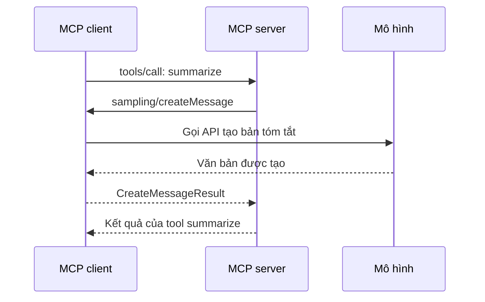
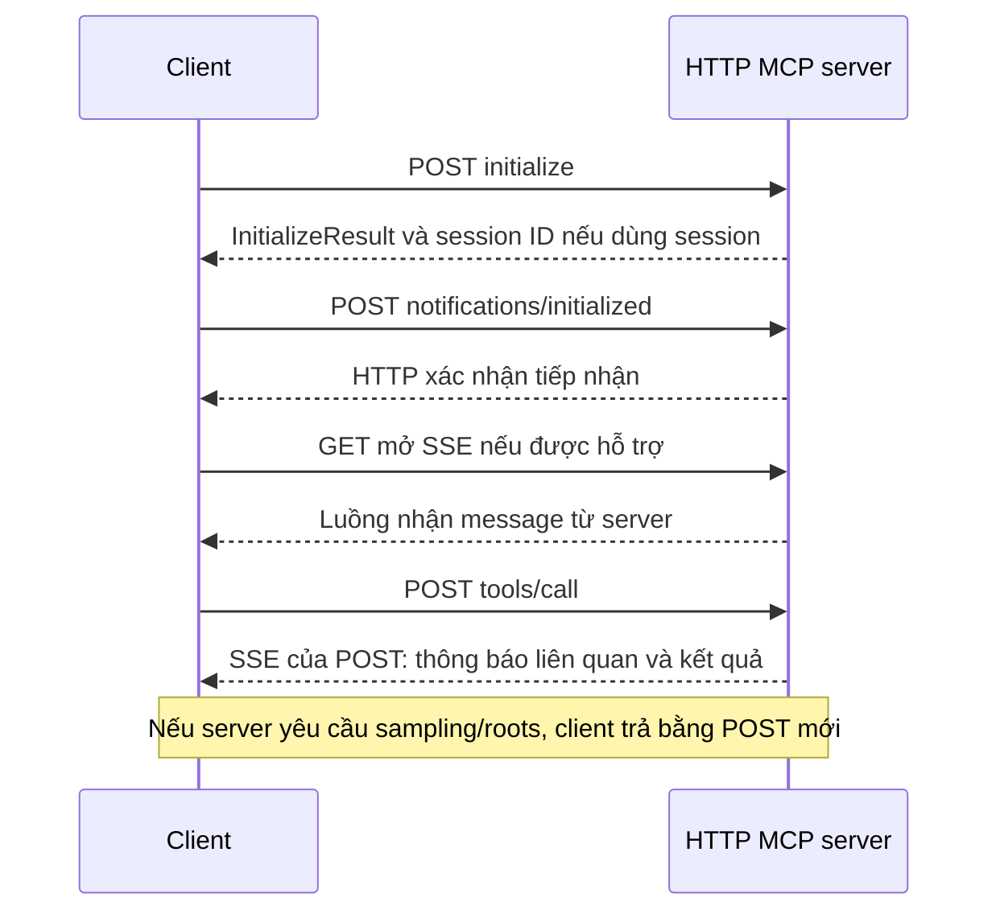

# Model Context Protocol: Advanced Topics — Giảng giải bằng tiếng Việt

Tài liệu học lại khóa **Model Context Protocol: Advanced Topics** của Anthropic Academy, giảng viên Stephen Grider.

- Khóa gốc: <https://anthropic.skilljar.com/model-context-protocol-advanced-topics>
- Ngày đọc và biên soạn: 15/10/2026.
- Đối tượng: người đã biết sơ bộ MCP và có thể đọc Python.
- Cách dùng: đọc theo thứ tự, làm các thao tác, rồi so kết quả với phần “Bạn cần thấy gì”.

## Phạm vi và cách phân biệt nội dung

Tôi đã mở đủ **15 mục** trong mục lục; đọc nội dung lý thuyết và toàn bộ các bước của ba walkthrough; đọc phụ đề hai video mở đầu/kết thúc; tải và xem mã nguồn trong `sampling.zip`, `notifications.zip`, `roots.zip` và `transport-http.zip`.

Đây là **bản giảng giải độc lập**, dùng cách diễn đạt và ví dụ bổ sung để giúp bạn hiểu và thực hành, không phải bản chép lời hoặc bản dịch nguyên văn video. Mỗi chương dẫn về bài gốc. Các phần ghi “Thực hành bổ sung” là bài tập do tôi soạn, không phải thao tác được xác nhận xuất hiện trong video.

Hai mục Survey và Assessment là biểu mẫu, không phải bài giảng. Tôi đã xem màn hình mở đầu và câu hỏi đầu tiên của mỗi mục; **không chọn đáp án, không gửi khảo sát hay nộp bài**. Tài liệu cung cấp cách thao tác và câu hỏi ôn tập tự soạn; không khẳng định đã đọc toàn bộ câu hỏi ẩn phía sau biểu mẫu.

Các lệnh dưới đây là hướng dẫn để bạn thực hiện. Tôi đã đọc mã nguồn nhưng **chưa chạy các ứng dụng mẫu, gọi API trả phí hay chuyển đổi video**. Những kết quả mô tả là kết quả dự kiến khi môi trường hoạt động đúng.

## Mục lục

1. [Let's get started! — Bức tranh toàn khóa](#bai-1)
2. [Sampling — Server nhờ client gọi mô hình](#bai-2)
3. [Sampling walkthrough — Sáu bước triển khai](#bai-3)
4. [Log and progress notifications — Thông báo khi đang làm](#bai-4)
5. [Notifications walkthrough — Bốn bước triển khai](#bai-5)
6. [Roots — Cho biết phạm vi tệp và thư mục](#bai-6)
7. [Roots walkthrough — Bảy bước triển khai](#bai-7)
8. [Survey — Khảo sát giữa khóa](#bai-8)
9. [JSON message types — Đọc thông điệp MCP](#bai-9)
10. [The STDIO transport — Giao tiếp qua tiến trình con](#bai-10)
11. [The StreamableHTTP transport — Đưa MCP lên HTTP](#bai-11)
12. [StreamableHTTP in depth — Theo dõi đường đi thông điệp](#bai-12)
13. [State and the StreamableHTTP transport — Trạng thái và mở rộng](#bai-13)
14. [Assessment on MCP concepts — Ôn tập cuối khóa](#bai-14)
15. [Wrapping up — Bước tiếp theo](#bai-15)

Phụ lục: [Tra cứu nhanh](#tra-cuu), [Lỗi thường gặp](#loi), [Bài tập tổng hợp](#tong-hop), [Nguồn và giới hạn phiên bản](#nguon).

## Chuẩn bị trước khi bắt đầu

### Hiểu đúng bốn vai trò

| Thành phần | Nhiệm vụ | Ví dụ trong khóa |
|---|---|---|
| Host | Ứng dụng chứa trải nghiệm người dùng và điều phối mô hình | Ứng dụng chat CLI |
| MCP client | Thành phần giữ kết nối MCP tới server | `ClientSession` trong Python |
| MCP server | Công bố và thực thi chức năng | Server tóm tắt, server cộng số, server video |
| Mô hình | Hiểu yêu cầu, suy luận và đề xuất gọi tool | Claude |

Trong mã mẫu, host và client có thể cùng nằm trong một chương trình. Vì thế người giảng đôi khi gọi gọn toàn bộ phía ứng dụng là “client”. Mô hình không tự mở ổ đĩa hay tự tạo kết nối mạng: ứng dụng và công cụ thực hiện các thao tác đó.

### Giữ môi trường giống mã mẫu

Các ZIP có `pyproject.toml` và `uv.lock`. Phiên bản MCP được khóa thực tế là:

| ZIP | Phiên bản `mcp` trong lockfile | Điểm khởi chạy |
|---|---:|---|
| `sampling.zip` | 1.9.3 | `uv run client.py` |
| `notifications.zip` | 1.9.3 | `uv run client.py` |
| `roots.zip` | 1.8.0 | `uv run main.py <thư-mục-root>` |
| `transport-http.zip` | 1.9.3 | `uv run main.py` |

API trong tài liệu chủ yếu theo **Python SDK 1.x của khóa**. Đừng xóa lockfile hoặc nâng SDK giữa lúc làm theo hướng dẫn: thay đổi phiên bản có thể làm tên lớp, chữ ký callback và hành vi transport khác đi. Kho SDK chính thức hiện có tài liệu di trú sang v2; khi nâng cấp, hãy đi theo [tài liệu SDK](https://github.com/modelcontextprotocol/python-sdk).

### Thao tác tải và mở ví dụ

1. Mở bài walkthrough hoặc bài về State bằng liên kết ở đầu chương tương ứng.
2. Tìm vùng **Downloads** và bấm tệp ZIP.
3. Giải nén mỗi ZIP vào một thư mục riêng, ví dụ `C:\MCP-Labs\sampling`.
4. Mở thư mục đó trong trình soạn mã.
5. Mở terminal **ngay tại thư mục chứa `pyproject.toml`**.
6. Kiểm tra công cụ:

```powershell
python --version
uv --version
```

7. Cài dependency theo lockfile:

```powershell
uv sync --locked
```

README gốc dùng `uv sync`; thêm `--locked` giúp phát hiện việc manifest và lockfile không còn khớp. Mã khóa yêu cầu Python từ 3.10; dùng bản Python tương thích với lockfile. Nếu chưa có `uv`, xem [hướng dẫn chính thức](https://docs.astral.sh/uv/getting-started/installation/).

Sampling và ứng dụng chat Roots cần API key hợp lệ. Notifications và ví dụ HTTP cộng số không cần gọi mô hình. Riêng chuyển đổi video còn cần FFmpeg trong `PATH`.

<a id="bai-1"></a>
## 1. Let's get started! — Bức tranh toàn khóa

[Mở bài gốc](https://anthropic.skilljar.com/model-context-protocol-advanced-topics/296349)

### Bài này muốn bạn hiểu gì?

Khóa cơ bản thường dừng ở việc “client gọi tool trên server”. Khóa này đi xa hơn: server có thể cần nhờ client làm việc, báo tiến độ, hỏi thư mục được phép sử dụng, rồi vận chuyển tất cả những thông điệp ấy qua các kiểu kết nối khác nhau.

Hãy tưởng tượng bạn xây trợ lý nghiên cứu. Người dùng yêu cầu một báo cáo. Server thu thập dữ liệu, nhưng còn phải giải quyết ba việc:

- **Viết bản tóm tắt:** server có nhất thiết phải tự giữ API key của mô hình không?
- **Cho người dùng biết đang làm:** trong lúc chờ, ứng dụng hiển thị gì?
- **Tìm tệp:** nếu người dùng chỉ nói tên tệp, ứng dụng biết tìm ở đâu?

Sampling, notifications và roots lần lượt giải quyết những nhu cầu đó. Phần sau khóa học hỏi tiếp: nếu server nằm trên một máy khác và giao tiếp qua HTTP, các tính năng này còn hoạt động như trên máy cá nhân không?

### Lộ trình tư duy

```text
Nhu cầu của server
  ├─ Cần mô hình sinh nội dung → Sampling
  ├─ Cần báo đang làm đến đâu → Logging / Progress
  └─ Cần biết phạm vi tệp → Roots

Các nhu cầu trên được đóng gói thành thông điệp JSON
  ├─ Chạy cục bộ → STDIO
  └─ Chạy từ xa → Streamable HTTP và bài toán trạng thái
```

### Thao tác học bài

1. Mở bài và phát video giới thiệu, thời lượng khoảng 1 phút 28 giây.
2. Đọc mục lục bên trái để nhận diện hai khối: tính năng MCP và transport.
3. Kiểm tra bạn có thể đọc `async def`, `await`, `async with` và tham số hàm Python.
4. Chuẩn bị một thư mục cho các lab, rồi chuyển sang Sampling.

**Bạn cần thấy gì:** hiểu được vai trò client/server/tool và biết vì sao phần HTTP cần được học sau phần thông điệp. Bài mở đầu không có lab lập trình riêng.

<a id="bai-2"></a>
## 2. Sampling — Server nhờ client gọi mô hình

[Mở bài gốc](https://anthropic.skilljar.com/model-context-protocol-advanced-topics/296288)

### Giải thích dễ hiểu

Sampling ở đây có nghĩa là **server đề nghị client tạo nội dung bằng một mô hình ngôn ngữ**. Đừng hiểu nó đơn thuần là tùy chỉnh ngẫu nhiên như temperature.

Ví dụ, server đã lấy được năm bài viết về pin xe điện. Server muốn rút thành báo cáo 300 từ. Nếu gọi API trực tiếp, server phải quản lý thông tin xác thực, tích hợp nhà cung cấp và chi phí. Với sampling, server gửi yêu cầu qua MCP; client quyết định cách gọi mô hình và trả nội dung về.

Trong mô hình triển khai của khóa, chi phí API nằm ở phía client. Đây là lựa chọn kiến trúc: MCP không tự quyết định ai trả tiền, không chuyển hóa đơn và không cung cấp lượt gọi miễn phí.

### Đường đi đầy đủ



Một lần gọi tool từ client có thể chứa một lần gọi ngược từ server. Client phải tiếp tục xử lý thông điệp trong khi chờ tool hoàn tất. Nếu chỉ “gửi yêu cầu rồi đứng chờ” mà không nhận yêu cầu ngược, chương trình có thể bị treo.

### Những thành phần cần có

| Phía server | Phía client |
|---|---|
| Tool nhận dữ liệu cần xử lý | Có kết nối tới mô hình |
| Tạo prompt | Có sampling callback |
| Gọi `ctx.session.create_message(...)` | Chuyển message MCP sang định dạng SDK mô hình |
| Kiểm tra nội dung trả về | Đóng gói `CreateMessageResult` |
| Tiếp tục xử lý hoặc trả kết quả tool | Gắn callback vào `ClientSession` |

### Thao tác theo dõi bài

1. Đọc ví dụ server thu thập dữ liệu rồi cần tóm tắt.
2. Tìm lời gọi `create_message` trong mã phía server.
3. Nhìn sang `sampling_callback` ở client: đây là nơi gọi API mô hình thật.
4. Theo dõi `CreateMessageResult` quay về server.
5. Kiểm tra client đã truyền callback khi tạo `ClientSession`.

**Bạn cần thấy gì:** API key có thể chỉ nằm ở client; server sử dụng khả năng tạo nội dung thông qua giao thức.

### Điều kiện cần nhớ

Client phải hỗ trợ sampling; có khả năng gọi tool không đồng nghĩa có khả năng xử lý sampling. Server gửi đề nghị, còn client kiểm soát mô hình và việc chấp nhận yêu cầu. Đặc tả mô tả capability `sampling` và khuyến nghị cho người dùng quyền xem, từ chối yêu cầu. [Đối chiếu đặc tả Sampling](https://modelcontextprotocol.io/specification/2025-06-18/client/sampling).

**Tự kiểm tra:** nếu server lấy được tài liệu nhưng thao tác tóm tắt cứ chờ mãi, hãy kiểm tra sampling callback và transport trước khi kết luận mô hình bị chậm.

<a id="bai-3"></a>
## 3. Sampling walkthrough — Sáu bước triển khai

[Mở bài gốc và tải `sampling.zip`](https://anthropic.skilljar.com/model-context-protocol-advanced-topics/295172)

### Trước tiên, mở đúng các tệp

Sau khi giải nén và chạy `uv sync --locked`, mở song song `server.py` và `client.py`.

- `server.py`: có tool `summarize`.
- `client.py`: khởi chạy server bằng STDIO, nhận sampling và gọi Anthropic.
- `pyproject.toml`: dependency.
- `uv.lock`: phiên bản cố định để tái tạo môi trường.

Trên trang walkthrough, các nút bước ở bên trái đổi phần giải thích và vùng mã được làm nổi bật. Bấm từng bước 1–6 hoặc dùng **Next →** bên trong walkthrough; nút **Next** ở cuối trang chuyển sang bài khác.

### Bước 1 — Khởi tạo yêu cầu sampling ở server

Trong `summarize`, nhận `text_to_summarize` và `ctx: Context`. Tạo prompt từ dữ liệu đầu vào. Gửi một `SamplingMessage` có vai trò `user` và nội dung `TextContent`.

Đoạn rút gọn theo API của mã mẫu:

```python
result = await ctx.session.create_message(
    messages=[
        SamplingMessage(
            role="user",
            content=TextContent(type="text", text=prompt),
        )
    ],
    max_tokens=4000,
    system_prompt="You are a helpful research assistant.",
)
```

`await` ở đây chờ phía client xử lý. Nó không có nghĩa server tự gọi Anthropic. `max_tokens` là giới hạn được đề nghị cho đầu ra; nội dung đầu vào không tự bị rút gọn chỉ vì bạn đặt giá trị này.

**Thao tác:** đặt con trỏ ở lời gọi trên và xác định rõ đâu là prompt, đâu là nội dung kiểu MCP, đâu là thông số sinh nội dung.

### Bước 2 — Viết sampling callback tại client

Callback nhận ngữ cảnh yêu cầu và `CreateMessageRequestParams`. Trong ví dụ, nó gọi hàm trợ giúp `chat(params.messages)`.

**Thao tác:** tìm `async def sampling_callback` trong `client.py`; sau đó lần theo `chat` để thấy lời gọi `anthropic_client.messages.create(...)`.

Bạn sẽ thấy hai tầng khác nhau: callback thuộc giao tiếp MCP; `messages.create` thuộc SDK nhà cung cấp mô hình.

### Bước 3 — Chuyển định dạng thông điệp

MCP biểu diễn nội dung bằng đối tượng như `TextContent(type="text", text=...)`. Anthropic SDK trong ví dụ nhận danh sách message có cấu trúc riêng. Hàm `chat` đọc từng message và tạo cấu trúc tương thích.

Ví dụ minh họa tối giản, chỉ hỗ trợ văn bản:

```python
messages = []
for message in input_messages:
    if message.content.type != "text":
        raise ValueError("Ví dụ này chỉ hỗ trợ nội dung văn bản")
    messages.append({
        "role": message.role,
        "content": message.content.text,
    })
```

**Thao tác:** kiểm tra cả nhánh `user` và `assistant` trong mã gốc. Đừng gửi thẳng danh sách đối tượng MCP vào SDK rồi mặc định hai định dạng giống nhau.

### Bước 4 — Trả văn bản trong `CreateMessageResult`

Sau khi có đầu ra mô hình, callback trả đối tượng chứa vai trò `assistant`, tên mô hình và nội dung văn bản.

```python
return CreateMessageResult(
    role="assistant",
    model=model,
    content=TextContent(type="text", text=text),
)
```

**Thao tác:** phân biệt `text` do mô hình sinh với đối tượng `CreateMessageResult` dùng để gửi qua MCP. Callback không chỉ trả một chuỗi tùy ý.

### Bước 5 — Gắn callback vào session

```python
async with ClientSession(
    read,
    write,
    sampling_callback=sampling_callback,
) as session:
    await session.initialize()
```

**Thao tác:** tìm tham số `sampling_callback=`. Định nghĩa hàm mà quên truyền vào session thì session chưa biết phải dùng hàm đó.

### Bước 6 — Server nhận và dùng kết quả

Sau khi `create_message` hoàn tất, server đọc `result.content`. Mẫu chỉ chấp nhận nội dung kiểu `text`; nếu nhận kiểu khác thì báo lỗi. Văn bản nhận được có thể được trả ngay, dùng để quyết định bước xử lý tiếp theo hoặc làm đầu vào một lần sampling khác.

**Thao tác:** lần từ `result.content.text` ở server tới `session.call_tool(...)` ở client. Đây là hai kết quả ở hai tầng khác nhau: kết quả sampling và kết quả tool.

### Chạy thử toàn bộ

1. Đặt API key cho terminal hiện tại. Trong PowerShell có thể nhập mà không để key xuất hiện trong lịch sử lệnh:

```powershell
$samplingKey = Read-Host "Anthropic API key" -AsSecureString
$env:ANTHROPIC_API_KEY = [System.Net.NetworkCredential]::new("", $samplingKey).Password
```

2. Trong `client.py`, thay chuỗi đầu vào `lots of text` bằng một đoạn ngắn, chẳng hạn:

```text
Nhóm triển khai tính năng A vào thứ Hai. Thứ Ba phát hiện lỗi xử lý
thời gian. Thứ Tư đã sửa lỗi và kiểm tra lại. Bản phát hành dự kiến thứ Sáu.
```

3. Kiểm tra biến `model` trong mã. Khóa dùng `claude-sonnet-4-0`; nếu tài khoản của bạn không hỗ trợ tên này, chọn model hợp lệ cho tài khoản trước khi chạy.
4. Từ thư mục lab, chạy:

```powershell
uv run client.py
```

5. Client tự tạo tiến trình `server.py`; không cần mở thêm một server STDIO riêng.
6. Quan sát nội dung tóm tắt được in ra. Câu chữ có thể thay đổi mỗi lần gọi mô hình.

**Bạn cần thấy gì:** có một kết quả tool chứa bản tóm tắt; server không giữ API key riêng để gọi Anthropic trong `summarize`.

### Chi tiết mã mẫu đáng chú ý

Callback gốc chỉ truyền `params.messages` vào `chat`, chưa chuyển tiếp đầy đủ `systemPrompt`, `maxTokens` hay các tùy chọn khác từ server. Khi phát triển thật, hãy ánh xạ các tùy chọn bạn hỗ trợ, đồng thời áp dụng giới hạn của client. Đừng suy ra rằng việc server đặt `system_prompt` bảo đảm model đã nhận system prompt ấy.

README trong ZIP có tiêu đề “Logging and Progress Demo”, nhưng mã thực tế là sampling. Hãy dựa vào tệp và hành vi, tránh nhầm sang lab Notifications.

**Thực hành bổ sung:** đổi yêu cầu thành “tóm tắt thành đúng ba gạch đầu dòng”; sau đó bỏ tham số callback khỏi session để quan sát lỗi thiếu hỗ trợ, rồi khôi phục lại.

<a id="bai-4"></a>
## 4. Log and progress notifications — Thông báo khi đang làm

[Mở bài gốc](https://anthropic.skilljar.com/model-context-protocol-advanced-topics/296284)

### Vì sao cần hai loại thông báo?

Người dùng bấm “Tạo báo cáo” rồi chờ 30 giây. Nếu giao diện không đổi, họ không biết ứng dụng đang xử lý hay đã hỏng.

- **Log** trả lời: “Hiện đang làm công đoạn nào? Có điều gì đáng chú ý?”
- **Progress** trả lời: “Đã hoàn thành bao nhiêu phần công việc?”
- **Tool result** trả lời: “Kết quả cuối cùng là gì?”

Ví dụ: “Đã đọc xong tài liệu” là log; `6/10` là tiến độ; đường dẫn báo cáo là kết quả cuối. Chúng không thay thế nhau.

### Server gửi thông báo bằng Context

Trong FastMCP của khóa, tool có thể nhận đối tượng được inject dựa trên kiểu `Context`. Người gọi tool không cần cung cấp đối tượng này trong JSON arguments.

```python
await ctx.info("Đang thu thập dữ liệu")
await ctx.report_progress(20, 100)
# ... xử lý ...
await ctx.info("Đang viết báo cáo")
await ctx.report_progress(70, 100)
```

Không bắt buộc tên tham số phải là `ctx`; bài lý thuyết dùng cả `context`. Điều cần nhận ra là vai trò và kiểu dữ liệu của nó.

### Client chọn cách hiển thị

Server gửi dữ liệu. Client quyết định in ra terminal, cập nhật thanh tiến độ hoặc chuyển thông tin tới giao diện web. Server không tự tạo giao diện người dùng chỉ bằng việc gọi `info()`.

| Loại ứng dụng | Cách trình bày có thể dùng |
|---|---|
| CLI | In log và phần trăm vào terminal |
| Web | Backend chuyển sự kiện tới trang bằng kênh cập nhật thích hợp |
| Desktop | Cập nhật nhãn trạng thái và progress bar |

### Thao tác theo dõi bài

1. Tìm các mốc công việc trong tool, ví dụ thu thập nguồn và viết báo cáo.
2. Gắn log vào các mốc có ý nghĩa.
3. Gắn tiến độ khi có cách ước lượng khối lượng đã xong.
4. Ở client, tìm logging callback được gắn vào session.
5. Tìm progress callback được gắn vào **từng lần gọi tool**.

**Bạn cần thấy gì:** client có thể nhận thông báo trước khi nhận kết quả cuối. Việc có hiển thị hay không tùy cách xây client.

### Đọc tiến độ cho đúng

`20/100` có thể là 20 phần việc trong 100, không nhất thiết là 20 giây trong 100 giây. Công thức phần trăm chỉ có ý nghĩa khi biết tổng và tổng lớn hơn 0. Nếu tổng không xác định, hiển thị số công việc đã làm hoặc trạng thái “đang xử lý”.

**Thực hành bổ sung:** với một danh sách 12 tệp, sau mỗi tệp báo `(đã_xử_lý, 12)` và log tên công đoạn. Tránh cập nhật hàng nghìn lần mỗi giây vì giao diện có thể không xử lý kịp.

<a id="bai-5"></a>
## 5. Notifications walkthrough — Bốn bước triển khai

[Mở bài gốc và tải `notifications.zip`](https://anthropic.skilljar.com/model-context-protocol-advanced-topics/291036)

Lab dùng phép cộng `1 + 3` để bạn tập trung vào thông báo thay vì nghiệp vụ phức tạp. Khoảng dừng hai giây trong server chỉ mô phỏng công việc chậm.

### Bước 1 — Tool nhận Context

Mở `server.py`, tìm `add(a: int, b: int, ctx: Context)`. `a` và `b` là dữ liệu người gọi truyền vào; `ctx` là ngữ cảnh FastMCP cung cấp.

**Thao tác:** so sánh chữ ký hàm với `arguments={"a": 1, "b": 3}` trong client. Không thêm một trường JSON tên `ctx`.

### Bước 2 — Gửi log và tiến độ

Mã mẫu thực hiện theo thứ tự:

```text
Log “Preparing to add...”
Tiến độ 20/100
Chờ hai giây
Log “OK, adding...”
Tiến độ 80/100
Trả a + b
```

Các mức log được phần walkthrough giới thiệu gồm `info`, `warning`, `debug`, `error`. Chọn mức theo ý nghĩa: trạng thái bình thường, tình huống cần chú ý, dữ liệu gỡ lỗi hoặc lỗi xử lý.

**Thao tác:** tìm từng `await ctx.info(...)` và `await ctx.report_progress(...)`. Đặt chúng gần công đoạn mà thông báo mô tả.

### Bước 3 — Định nghĩa hai callback phía client

Mở `client.py`:

- `logging_callback` nhận `LoggingMessageNotificationParams`; mã gốc in `params.data`.
- `print_progress_callback` nhận `progress`, `total`, `message`; mã gốc tính phần trăm khi có tổng.

Phiên bản minh họa bổ sung có xử lý tổng bằng 0:

```python
async def show_progress(progress, total, message):
    if total is not None and total > 0:
        print(f"{progress / total:.0%} — {message or ''}")
    else:
        print(f"Đã xử lý: {progress} — {message or ''}")
```

### Bước 4 — Gắn callback đúng chỗ

```python
async with ClientSession(
    read, write, logging_callback=logging_callback
) as session:
    await session.initialize()
    result = await session.call_tool(
        name="add",
        arguments={"a": 1, "b": 3},
        progress_callback=print_progress_callback,
    )
```

Logging callback thuộc session; progress callback thuộc lần gọi. Nhờ đó hai tác vụ có thể dùng hai cách hiển thị tiến độ khác nhau.

### Chạy và quan sát

1. Giải nén ZIP vào thư mục riêng và mở terminal ở đó.
2. Chạy `uv sync --locked`.
3. Chạy `uv run client.py`.
4. Quan sát log và các mốc khoảng 20%, 80%.
5. Nếu muốn nhìn cả kết quả cuối, sửa lời gọi trong mã gốc để gán vào `result`, rồi thêm `print(result.content)`.

**Bạn cần thấy gì:** log và progress xuất hiện trong lúc tool chạy. Phép cộng trả 4; tuy nhiên **client gốc không in kết quả cuối**, nên không thấy số 4 trên terminal chưa chứng minh tool bị lỗi. Mẫu cũng không báo 100%; kết quả hoàn tất vẫn có thể đến sau mốc 80%.

**Thực hành bổ sung:** thêm `report_progress(100, 100)` trước khi trả kết quả; chạy lại để đối chiếu trải nghiệm. Sau đó thử bỏ riêng progress callback để thấy log và progress là hai luồng dữ liệu riêng.

<a id="bai-6"></a>
## 6. Roots — Cho biết phạm vi tệp và thư mục

[Mở bài gốc](https://anthropic.skilljar.com/model-context-protocol-advanced-topics/296289)

### Bài toán thực tế

Người dùng nói: “Chuyển `biking.mp4` sang MOV”. Tool chuyển đổi cần đường dẫn cụ thể, nhưng câu nói chỉ có tên tệp. Mô hình không tự biết tệp nằm trong Desktop, Movies hay một ổ cứng khác.

Roots cung cấp danh sách những vị trí thuộc phạm vi làm việc. Ví dụ, client công bố root `C:\MCP-Labs\media`. Server có thể dựa vào phạm vi này để tìm tệp và kiểm tra thao tác truy cập.

Luồng trong bài:

1. Người dùng yêu cầu chuyển đổi video.
2. Mô hình gọi tool lấy danh sách root.
3. Mô hình gọi tool liệt kê thư mục trong root để tìm tên video.
4. Sau khi có đường dẫn đầy đủ, mô hình gọi tool chuyển đổi.

Đối với người dùng, câu lệnh vẫn ngắn gọn. Việc tìm đường dẫn được ứng dụng thực hiện bằng các tool có giới hạn phạm vi.

### Hai nghĩa cần tách ra

| Roots cung cấp | Phần ứng dụng phải tự làm |
|---|---|
| Danh sách vị trí phía client công bố | Xác thực từng yêu cầu đọc/ghi |
| Bối cảnh giúp tìm tệp | Chuẩn hóa và kiểm tra đường dẫn |
| Ranh giới làm việc mong muốn | Kiểm soát quyền hệ điều hành hoặc sandbox nếu cần |

**SDK không tự chặn mọi truy cập ngoài roots.** Nếu một tool bỏ qua kiểm tra, tiến trình server vẫn có thể dùng quyền hệ điều hành sẵn có để truy cập. Roots chỉ trở thành giới hạn được thực thi khi ứng dụng kiểm tra đúng.

Đặc tả sử dụng URI `file://` cho roots; server yêu cầu danh sách bằng `roots/list`. [Đối chiếu đặc tả Roots](https://modelcontextprotocol.io/specification/2025-06-18/client/roots).

### Ví dụ dễ nhớ

```text
Root được công bố: C:\MCP-Labs\media

Trong phạm vi:
  C:\MCP-Labs\media\biking.mp4
  C:\MCP-Labs\media\holidays\trip.mp4

Ngoài phạm vi:
  C:\MCP-Labs\private\notes.txt
  C:\MCP-Labs\media-backup\biking.mp4
```

Tên `media-backup` bắt đầu bằng chuỗi `media`, nhưng không phải thư mục con của `media`. Vì vậy không kiểm tra bằng `str(path).startswith(str(root))`.

### Thao tác học bài

1. Viết ra một root mà bạn thật sự muốn đưa vào lab.
2. Chọn một tệp trong root và một tệp nằm ngoài root.
3. Vẽ chuỗi `list_roots → read_dir → convert_video`.
4. Đánh dấu nơi mỗi tool phải kiểm tra đường dẫn.
5. Chuyển sang walkthrough để xem client cung cấp roots bằng callback.

**Bạn cần thấy gì:** root vừa giúp khám phá tệp, vừa là đầu vào cho chính sách truy cập. Nó không tự gửi nội dung tệp sang server và không tự gắn ổ đĩa của client vào máy chủ từ xa.

**Thực hành bổ sung:** nếu server chạy trên máy B, hãy tự hỏi đường dẫn `C:\...` thuộc máy A có tồn tại trên B không. Muốn xử lý tệp từ xa cần cơ chế truyền dữ liệu hoặc lưu trữ chia sẻ riêng; roots không thay thế cơ chế ấy.

<a id="bai-7"></a>
## 7. Roots walkthrough — Bảy bước triển khai

[Mở bài gốc và tải `roots.zip`](https://anthropic.skilljar.com/model-context-protocol-advanced-topics/295839)

### Nhìn cấu trúc chương trình trước

| Tệp | Vai trò |
|---|---|
| `main.py` | Đọc cấu hình, nhận roots từ dòng lệnh, tạo ứng dụng chat |
| `mcp_client.py` | Quản lý session và callback cung cấp roots |
| `mcp_server.py` | Tool `list_roots`, `read_dir`, `convert_video` và hàm kiểm tra |
| `core/utils.py` | Đổi URI tệp về đường dẫn |
| `core/video_converter.py` | Kiểm tra đầu vào và gọi FFmpeg |
| `.env.example` | Mẫu cấu hình API/model |

### Bước 1 — Người dùng xác định roots

`main.py` lấy các đối số sau tên chương trình bằng `sys.argv[1:]`. Danh sách đó được truyền vào `MCPClient(..., roots=root_paths)`.

**Thao tác:** tìm `root_paths` và lần theo nó tới hàm khởi tạo client. Chẳng hạn:

```powershell
uv run main.py "C:\MCP-Labs\media" "D:\PracticeVideos"
```

Hai chuỗi trên là hai root. Chỉ đưa vào những thư mục bạn muốn dùng trong bài thử.

### Bước 2 — Biến đường dẫn thành đối tượng Root

Client tạo `Path`, đổi thành đường dẫn tuyệt đối và đóng gói vào `Root(uri=..., name=...)`.

**Điều chỉnh bổ sung cho Windows:** mẫu gốc ghép chuỗi `file://{p}`. Dùng `Path.as_uri()` rõ ràng hơn để tạo URI đúng định dạng:

```python
path = Path(raw_path).resolve()
root = Root(uri=FileUrl(path.as_uri()), name=path.name or "Root")
```

Ví dụ đường dẫn Windows `C:\MCP-Labs\media` được biểu diễn dưới dạng URI `file:///C:/MCP-Labs/media`. Đường dẫn và URI có liên quan nhưng không phải cùng một kiểu chuỗi.

**Thao tác:** mở `_create_roots`, xác định chỗ chuyển đổi này; nếu dùng sửa đổi trên, giữ nguyên các import tương ứng trong mã mẫu.

### Bước 3 — Cung cấp roots qua callback

Client không cần gửi danh sách tự phát ở mọi thời điểm. Khi server yêu cầu roots, session gọi callback đã đăng ký:

```python
async def _handle_list_roots(self, context):
    return ListRootsResult(roots=self._roots)
```

Sau đó callback được gắn bằng `list_roots_callback=...` khi tạo `ClientSession`.

**Thao tác:** mở `connect()` trong `mcp_client.py`, tìm `list_roots_callback`. Mẫu chỉ gắn callback này khi danh sách roots không rỗng.

### Bước 4 — Server sử dụng roots theo hai cách

Server cần roots để:

1. Giúp mô hình biết chỗ tìm tệp.
2. Kiểm tra yêu cầu trước khi đọc thư mục hoặc chuyển đổi tệp.

Tool `list_roots` trong ví dụ phục vụ mục đích đầu. Có thể dùng một cách thiết kế khác là đưa thông tin roots vào prompt; walkthrough nêu cả hai lựa chọn.

**Thao tác:** tìm ba tool trong `mcp_server.py`. Tự phân loại tool nào phục vụ khám phá, tool nào thực hiện công việc cuối.

### Bước 5 — Server yêu cầu danh sách từ client

```python
roots_result = await ctx.session.list_roots()
client_roots = roots_result.roots
```

Lời gọi trên gửi request từ server sang client. Client chạy callback ở bước 3 rồi trả danh sách.

Có hai tên rất dễ nhầm:

- Tool `list_roots` do ví dụ tự xây để mô hình có thể gọi.
- Request MCP `roots/list` do server gửi qua `ctx.session.list_roots()`.

Tool của ví dụ có thể dùng request giao thức ở bên trong. Chúng không phải một đối tượng.

### Bước 6 — Viết hàm quyết định quyền truy cập

Mẫu có `is_path_allowed(requested_path, ctx)`. Hàm lấy roots, kiểm tra đường dẫn tồn tại và thử xác định nó có nằm trong root không.

**Thao tác:** đọc nhánh trả `False`, rồi đọc vòng lặp thử `relative_to(root_path)`. Nếu không root nào chứa đường dẫn thì từ chối.

Khi phát triển tiếp, cần xem xét đường dẫn chuẩn hóa, symlink/junction, root là tệp hay thư mục, và cả vị trí đầu ra. Đây là phần ứng dụng, không được bỏ qua chỉ vì đã dùng SDK.

Ví dụ bổ sung đơn giản cho bài tập có **roots là thư mục** và đường dẫn đã tồn tại:

```python
from pathlib import Path

def inside_directory_roots(requested: str, roots: list[str]) -> bool:
    target = Path(requested).resolve(strict=True)
    for raw_root in roots:
        root = Path(raw_root).resolve(strict=True)
        if root.is_dir() and target.is_relative_to(root):
            return True
    return False
```

Đoạn này minh họa kiểm tra quan hệ đường dẫn trên filesystem cục bộ; chưa phải sandbox hoàn chỉnh và chưa giải quyết mọi thay đổi filesystem đồng thời. Nó nhận đường dẫn đã đổi từ URI, không nhận trực tiếp chuỗi `file://`.

### Bước 7 — Áp dụng kiểm tra vào mọi tool liên quan

Trong mã gốc:

- `read_dir` chuyển đầu vào thành đường dẫn tuyệt đối, gọi `is_path_allowed`, rồi mới liệt kê.
- `convert_video` kiểm tra đầu vào và điều kiện cho phép trước khi chuyển đổi.

**Thao tác:** tìm mọi vị trí gọi `is_path_allowed`. Nếu bổ sung tool đọc tệp, đổi tên hoặc xóa tệp, bạn phải áp dụng chính sách tương ứng ở tool mới.

### Chạy ứng dụng chat

1. Chuẩn bị thư mục thử, chẳng hạn `C:\MCP-Labs\media`, cùng một bản sao video nhỏ.
2. Từ thư mục đã giải nén, tạo `.env` theo mẫu:

```powershell
Copy-Item .env.example .env
```

3. Mở `.env`, nhập API key và model bạn có quyền sử dụng. Đây là cấu hình của ứng dụng chat; không dán key vào hội thoại.
4. Kiểm tra công cụ chuyển đổi nếu bạn định dùng tính năng video:

```powershell
ffmpeg -version
```

5. Cài dependency và chạy ứng dụng:

```powershell
uv sync --locked
uv run main.py "C:\MCP-Labs\media"
```

6. Trong CLI, thử hỏi: “Những thư mục nào đang nằm trong phạm vi làm việc?”
7. Tiếp tục: “Liệt kê tệp trong thư mục media”.
8. Khi đã thấy `biking.mp4`, hỏi: “Chuyển biking.mp4 sang định dạng mov”.
9. Kiểm tra đường dẫn đầu ra được tool trả về và tệp thực tế trong thư mục.
10. Thử yêu cầu đọc một thư mục nằm ngoài root để kiểm tra nhánh từ chối.

**Bạn cần thấy gì:** ứng dụng tìm đường dẫn từ danh sách roots, chuyển đổi được tệp trong phạm vi, từ chối truy cập ngoài phạm vi. Nếu mô hình không gọi tool đúng, có thể kiểm tra trực tiếp các tool thay vì chỉ dựa vào cách diễn đạt trong chat.

### Lưu ý khi đọc mã mẫu

Đừng lấy nhánh “nếu là tệp thì kiểm tra thư mục cha” làm quy tắc tổng quát. Khi roots có thể là một tệp cụ thể, kiểm tra thư mục cha có thể cho kết quả không đúng ý định. Hãy xác định rõ chính sách của ứng dụng: roots chỉ là thư mục, hay cho phép cả tệp.

README gốc có lệnh cài FFmpeg cho macOS. Trên Windows, cần dùng bản FFmpeg phù hợp và bảo đảm `ffmpeg -version` chạy được; lệnh `brew` không phải lệnh dành cho PowerShell.

<a id="bai-8"></a>
## 8. Survey — Khảo sát giữa khóa

[Mở mục khảo sát](https://anthropic.skilljar.com/model-context-protocol-advanced-topics/297276)

Trang hiển thị khảo sát mức độ hài lòng, **3 câu hỏi**. Câu đầu hỏi cảm nhận của bạn về khóa học tới thời điểm này.

### Thao tác trên trang

1. Mở **Survey** trong mục lục.
2. Bấm **Start** để mở biểu mẫu.
3. Đọc câu hỏi và tự chọn mức đánh giá phù hợp với trải nghiệm.
4. Bấm **Next Question** để chuyển câu theo giao diện.
5. Kiểm tra câu trả lời trước khi gửi ở cuối biểu mẫu.

Tôi không chọn hay gửi câu trả lời thay bạn. Hai câu sau không được xác nhận trong lần đọc này, nên tài liệu không suy đoán nội dung của chúng.

### Tự tổng kết trước khi sang HTTP

Bạn nên có thể giải thích ba câu sau bằng lời của mình:

- Sampling: server nhờ client gọi mô hình.
- Notifications: server gửi thông tin trong khi tác vụ đang chạy.
- Roots: client công bố phạm vi tệp; server phải tự thực thi kiểm tra truy cập.

Nếu chưa rõ một ý, quay lại walkthrough tương ứng. Phần transport tiếp theo sẽ giải thích vì sao các luồng này có thể thay đổi khi chuyển từ cục bộ sang HTTP.

<a id="bai-9"></a>
## 9. JSON message types — Đọc thông điệp MCP

[Mở bài gốc](https://anthropic.skilljar.com/model-context-protocol-advanced-topics/296290)

### Vì sao cần đọc JSON?

SDK giúp bạn gọi `session.call_tool(...)`, nhưng bên dưới là các thông điệp. Khi hiểu cấu trúc đó, bạn có thể đọc log, kiểm tra bắt tay kết nối và tìm ra chỗ một yêu cầu bị mất.

Khóa nhấn mạnh hai nhóm: request–result và notification. Trong thực hành cũng phải nhận ra phản hồi lỗi: một request được xử lý có thể nhận kết quả thành công hoặc lỗi, không phải lúc nào cũng có `result`.

### Ví dụ 1 — Request gọi tool

Ví dụ tự soạn theo cấu trúc thông điệp dùng trong khóa:

```json
{
  "jsonrpc": "2.0",
  "id": 21,
  "method": "tools/call",
  "params": {
    "name": "add",
    "arguments": {"a": 2, "b": 7}
  }
}
```

Đọc thành câu: “Yêu cầu số 21: hãy gọi tool add với hai số 2 và 7”. `id` giúp ghép phản hồi đúng yêu cầu; nó không phải tên tool.

### Ví dụ 2 — Phản hồi thành công

```json
{
  "jsonrpc": "2.0",
  "id": 21,
  "result": {
    "content": [{"type": "text", "text": "9"}]
  }
}
```

Cùng `id: 21`, nên client biết đây là phản hồi cho yêu cầu trên. Một SDK có thể thêm những trường đầu ra khác; không cần mặc định phản hồi thực tế chỉ có các trường trong ví dụ tối giản.

### Ví dụ 3 — Notification

```json
{
  "jsonrpc": "2.0",
  "method": "notifications/progress",
  "params": {
    "progressToken": "job-demo",
    "progress": 3,
    "total": 10
  }
}
```

Notification không có `id` yêu cầu để chờ một result tương ứng. `progressToken` dùng để liên hệ tiến độ với công việc; đừng nhầm nó với `id` của request.

### Ví dụ 4 — Phản hồi lỗi

```json
{
  "jsonrpc": "2.0",
  "id": 21,
  "error": {
    "code": -32602,
    "message": "Invalid params"
  }
}
```

Nếu ghi log chỉ tìm trường `result`, bạn có thể bỏ sót lý do thất bại. Lỗi thực thi tool cũng có thể được SDK biểu diễn trong kết quả tool; vì vậy hãy xem cả nội dung phản hồi, không chỉ HTTP status.

### Nhận diện hướng thông điệp

| Tình huống | Ai khởi tạo? | Ai phản hồi? |
|---|---|---|
| Gọi tool, liệt kê prompt, đọc resource | Client | Server |
| Sampling, yêu cầu roots | Server | Client |
| Log, progress | Server | Không có result JSON-RPC tương ứng |
| Báo đã initialize xong | Client | Không có result JSON-RPC tương ứng |

Điểm mấu chốt: **MCP có giao tiếp hai chiều**. Server không chỉ là bên trả lời tool call.

### Thao tác theo bài

1. Mở đặc tả MCP được bài nhắc tới, phân biệt nó với kho mã SDK.
2. Tìm các kiểu Call Tool, Initialize, Create Message và List Roots.
3. Đọc tên trường bằng cách đối chiếu với ví dụ cụ thể.
4. Với mỗi message, tự đánh dấu: request, response hay notification.
5. Vẽ mũi tên client → server hoặc server → client.

Đặc tả có thể dùng TypeScript để mô tả kiểu dữ liệu. Điều đó không yêu cầu ứng dụng MCP của bạn phải viết bằng TypeScript; Python vẫn tạo và đọc thông điệp theo cùng cấu trúc.

**Bạn cần thấy gì:** nhìn một log JSON là biết ai đang yêu cầu ai và có phải chờ phản hồi không.

<a id="bai-10"></a>
## 10. The STDIO transport — Giao tiếp qua tiến trình con

[Mở bài gốc](https://anthropic.skilljar.com/model-context-protocol-advanced-topics/296291)

### Transport là gì?

JSON là nội dung thông điệp. Transport là cách vận chuyển nội dung đó. Bạn có thể giữ nguyên việc “gọi add” nhưng truyền qua luồng tiến trình thay vì HTTP.

Với STDIO trong khóa, client tạo server thành tiến trình con:

```text
MCP client                            MCP server (tiến trình con)
     ───────── ghi vào stdin ──────────────>
     <──────── đọc từ stdout ──────────────
```

Cả request của server lẫn response của server đều đi qua stdout của server. Chiều luồng không quyết định đó là request hay response; cấu trúc thông điệp mới quyết định.

### Bốn kịch bản cần thuộc

| Kịch bản | Luồng được sử dụng |
|---|---|
| Client gọi tool | Client ghi request vào stdin của server |
| Server trả kết quả tool | Server ghi response ra stdout |
| Server yêu cầu sampling/roots | Server ghi request ra stdout |
| Client trả kết quả sampling/roots | Client ghi response vào stdin của server |

Mô hình này phù hợp khi client và tiến trình server chạy cùng môi trường máy cục bộ. Không có URL công khai mà client trên một máy bất kỳ tự truy cập được.

### Bắt tay ba thông điệp

```text
1. Client → Server: initialize request
2. Server → Client: initialize result
3. Client → Server: notifications/initialized
```

Sau đó mới chuyển sang hoạt động thông thường theo các capability đã thương lượng. `session.initialize()` trong SDK xử lý trình tự này cho bạn. Việc một API trả được kết quả khi bỏ qua bắt tay không phải bằng chứng rằng mọi client MCP đều được phép bỏ qua bước đó. [Đối chiếu vòng đời MCP](https://modelcontextprotocol.io/specification/2025-06-18/basic/lifecycle).

### Thực hành nhập JSON bằng terminal

Khóa giới thiệu cách chạy server rồi gửi thông điệp trực tiếp. Có thể dùng `server.py` của lab Notifications để tránh phụ thuộc API model.

1. Mở terminal trong thư mục Notifications.
2. Chạy `uv run server.py`.
3. Server có thể trông như đang đứng yên: nó đang chờ stdin, chưa hẳn bị treo.
4. Dán request initialize sau trên **một dòng**, rồi Enter:

```json
{"jsonrpc":"2.0","id":1,"method":"initialize","params":{"protocolVersion":"2024-11-05","capabilities":{},"clientInfo":{"name":"manual-client","version":"0.1.0"}}}
```

5. Đọc result: xác nhận server phản hồi phiên bản mà client của bạn hiểu. Ví dụ chọn phiên bản lịch sử để phù hợp thời kỳ mã mẫu; không tự coi đây là phiên bản mới nhất.
6. Gửi thông báo sẵn sàng:

```json
{"jsonrpc":"2.0","method":"notifications/initialized"}
```

7. Liệt kê tool:

```json
{"jsonrpc":"2.0","id":2,"method":"tools/list"}
```

8. Gọi `add`:

```json
{"jsonrpc":"2.0","id":3,"method":"tools/call","params":{"name":"add","arguments":{"a":2,"b":7}}}
```

9. Ghép response với `id: 3`; nội dung kết quả tương ứng phép cộng là 9.
10. Dừng lab khi xong, chẳng hạn bằng `Ctrl+C` tại terminal.

**Bạn cần thấy gì:** initialize có phản hồi, initialized không đòi một result, tools/list có mô tả `add`, tools/call trả kết quả sau khi xử lý.

Các message STDIO phải được phân tách bằng dòng mới; stdout của server chỉ dành cho thông điệp MCP hợp lệ. Log chẩn đoán thuần văn bản nên đưa sang stderr, chẳng hạn `print("debug", file=sys.stderr)`, hoặc dùng API logging MCP. [Quy tắc STDIO](https://modelcontextprotocol.io/specification/2025-06-18/basic/transports).

**Thực hành bổ sung:** thêm `_meta.progressToken` vào `params` của tool call, như ví dụ HTTP ở chương 12, để tìm thông báo progress cùng token. Nếu client không yêu cầu báo tiến độ, đừng mặc định sẽ có sự kiện tiến độ.

<a id="bai-11"></a>
## 11. The StreamableHTTP transport — Đưa MCP lên HTTP

[Mở bài gốc](https://anthropic.skilljar.com/model-context-protocol-advanced-topics/296287)

### Đổi transport để làm gì?

Bạn đã có server chạy trên laptop. Bây giờ muốn một ứng dụng trên máy khác dùng server đó. STDIO giữa client và tiến trình con không trực tiếp đáp ứng mô hình triển khai này. Streamable HTTP cho phép client truy cập server bằng một endpoint HTTP.

Điều khó nằm ở hướng ngược. Client biết URL server nên dễ gửi request. Server thường không có một URL công khai của client để chủ động gọi vào. Trong khi đó sampling và roots lại cần server gửi yêu cầu sang client.

### Phân biệt request ở hai tầng

Đây là điểm dễ nhầm nhất của phần HTTP:

- **HTTP request**: lần gọi mạng như GET hoặc POST.
- **MCP request**: đối tượng JSON có `method` và `id` yêu cầu bên kia xử lý.

Một MCP request từ server có thể nằm **bên trong HTTP response** đang được stream về client. Vì vậy câu “server không khởi tạo được HTTP request tới client” không có nghĩa “server không gửi được MCP request tới client”.

### SSE giải quyết vấn đề ra sao?

Server-Sent Events giữ một HTTP response mở và gửi thêm các sự kiện trong response đó. Tưởng tượng client mở một đường nhận tin; server đưa thông điệp MCP lên đường đang mở ấy.

SSE chỉ đẩy dữ liệu theo hướng server → client. Khi cần trả lời một MCP request của server, client gửi một HTTP POST mới về endpoint. Kết hợp hai chiều này, MCP tiếp tục trao đổi hai chiều trên HTTP.

### Hai tùy chọn của SDK trong khóa

```python
mcp = FastMCP(
    "demo",
    stateless_http=False,
    json_response=False,
)
```

- `stateless_http`: cách SDK quản lý trạng thái giữa các HTTP request.
- `json_response`: chọn trả POST bằng một kết quả JSON thay cho luồng SSE.

Hai trục này khác nhau. Một server có thể giữ session nhưng trả POST bằng JSON; cũng có thể không giữ session liên request mà vẫn dùng streaming cho một response.

### Thao tác theo dõi bài

1. Ghi lại những tính năng ứng dụng của bạn dùng: gọi tool, sampling, roots, log, progress hay subscription.
2. Với từng tính năng, đánh dấu có cần server gửi message sang client không.
3. Đọc cấu hình FastMCP; tìm chính xác hai cờ trên.
4. Đừng chỉ kiểm tra “tool add trả đúng số”. Hãy kiểm tra riêng các luồng gửi ngược.
5. Chuyển sang bài chuyên sâu để quan sát từng HTTP request và response.

**Bạn cần thấy gì:** chuyển từ STDIO sang HTTP không chỉ là đổi một dòng tên transport. Phải bảo đảm những đường truyền mà tính năng cần vẫn tồn tại và client thật sự xử lý chúng.

### Cách hiểu đúng cảnh báo trong khóa

Khóa dùng các cấu hình hạn chế để cho thấy log, progress hay sampling có thể mất hoặc thất bại. Đó là cảnh báo thực hành có ích, nhưng không nên biến thành quy tắc “HTTP không hỗ trợ sampling” hoặc “bật một cờ là mọi notification đều biến mất”. Hành vi cụ thể còn phụ thuộc phiên bản SDK, cách định tuyến message và những stream đang mở. Chương 13 ghi rõ phạm vi của từng cấu hình.

<a id="bai-12"></a>
## 12. StreamableHTTP in depth — Theo dõi đường đi thông điệp

[Mở bài gốc](https://anthropic.skilljar.com/model-context-protocol-advanced-topics/296286)

### Mô hình được bài giảng sử dụng

Bài mô tả một session có trạng thái với:

1. Request initialize và response.
2. Session ID để nhận diện các request cùng phiên.
3. Notification initialized.
4. Luồng SSE từ GET để nhận thông điệp server chủ động gửi.
5. Những POST gọi tool có thể trả bằng SSE riêng trong thời gian thực thi.

Có thể hình dung một quầy nhận tin chung và một luồng xử lý cho công việc cụ thể. Khi công việc kết thúc, luồng POST của nó đóng; luồng nhận tin chung có thể còn mở.



Trong triển khai được khóa minh họa, progress được theo dõi qua luồng GET, còn log gắn tool và kết quả tool qua luồng POST. Dùng đây làm mô hình để đọc ví dụ, không mặc định mọi SDK đều định tuyến giống nhau.

**Đối chiếu đặc tả:** GET SSE là tùy chọn; session ID cũng tùy chọn. Nếu server cấp ID, client phải gửi lại ID trong request tiếp theo. POST có thể trả JSON hoặc SSE. Vì vậy “luôn có đúng hai luồng SSE” không phải yêu cầu chung. [Đặc tả Streamable HTTP](https://modelcontextprotocol.io/specification/2025-06-18/basic/transports).

### Thực hành với demo HTTP tải kèm khóa

Tệp `transport-http.zip` nằm trong Downloads của bài State ở chương sau. Đây là chương trình demo bổ sung cho cụm bài HTTP, gồm `main.py` và `index.html`.

#### Thao tác 1 — Mở mã server

Mở `main.py`. Bạn sẽ thấy:

- Một `FastMCP`.
- Tool `add` có log, chờ hai giây và báo progress.
- Route `/` phục vụ `index.html`.
- Server chạy bằng `mcp.run(transport="streamable-http")`.

**ZIP thực tế đặt cả `stateless_http=True` và `json_response=True`.** Đây là cấu hình cuối để quan sát giới hạn, không phải cấu hình tốt nhất để bắt đầu xem đầy đủ session/SSE.

#### Thao tác 2 — Chuẩn bị chế độ quan sát đầy đủ

Trong bản sao lab, sửa hai cờ về:

```python
stateless_http=False,
json_response=False,
```

Lưu tệp. Mục đích là quan sát session và streaming trước, rồi mới bật từng cờ để so sánh.

#### Thao tác 3 — Chạy server và mở trang demo

```powershell
uv sync --locked
uv run main.py
```

Mở `http://localhost:8000/` theo cấu hình demo. Nếu terminal báo cổng hoặc host khác, dùng địa chỉ thực tế đó và sửa biến `serverUrl` trong HTML cho khớp. Mã HTML của ZIP đang dùng `http://localhost:8000/mcp/`.

Trang có tiêu đề **MCP Protocol Demo**, các khối Initialize Request, Initialized Notification, Tool Call và vùng GET SSE.

#### Thao tác 4 — Gửi Initialize Request

1. Bấm **Send Initialize Request**.
2. Đọc cột response: tìm kết quả initialize và các header.
3. Với chế độ stateful, tìm `mcp-session-id`.
4. Ghi lại ID đó để hiểu các request kế tiếp đang thuộc cùng session.

HTML gốc gửi phiên bản giao thức lịch sử `2024-11-05`. Khi làm theo đúng lockfile, hãy quan sát phiên bản server thương lượng. Nếu thay SDK/protocol, cần cập nhật cả client demo cho tương thích, không chỉ thay một chuỗi cho giống tài liệu mới.

#### Thao tác 5 — Gửi Initialized Notification

1. Bấm **Send Initialized Notification**.
2. Kiểm tra request có header session khi server đã cấp session.
3. Quan sát phản hồi HTTP tiếp nhận notification.

HTTP 202 là xác nhận tầng vận chuyển, không phải một `result` JSON-RPC dành cho notification.

#### Thao tác 6 — Mở GET SSE

1. Tìm nút **Start GET SSE**.
2. Nếu nút khả dụng, bấm để mở luồng nhận thông điệp server.
3. Luồng có thể ở trạng thái chờ lâu; với SSE, đây là trạng thái bình thường.

**Chi tiết trong ZIP:** nút này đang có `disabled`, và dòng bật nút trong `updateSessionId` bị comment. Để dùng giao diện với chế độ stateful, trong hàm `updateSessionId(id)` hãy bật nút khi có ID:

```javascript
document.getElementById("sse-start-button").disabled = !id;
```

Lưu HTML, tải lại trang demo và initialize lại. Đây là điều chỉnh bổ sung khi thực hành; không phải thao tác đã được chạy trong lần biên soạn tài liệu này. Nút bị khóa trong giao diện không tự chứng minh server không hỗ trợ GET SSE.

#### Thao tác 7 — Gọi Add Tool

1. Bấm **Call Add Tool**.
2. HTML gửi `a=5`, `b=3`, đồng thời có progress token.
3. Quan sát log xuất hiện trước kết quả cuối nếu luồng tương ứng đang hoạt động.
4. Tìm kết quả phép cộng là 8.

Request minh họa rút gọn từ demo:

```json
{
  "jsonrpc": "2.0",
  "id": 3,
  "method": "tools/call",
  "params": {
    "_meta": {"progressToken": "abc"},
    "name": "add",
    "arguments": {"a": 5, "b": 3}
  }
}
```

#### Thao tác 8 — Quan sát bằng Network

Thực hành bổ sung để nhìn rõ điều đang diễn ra:

1. Nhấn `F12`, mở **Network** của Chrome.
2. Tìm request tới `/mcp/`.
3. Mở **Headers** để xem method, content type và session ID.
4. Với POST trả streaming, tìm `text/event-stream`.
5. Với GET SSE, để ý request còn mở khi đang nhận sự kiện.
6. Khi tool kết thúc, kiểm tra POST tương ứng đã nhận result.

Trên phiên bản protocol yêu cầu header phiên bản, gửi `MCP-Protocol-Version` đã thương lượng trong các request sau initialize. [Quy tắc header](https://modelcontextprotocol.io/specification/2025-06-18/basic/transports).

**Bạn cần thấy gì:** phân biệt được HTTP request, message MCP nằm trong request/response và stream mang message. Không còn nhầm “POST trả response” với “response đó chỉ được chứa đúng một kết quả ngay lập tức”.

### Nếu muốn quan sát sampling qua HTTP

Ví dụ HTTP tải kèm chỉ có tool cộng số; nó không có callback sampling hoàn chỉnh. Muốn thử sampling, bạn phải bổ sung client HTTP hỗ trợ callback và nối nó với server có tool sampling. Chỉ bấm nút Add không kiểm tra được sampling. Đây là bước mở rộng, không phải chức năng đã có sẵn trong ZIP HTTP.

<a id="bai-13"></a>
## 13. State and the StreamableHTTP transport — Trạng thái và mở rộng

[Mở bài gốc và tải `transport-http.zip`](https://anthropic.skilljar.com/model-context-protocol-advanced-topics/296285)

### “State” ở đây là gì?

Trong cụm bài này, state chủ yếu là thông tin gắn với session/kết nối MCP: client nào, luồng nhận nào và những request đang chờ nào thuộc cùng một cuộc trao đổi.

Đừng tự đồng nhất nó với toàn bộ lịch sử chat hoặc database nghiệp vụ. Một server có transport stateless vẫn có thể đọc database, lưu tệp và gọi API. Từ “stateless” phải được hiểu theo lớp đang nói tới.

### Vì sao load balancer làm bài toán khó hơn?

Giả sử có hai instance A và B:

```text
                     ┌─ Instance A: giữ GET SSE của client
Client → Load balancer
                     └─ Instance B: nhận POST gọi tool
```

Tool chạy ở B muốn hỏi client về roots hoặc sampling, nhưng luồng nhận của client đang ở A. Nếu A và B không chia sẻ hoặc phối hợp trạng thái, B không có sẵn đường gửi ngược đúng session.

Đó là vấn đề kiến trúc được bài đưa ra, không phải lỗi số học trong tool. Chỉ tăng thêm instance chưa đủ để ứng dụng hoạt động đúng.

### `stateless_http=True`

Trong SDK 1.9.3 của ví dụ, session manager tạo transport mới cho từng HTTP request và không giữ session ID giữa các request. Điều này giúp các request độc lập dễ được phân phối, nhưng phá vỡ giả định “request sau tiếp tục đúng phiên đang giữ các kênh trước”. [Mã session manager v1.9.3](https://raw.githubusercontent.com/modelcontextprotocol/python-sdk/v1.9.3/src/mcp/server/streamable_http_manager.py).

Bài giảng nêu các hệ quả đối với sampling, progress và subscription. Hãy hiểu trọng tâm là các tính năng phụ thuộc vào session và luồng gửi ngược phải được xem lại; đừng suy ra server không thể gọi mô hình bằng API trực tiếp.

**Sampling và gọi API trực tiếp là hai cách khác nhau.** Nếu server có key và chủ động gọi SDK nhà cung cấp, thao tác đó không phải sampling qua MCP client và không biến mất chỉ vì bật stateless transport.

### `json_response=True`

POST chờ kết quả cuối rồi trả một đối tượng JSON, thay vì đưa nhiều message trung gian qua response SSE. Trong mã transport v1.9.3, nhánh này chờ response và không chuyển những request/notification trung gian trên luồng POST đó ra ngoài. Những message đi trên một GET SSE riêng phải được xem xét riêng. [Mã transport v1.9.3](https://raw.githubusercontent.com/modelcontextprotocol/python-sdk/v1.9.3/src/mcp/server/streamable_http.py).

Vì vậy, nếu tool đang chờ một sampling request mà request đó không tới client, tool có thể không đi tới bước tạo kết quả cuối. Không phải cứ chọn JSON response là mọi tool luôn hoàn tất được.

### Bảng đọc cấu hình

Bảng này dùng để thiết kế thử nghiệm, không phải cam kết mọi tính năng giống nhau trên mọi phiên bản:

| `stateless_http` | `json_response` | Điều cần quan sát |
|---:|---:|---|
| `False` | `False` | Session và streaming POST; có thể dùng thêm GET SSE |
| `False` | `True` | Vẫn giữ session; POST chỉ trả JSON cuối, nên kiểm tra message trung gian và GET riêng |
| `True` | `False` | Transport mới theo request; POST có thể stream, nhưng không có phiên bền giữa các request |
| `True` | `True` | Hợp với tool độc lập chỉ cần kết quả cuối; không dựa vào luồng nhiều request của một session |

Mã SDK và khóa học đủ để thấy **hai cờ không đồng nghĩa**. Đặc biệt, không dùng “không có session” như từ đồng nghĩa với “không stream”. Việc progress/log cụ thể đi được hay không còn tùy đường định tuyến.

### Thực hành so sánh bốn cấu hình

1. Dùng bản sao `transport-http` ở chương 12.
2. Bắt đầu với `False/False`, initialize và gọi Add.
3. Ghi lại: có session ID không; POST có SSE không; thấy log/progress nào; kết quả cuối là gì.
4. Dừng server, đổi **chỉ** `json_response=True`.
5. Khởi động lại, tải lại trang và initialize lại. Đừng dùng session ID cũ.
6. Lặp lại và so với lần đầu.
7. Đổi thành `stateless_http=True, json_response=False`, khởi động lại và kiểm tra.
8. Cuối cùng dùng `True/True`, đúng cấu hình ZIP gốc, để so sánh.

Mẫu ghi kết quả:

| Cấu hình | Có session ID? | Content-Type POST | Log nhận được | Progress nhận được | Kết quả Add |
|---|---|---|---|---|---|
| False / False | … | … | … | … | … |
| False / True | … | … | … | … | … |
| True / False | … | … | … | … | … |
| True / True | … | … | … | … | … |

Đừng điền bảng từ trí nhớ. Mục đích bài tập là thấy hành vi của **đúng phiên bản bạn đang chạy**. Nếu nút GET SSE bị khóa, xem điều chỉnh giao diện ở chương 12 trước khi kết luận về transport.

### Điểm cần đính chính khi áp dụng bài giảng

Khóa nói stateless có thể cho phép gọi thẳng mà không cần initialize. SDK mẫu có chế độ xử lý riêng phục vụ mục đích này; không nên chuyển thành quy tắc chung rằng “MCP stateless không cần bắt tay”. Khi viết client tương thích, vẫn thực hiện lifecycle và thương lượng capability theo protocol mà hai bên hỗ trợ. [Vòng đời chính thức](https://modelcontextprotocol.io/specification/2025-06-18/basic/lifecycle).

### Chọn kiến trúc theo nhu cầu

- Tool độc lập, nhận đầu vào và trả kết quả cuối: chế độ đơn giản có thể phù hợp.
- Cần sampling hoặc roots trong khi tool chạy: kiểm tra client, session và đường gửi request ngược.
- Cần subscription dài hạn: phải thiết kế việc duy trì và định tuyến thông báo.
- Cần nhiều instance nhưng vẫn giữ session: có thể phải dùng định tuyến ổn định, phối hợp trạng thái hoặc thiết kế hạ tầng khác; đây là mở rộng kiến trúc ngoài ví dụ tối giản của khóa.

**Bạn cần thấy gì:** tự giải thích được vì sao một tool chạy tốt bằng STDIO có thể thất bại trên HTTP dù mã nghiệp vụ không thay đổi. Hãy thử bằng transport dùng thật trước khi triển khai.

<a id="bai-14"></a>
## 14. Assessment on MCP concepts — Ôn tập cuối khóa

[Mở bài đánh giá](https://anthropic.skilljar.com/model-context-protocol-advanced-topics/296301)

Trang hiển thị **10 câu hỏi**. Tôi đã mở màn hình làm bài và đọc câu đầu về việc server cần tóm tắt bằng mô hình nhưng không muốn tự quản lý chi phí API. Các câu sau chưa được xác nhận vì cần tiếp tục biểu mẫu. Phần dưới là **bộ ôn tập tự soạn**, không phải bản sao đề thi hay khẳng định về toàn bộ nội dung đề.

### Thao tác làm bài trên trang

1. Ôn lại bảng tra cứu cuối tài liệu.
2. Mở mục Assessment, bấm **Start** nếu còn ở màn hình giới thiệu.
3. Đọc kỹ tình huống và chọn phương án theo bản chất giao tiếp.
4. Dùng **Next Question** để chuyển câu theo giao diện.
5. Ở cuối, xem lại và tự nộp bài khi sẵn sàng.

Nếu hệ thống đã giữ bài đang làm, tiếp tục từ trạng thái hiện có; không cần bắt đầu lại chỉ vì tài liệu hướng dẫn có bước Start.

### Mười câu ôn tập tự soạn

**1. Server muốn nhờ client tạo bản tóm tắt. Cơ chế nào phù hợp?**

Sampling. Server gửi yêu cầu tạo nội dung; client xử lý và trả kết quả. Nếu server tự gọi SDK mô hình thì đó là tích hợp API trực tiếp.

**2. Có hàm `sampling_callback` nhưng server vẫn không dùng được sampling. Cần kiểm tra gì?**

Hàm đã gắn vào `ClientSession` chưa; client có hỗ trợ capability không; format nội dung có đúng không; transport có đưa request ngược tới client không.

**3. Log “đang tạo báo cáo” khác kết quả tool ra sao?**

Log mô tả trạng thái trong quá trình thực thi. Kết quả tool là đầu ra sau khi xử lý hoàn tất. Nhận được log chưa chứng minh tool thành công.

**4. Logging callback và progress callback được gắn ở đâu trong mẫu?**

Logging callback gắn vào `ClientSession`. Progress callback gắn vào lần gọi `call_tool`.

**5. Khai báo một root có tự chặn mọi truy cập ngoài root không?**

Không. Server phải kiểm tra đường dẫn trong các tool. Quyền hệ điều hành và sandbox là những lớp thực thi khác.

**6. Đường dẫn `C:\media-backup\a.mp4` có nằm trong root `C:\media` vì cùng tiền tố không?**

Không. Phải kiểm tra quan hệ đường dẫn sau chuẩn hóa, không chỉ so sánh chuỗi bắt đầu giống nhau.

**7. Notification có cần result JSON-RPC tương ứng không?**

Không. Nó khác request có `id` và phản hồi tương ứng. Trên HTTP vẫn có thể có status xác nhận tiếp nhận ở tầng transport.

**8. Ba thông điệp đầu của kết nối MCP thông thường là gì?**

Initialize request, initialize result, rồi initialized notification.

**9. Server gửi request sang client bằng STDIO như thế nào?**

Server ghi message request ra stdout; client đọc và xử lý rồi trả response qua stdin của server.

**10. Vì sao chuyển sang HTTP rồi đặt hai cờ `True` có thể làm sampling hỏng?**

Sampling cần request từ server tới client và response quay lại. Cấu hình có thể bỏ session liên request hoặc bỏ message trung gian trong POST response. Cần kiểm tra đường đi thực tế, không chỉ tool result cuối.

### Cách biết mình đã hiểu

Bạn nên giải thích được mỗi câu mà không chỉ nhớ tên hàm. Nếu còn lúng túng, vẽ hai cột “client/server”, đặt từng message vào đúng chiều rồi xác định transport mang nó.

<a id="bai-15"></a>
## 15. Wrapping up — Bước tiếp theo

[Mở bài kết thúc](https://anthropic.skilljar.com/model-context-protocol-advanced-topics/296350)

Video kết thúc khoảng 48 giây đưa ra ba hướng tiếp tục: tham gia trao đổi cộng đồng MCP trên GitHub, theo dõi trang MCP để cập nhật thay đổi đặc tả và tự xây server dựa trên mã đã học.

### Biến lời khuyên thành thao tác cụ thể

1. Mở [trang MCP](https://modelcontextprotocol.io/) và đánh dấu nơi bạn đọc đặc tả.
2. Từ [kho MCP trên GitHub](https://github.com/modelcontextprotocol/modelcontextprotocol), tìm khu vực thảo luận và những đề xuất liên quan chủ đề bạn đang học.
3. Chọn một ý tưởng nhỏ thay vì bắt đầu bằng hệ thống nhiều tính năng.
4. Dùng một lab trong khóa làm nền; đổi nghiệp vụ nhưng giữ một mục tiêu học rõ ràng.
5. Ghi lại phiên bản SDK/protocol và hành vi quan sát được để lần nâng cấp sau có cơ sở đối chiếu.

### Ví dụ dự án đầu tiên

Xây server xử lý tài liệu trong một thư mục thử:

- Roots xác định thư mục tài liệu.
- Tool liệt kê và đọc các tệp trong phạm vi.
- Sampling nhờ client tạo tóm tắt.
- Log báo các công đoạn; progress báo số tệp đã xử lý.
- Sau khi chạy đúng bằng STDIO, chuyển sang Streamable HTTP và kiểm tra lại từng luồng.

Đây là bài tập tổng hợp bổ sung của tài liệu. Nó nối các chủ đề của khóa thành một quy trình, không phải dự án có sẵn trong ZIP.

**Bạn cần thấy gì:** biết tự tìm nguyên nhân ở lớp tính năng, lớp message hay lớp transport; đồng thời có một dự án nhỏ để thực hành tiếp.

<a id="tra-cuu"></a>
## Phụ lục A — Tra cứu nhanh

### Chọn tính năng theo nhu cầu

| Bạn cần làm gì? | Điểm bắt đầu |
|---|---|
| Server nhờ client gọi LLM | Sampling |
| Báo “đang xử lý bước nào” | Logging notification |
| Báo “đã xong bao nhiêu” | Progress notification |
| Cho server biết phạm vi tệp/thư mục | Roots |
| Thực thi giới hạn truy cập | Kiểm tra trong tool và lớp quyền phù hợp |
| Nối client với tiến trình server cục bộ | STDIO |
| Nối tới server từ xa bằng HTTP | Streamable HTTP |
| Trả tool result dạng JSON cuối | Xem `json_response` |
| Không giữ transport session giữa request | Xem `stateless_http` |

### Bản đồ hàm của Python SDK 1.x trong khóa

| Tên | Chạy ở phía nào? | Ý nghĩa |
|---|---|---|
| `ctx.session.create_message(...)` | Server | Đề nghị client sampling |
| `sampling_callback` | Client | Thực hiện yêu cầu sampling |
| `CreateMessageResult` | Client tạo, server nhận | Gói nội dung mô hình trả về |
| `ctx.info(...)` | Server | Gửi log MCP |
| `ctx.report_progress(...)` | Server | Gửi thông tin tiến độ |
| `logging_callback` | Client | Nhận log cho session |
| `progress_callback` | Client | Nhận progress cho lời gọi |
| `ctx.session.list_roots()` | Server | Yêu cầu client cung cấp roots |
| `list_roots_callback` | Client | Cung cấp danh sách roots |
| `ListRootsResult` | Client tạo, server nhận | Gói danh sách roots |
| `session.initialize()` | Client | Thực hiện bắt tay ban đầu |
| `session.call_tool(...)` | Client | Gọi tool trên server |

### Từ vựng

| Thuật ngữ | Cách hiểu |
|---|---|
| Capability | Tính năng một bên tuyên bố hỗ trợ |
| Callback | Hàm được hệ thống gọi khi có sự kiện/yêu cầu phù hợp |
| Request | Lời yêu cầu có phản hồi tương ứng |
| Result | Nội dung phản hồi thành công |
| Notification | Thông báo một chiều không chờ result JSON-RPC |
| Session | Nhóm tương tác liên quan giữa client và server |
| SSE | HTTP response giữ mở để server gửi sự kiện |
| Stateful | Có trạng thái được duy trì giữa những tương tác liên quan |
| Stateless | Không duy trì trạng thái ở lớp đang xét giữa request |
| Load balancer | Thành phần phân phối request tới nhiều instance |
| Horizontal scaling | Tăng số instance thay vì chỉ tăng cấu hình một máy |

<a id="loi"></a>
## Phụ lục B — Lỗi thường gặp và nơi kiểm tra

| Hiện tượng | Kiểm tra trước | Lý do |
|---|---|---|
| Server STDIO chạy rồi không in gì | Đã có client gửi initialize chưa? | Server có thể đang chờ stdin |
| JSON parse lỗi ngay lúc kết nối | Có `print` văn bản ra stdout server không? | Văn bản ngoài giao thức làm hỏng luồng |
| Tool không tìm thấy | Tên tool, đăng ký decorator, tools/list | Tên trong prompt không tự đăng ký tool |
| Sampling không hoạt động | Callback, capability, đường gửi ngược | Tool call thành công không chứng minh sampling được hỗ trợ |
| API key lỗi | Môi trường của tiến trình client và tài khoản API | Client của lab Sampling mới là bên gọi API |
| System prompt không có tác dụng | Callback có chuyển `params.systemPrompt` sang SDK không? | Mã mẫu chưa ánh xạ đầy đủ tùy chọn |
| Không thấy tiến độ | Callback, token, luồng SSE | Một trong các mắt xích có thể thiếu |
| Có log nhưng không thấy số 4 | Client Notifications có in result không? | Mẫu gốc chỉ in notification |
| Roots không chặn truy cập | Mọi tool đã kiểm tra đường dẫn chưa? | SDK không tự tạo sandbox filesystem |
| Không tìm thấy video | Tool list roots và read_dir có chạy không? | Tên tệp chưa phải đường dẫn tuyệt đối |
| FFmpeg không chạy | `ffmpeg -version`, PATH, stderr | Lỗi công cụ chuyển đổi khác lỗi MCP |
| HTTP trả lỗi session | Session ID có từ server đang chạy hiện tại không? | Restart hoặc định tuyến khác instance có thể làm ID không còn hợp lệ |
| POST bị từ chối kiểu nội dung | Content-Type và Accept | Demo cần định dạng/kiểu nhận phù hợp |
| POST chỉ có một JSON cuối | `json_response` | Streaming có thể đã bị tắt cho POST |
| Nút Start GET SSE bị khóa | `index.html` và `updateSessionId` | ZIP đã vô hiệu hóa nút trong giao diện |
| Cục bộ ổn, sau load balancer lỗi | Request và GET SSE có cùng session/instance không? | Trạng thái có thể không nằm cùng nơi xử lý |
| API đổi tên sau nâng dependency | `uv.lock`, SDK major version | Khóa dùng FastMCP trong SDK 1.x |

Một thứ tự gỡ lỗi thực dụng: **mã nghiệp vụ đơn giản → message đúng → callback chạy → transport mang đủ message → hạ tầng định tuyến đúng**. Mỗi lần chỉ thay một biến để biết điều gì tạo ra khác biệt.

<a id="tong-hop"></a>
## Phụ lục C — Bài tập tổng hợp: trợ lý tóm tắt thư mục

Đây là thiết kế bài tập bổ sung; chưa có mã hoàn chỉnh kèm tài liệu.

### Yêu cầu

Người dùng chọn một thư mục chứa vài tệp `.txt`. Trợ lý liệt kê tệp, tóm tắt nội dung thành báo cáo và cho biết tiến độ. Tệp ngoài root phải bị từ chối.

### Làm lần lượt

1. **Tạo dữ liệu thử:** ba tệp văn bản ngắn, không cần nội dung nhạy cảm.
2. **Chỉ làm tool trước:** tạo tool liệt kê và đọc tệp; thử với đường dẫn đầy đủ.
3. **Thêm roots:** client cung cấp root; tool kiểm tra từng đường dẫn.
4. **Kiểm tra nhánh từ chối:** thử một tệp ở thư mục bên cạnh, cùng tiền tố tên.
5. **Thêm sampling:** server gửi nội dung cho callback client để tạo tóm tắt.
6. **Thêm logging:** báo công đoạn đọc tệp, tạo tóm tắt, ghép báo cáo.
7. **Thêm progress:** báo số tệp đã xử lý/tổng số tệp; tránh giả định phần trăm là thời gian còn lại.
8. **Chạy STDIO:** xác nhận toàn bộ luồng với một client có callback phù hợp.
9. **Chuyển sang HTTP:** dùng client HTTP tương thích; kiểm tra lại sampling và roots, không chỉ tool call.
10. **So sánh cấu hình:** thay từng cờ, ghi những tính năng nào còn hoạt động.

### Tiêu chí hoàn thành

- Có báo cáo cuối chứa ý chính của ba tệp.
- Client nhận được thông tin trong lúc xử lý.
- Tệp ngoài root bị từ chối ở tool, không chỉ bị mô hình hứa rằng sẽ không đọc.
- Nếu thiếu sampling hoặc đường truyền cần thiết, ứng dụng báo lỗi rõ ràng.
- Ghi lại phiên bản SDK/protocol và cấu hình dùng để tạo kết quả.

<a id="nguon"></a>
## Phụ lục D — Nguồn và giới hạn phiên bản

### Nguồn chính

Các bài gốc được liên kết ngay ở đầu đủ 15 chương. Nội dung walkthrough và bốn ZIP tải từ chính khóa là cơ sở cho tên tệp, tên hàm, thứ tự bước và các nhận xét về mã mẫu.

Hai video giới thiệu/kết thúc được đọc qua phụ đề của trình phát. Các chương lý thuyết còn lại dựa trên phần văn bản bài học đọc được trên trang. Tài liệu không khẳng định đã xem từng khung hình, từng thao tác con trỏ trong toàn bộ video.

### Nguồn đối chiếu kỹ thuật

- [MCP Lifecycle, bản đặc tả 2025-06-18](https://modelcontextprotocol.io/specification/2025-06-18/basic/lifecycle): bắt tay và capability.
- [MCP Transports, bản đặc tả 2025-06-18](https://modelcontextprotocol.io/specification/2025-06-18/basic/transports): STDIO, POST/GET, SSE và session.
- [MCP Sampling, bản đặc tả 2025-06-18](https://modelcontextprotocol.io/specification/2025-06-18/client/sampling): quyền kiểm soát của client.
- [MCP Roots, bản đặc tả 2025-06-18](https://modelcontextprotocol.io/specification/2025-06-18/client/roots): URI và thông điệp roots.
- [Python SDK v1.9.3 — session manager](https://raw.githubusercontent.com/modelcontextprotocol/python-sdk/v1.9.3/src/mcp/server/streamable_http_manager.py): transport theo request khi stateless.
- [Python SDK v1.9.3 — HTTP transport](https://raw.githubusercontent.com/modelcontextprotocol/python-sdk/v1.9.3/src/mcp/server/streamable_http.py): nhánh JSON response và SSE.
- [Kho Python SDK chính thức](https://github.com/modelcontextprotocol/python-sdk): tài liệu SDK và di trú phiên bản.

Bản đặc tả có ngày cố định được dùng để đối chiếu rõ ràng, **không được gắn nhãn là bản mới nhất**. Mã nguồn có tag được dùng để giải thích đúng phiên bản của khóa. Khi tự triển khai với SDK khác, ưu tiên tài liệu của phiên bản đó và kiểm tra lại hành vi.

### Những nhận định cần giữ đúng phạm vi

| Cách nói dễ hiểu nhầm | Cách áp dụng trong tài liệu |
|---|---|
| Roots cấp quyền và tự chặn filesystem | Roots công bố phạm vi; ứng dụng phải thực thi giới hạn |
| Sampling làm server hết mọi chi phí | Lab chuyển việc gọi API sang client; chi phí còn tùy cách triển khai |
| HTTP luôn có session ID | Chỉ gửi lại session ID khi server đã cấp |
| Streamable HTTP luôn có đúng hai SSE | Đó là mô hình của ví dụ; không phải điều kiện chung |
| Stateless nghĩa là không dùng được AI | Sampling phụ thuộc kênh MCP; server vẫn có thể gọi API riêng |
| Stateless nghĩa là luôn được bỏ initialize | Không dùng hành vi đặc thù SDK làm quy tắc protocol |
| JSON response và stateless là một | Hai tùy chọn tác động lên hai khía cạnh khác nhau |
| Đã mở mọi mục nghĩa là đã làm xong đề | Chỉ đọc; không chọn đáp án hoặc nộp assessment/survey |
